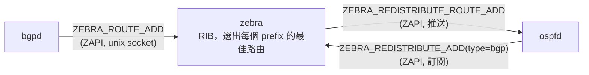
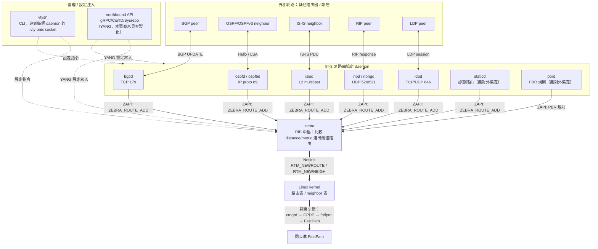
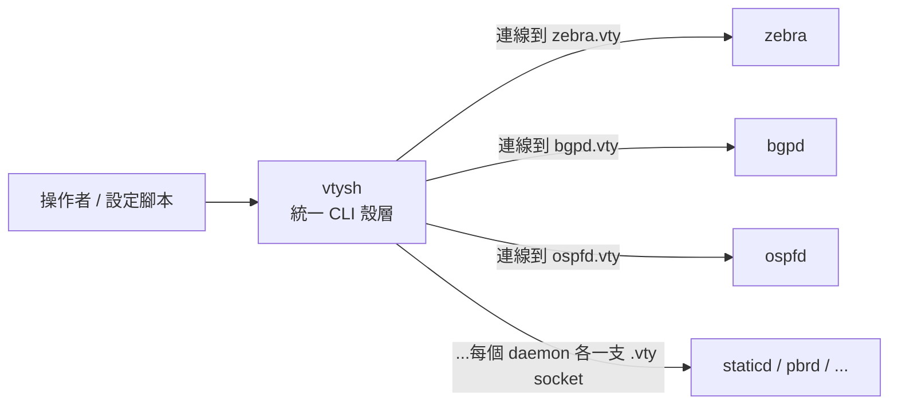
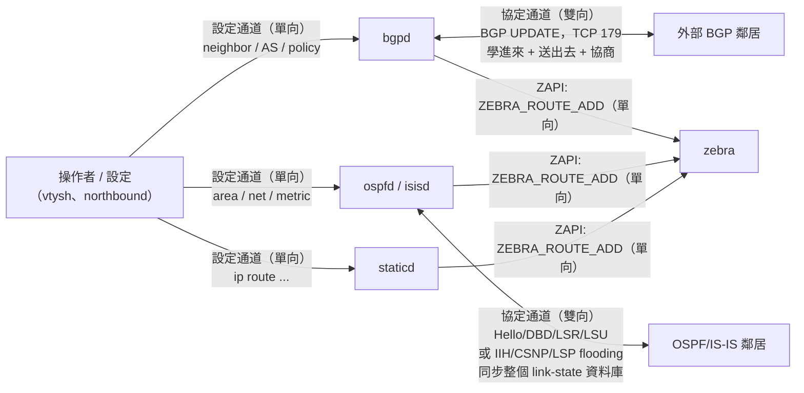
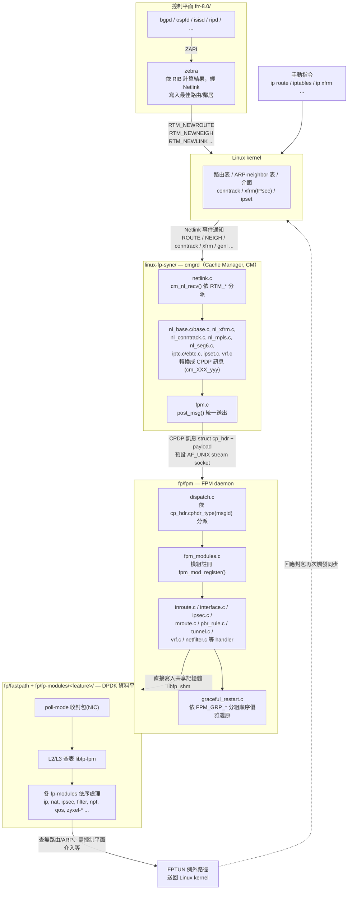
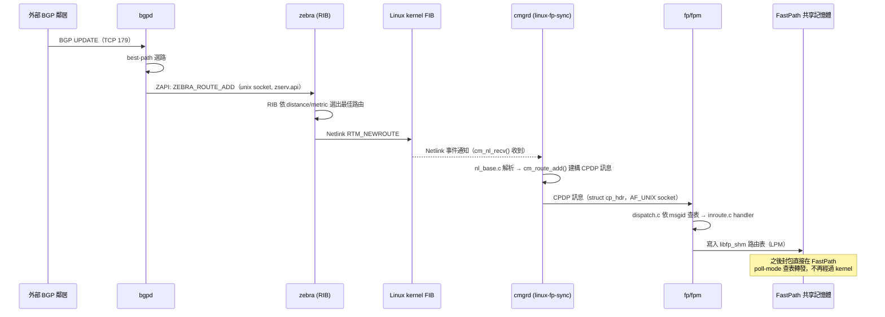
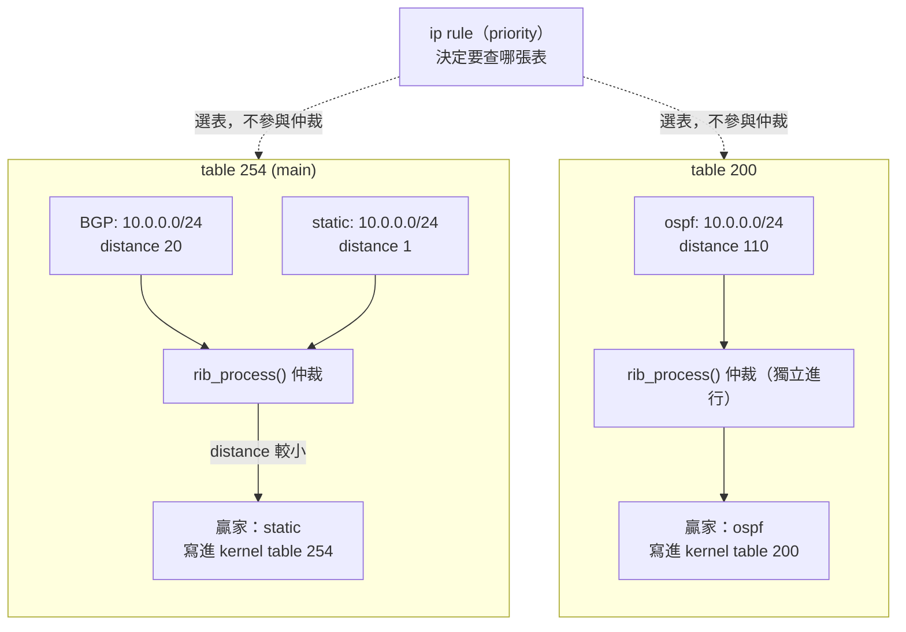
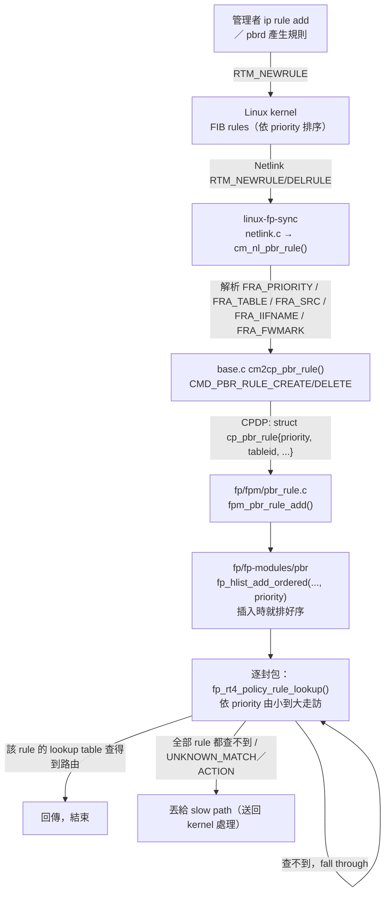

# 6WIND FastPath + FRR 架構與流程

本文件說明本 repo 中三大元件 —— `frr-8.0/`(控制平面路由協定套件)、
`linux-fp-sync/`(Cache Manager,`cmgrd`)、`fp/`(DPDK FastPath 資料平面)——
如何協同運作，把 Linux kernel 的路由/介面/連線狀態同步進 FastPath,
以及封包在這條路徑上的實際流向。整體背景亦可參考專案根目錄的 `CLAUDE.md`。

## 1. 總覽：為什麼需要三個元件

FRR 是標準的開源路由協定 daemon 套件（bgpd、ospfd、zebra…），它原生只負責
把最佳路由寫進 **Linux kernel** 的路由表（透過 Netlink）。但封包實際轉發
是由 `fp/` 這個跑在 DPDK 之上、繞過 kernel network stack 的 **使用者空間
FastPath** 處理的。因此需要一個橋樑，把 kernel 端因為 FRR（以及其他來源，
如手動 `ip`/`iptables`/`conntrack`）而改變的狀態，即時鏡射到 FastPath 的
共享記憶體資料結構中 —— 這正是 `linux-fp-sync`（Cache Manager, `cmgrd`）
與 `fp/fpm`（FastPath 端的 FPM daemon）共同完成的工作。

三者的角色分工：

| 元件 | 角色 | 產出物 |
|---|---|---|
| `frr-8.0/` | 控制平面：執行 BGP/OSPF/ISIS/… 路由運算，把最佳路由寫入 kernel FIB | zebra、bgpd、ospfd… 等 daemon |
| `linux-fp-sync/` | 同步層：監聽 kernel Netlink 事件，轉譯成 CPDP 訊息送往 FastPath | `cmgrd` 執行檔 |
| `fp/` | 資料平面：DPDK 使用者空間封包轉發引擎，含 `fpm` 接收端 daemon | `fp-rte`（FastPath 主程式）、`fpm`（FPM daemon）等 |

## 2. FRR 內部通訊：ZAPI（Zebra API）

在談「kernel → FastPath」之前，先看 `frr-8.0/` **內部**各 daemon 是怎麼
互相溝通的 —— 這與後面的 CPDP 是完全不同層次、不同協定的機制，很容易
搞混，先在這裡釐清。

### 2.1 daemon ↔ zebra：唯一的溝通管道

`bgpd`、`ospfd`、`ripd`、`isisd`… 等路由協定 daemon **彼此之間不會直接
溝通**，全部都是各自跟 `zebra`（RIB/FIB 中樞）單獨對話，協定稱為
**ZAPI（Zebra API）**：

- Client 端函式庫：`frr-8.0/lib/zclient.c` / `zclient.h`
- Server 端：`frr-8.0/zebra/zserv.c`
- 傳輸方式：**Unix domain socket**，路徑由 `frr_zclientpath`
  （`frr-8.0/lib/libfrr.h`，實際組成用到 `ZEBRA_SERV_PATH`，預設在
  `/var/run/frr/zserv.api`）決定。
- 訊息格式：自訂二進位協定，header 帶固定值
  `ZEBRA_HEADER_MARKER`（254），訊息種類（`zebra_message_types_t`，
  定義於 `zclient.h`）常見的有：

  | 訊息 | 方向 | 用途 |
  |---|---|---|
  | `ZEBRA_ROUTE_ADD` / `ZEBRA_ROUTE_DELETE` | daemon → zebra | 把自己算出的最佳路由推給 zebra |
  | `ZEBRA_INTERFACE_ADD` / `ZEBRA_INTERFACE_ADDRESS_ADD` | zebra → daemon | 通知介面/位址變化 |
  | `ZEBRA_NEXTHOP_REGISTER` / `ZEBRA_NEXTHOP_UPDATE` | daemon ↔ zebra | daemon 訂閱某個 nexthop 是否可達（如 BGP recursive lookup） |
  | `ZEBRA_REDISTRIBUTE_ADD` / `ZEBRA_REDISTRIBUTE_DELETE` | daemon → zebra | 訂閱「請把某個協定的路由也轉發給我」 |
  | `ZEBRA_REDISTRIBUTE_ROUTE_ADD` / `_DEL` | zebra → daemon | zebra 把訂閱到的其他協定路由推送過來 |

### 2.2 協定間的路由再分發（redistribute）也是透過 zebra 中介

沒有 daemon 對 daemon 的直連。例如設定 `redistribute bgp` 到 OSPF，
實際流程是：



也就是說 `redistribute` 的本質是 daemon 向 zebra **訂閱**另一個協定的
路由，由 zebra 統一轉發；zebra 永遠是唯一的中介點。

### 2.3 跟「其他路由器」溝通：不經過 ZAPI，是各協定自己的標準封包

ZAPI 只存在於 FRR **內部**（daemon↔zebra，同一台機器上的 IPC）。跟網路
上其他路由器交換路由資訊，是每個 daemon 各自用該協定的標準封包格式
（跟 zebra 無關）：

| daemon | 對外溝通方式 |
|---|---|
| `bgpd` | TCP port 179，BGP UPDATE/KEEPALIVE 等封包 |
| `ospfd` / `ospf6d` | IP protocol 89，multicast Hello/LSA |
| `isisd` | 直接跑在 L2，multicast |
| `ripd` / `ripngd` | UDP 520 / 521 |
| `ldpd` | TCP/UDP 646，LDP session |

### 2.4 小結：三層通訊不要混淆

| 層次 | 協定 | 通道 | 涵蓋範圍 |
|---|---|---|---|
| daemon ↔ zebra | ZAPI | Unix socket (`zserv.api`) | FRR 進程內部 |
| daemon ↔ 鄰居路由器 | BGP/OSPF/IS-IS/… 各自協定 | TCP/UDP/multicast | 對外網路 |
| zebra → kernel | Netlink | Netlink socket | FRR → Linux kernel |
| kernel ↔ FastPath | CPDP | AF_UNIX socket | `linux-fp-sync` ↔ `fp/fpm`（見第 5 節） |

`frr-8.0/` 上游其實還有一個額外的 **northbound API**
（`frr-8.0/lib/northbound*.c`，可選擇性透過 gRPC / ConfD / Sysrepo
對外開放，`frr-8.0/grpc/` 即為 gRPC 版本），讓外部管理系統以 YANG
model 寫入設定（例如靜態路由、PBR 規則）。這是**設定注入**的管道，
跟 ZAPI（daemon 內部路由資訊交換）是不同用途；且經檢查
`frr-8.0/grpc/` 與 `frr-8.0/lib/northbound*.c` 完全沒有 Zyxel
客製化痕跡，此路徑在本專案是否實際被使用，原始碼中查不到。

### 2.5 FRR 與各路由機制的關係圖

把第 2 節講的三種溝通管道（ZAPI、對外協定封包、管理/設定注入）跟
zebra、kernel 放在同一張圖，可以看出 **zebra 是唯一樞紐**：所有動態
協定 daemon、靜態路由 daemon（`staticd`）、PBR daemon（`pbrd`）都只
跟 zebra 對話，管理介面（`vtysh`、northbound）也只透過 zebra／各
daemon 的 CLI 下設定，沒有任何一條路徑是「daemon 直接改 kernel」或
「daemon 直接改 FastPath」：



重點：不管路由是「跟鄰居學來的」（bgpd/ospfd/…）還是「人工設定的」
（staticd/pbrd，經 CLI 或 northbound 注入），**進入 zebra 之後走的是
同一條路** —— zebra 寫進 kernel FIB，剩下同步到 FastPath 的流程完全
不分來源。

### 2.6 vtysh CLI：統一管理殼層

`vtysh` 不是路由資訊傳遞的一環，而是操作者/設定腳本用來下指令的**管理
工具**，跟 ZAPI（daemon↔zebra 交換路由）、CPDP（kernel↔FastPath 同步）
都是不同層次的機制：

- 每個 daemon（`zebra`、`bgpd`、`ospfd`…）啟動時都各自開一支自己的
  **VTY unix domain socket**，命名為 `<daemon>.vty`（放在
  `frr_vtydir`，通常是 `/var/run/frr/`），由 `vty_serv_un()`
  （`frr-8.0/lib/vty.c:1929`）建立，這是每個 daemon 原生就有的獨立
  CLI 介面。
- `vtysh` 本身是一個獨立執行檔（`frr-8.0/vtysh/vtysh.c`），啟動時
  掃描該目錄下所有 `*.vty` 檔案（`vtysh_connect_all()`，
  vtysh.c:3846/3863），對每一個「有在跑」的 daemon 各自建立一條連線
  （`vtysh_client` 陣列，每個 daemon 一個 entry，如 `bgpd`、`zebra`、
  `pathd`…），把它們**合併成一個單一殼層**。
- 使用者在 `vtysh` 裡打的指令，會依該指令定義時標記的目標 daemon
  （原始碼中用 `DEFUNSH(VTYSH_BGPD, ...)`、`DEFUNSH(VTYSH_PATHD, ...)`
  這類巨集標記），**轉發**到對應那個 daemon 的 `.vty` socket 上執行，
  結果再彙整顯示——例如打 `router bgp 65000` 實際上是轉送給 `bgpd`
  執行，`vtysh` 自己不處理路由邏輯、也不持有路由狀態。
- **設定檔管理**：預設每個 daemon 各自維護自己的設定檔
  （`bgpd.conf`、`ospfd.conf`…）；若啟用
  `service integrated-vtysh-config`（vtysh.c:3156-3164，設定
  `vtysh_write_integrated`），`vtysh` 可以把所有 daemon 的設定合併寫成
  單一的 `/etc/frr/frr.conf`。



也就是說，`vtysh` 正是第 2.5 節「管理 / 設定注入」節點的實際實作之一
（另一條是 northbound/gRPC）——透過它下的靜態路由、`redistribute`、
PBR 規則等設定，會被送進對應 daemon，再依第 2～3 節描述的路徑，一路
同步到 FastPath。

#### vty 是什麼

`vty` 是 **Virtual TeletYpe（虛擬終端機）** 的簡稱（見
`frr-8.0/lib/vty.h:1` 檔頭註解），是每個 daemon 內部代表「**一條 CLI
連線/工作階段**」的資料結構（`struct vty`，`vty.h:60`），不是網路協定。
每當有連線進來（不論是 `vtysh`、telnet、或讀取一份設定檔），daemon
就會建立一個 `struct vty` 物件，記錄這條連線的狀態，主要欄位：

| 欄位 | 用途 |
|---|---|
| `fd` / `wfd` | 讀 / 寫的檔案描述符 |
| `node` | 目前所在的 CLI 節點（如 `CONFIG_NODE`、`BGP_NODE`…），決定能打哪些指令、指令作用範圍 |
| `buf` / `lbuf` / `obuf` | 指令輸入緩衝、行緩衝、輸出緩衝 |
| `hist[]` | 指令歷史（上下鍵翻歷史） |
| `type` | 這條連線的來源種類 |

`type`（`vty.h:75`）共 4 種：

| type | 意義 |
|---|---|
| `VTY_TERM` | 一般互動式終端連線（例如直接連上 daemon 自己的 port） |
| `VTY_FILE` | 正在讀取一份設定檔（開機時讀 `bgpd.conf` 等） |
| `VTY_SHELL` | `vtysh` 自己本地端那個 vty，處理使用者在 vtysh 打的原始輸入 |
| `VTY_SHELL_SERV` | daemon 端用來服務某個 `vtysh` 連進來的連線 |

前面提到「每個 daemon 開一支 `<daemon>.vty` unix socket」，其 server
端 `vty_serv_un()`（`lib/vty.c:1929`）每接受一條新連線，就會 new 出一個
`struct vty`（type = `VTY_SHELL_SERV`）代表它。簡言之：**`vty` = 一條
CLI 連線的狀態物件；`vtysh` = 用來同時連上多個 daemon 各自 vty 的統一
用戶端程式。**

#### vty 連線是持久連線，不是每次指令重連

`vtysh` 與每個 daemon 之間的 `.vty` unix socket 連線，是**長駐的持久
連線**，從 `vtysh` 啟動一路維持到程式結束（或 `exit`）為止，並非每
下一次指令就重新連線再斷開：

- **vtysh 端**：`vtysh_connect_all()` 只在程式啟動時對每個 daemon
  各連線一次，fd 存進 `vtysh_client[]` 陣列（vtysh.c:3755）。之後每
  打一行指令都由 `vtysh_client_run()`（vtysh.c:201）直接對**同一個
  既有 fd** `write()` 指令、`read()` 回應（vtysh.c:221/237），完全不
  會重新 `connect()`。只有偵測到連線異常斷線時，才會標記
  `VTYSH_WAS_ACTIVE` 並呼叫 `vtysh_reconnect()`（vtysh.c:3760）重建
  連線——這是錯誤復原機制，不是正常流程。
- **daemon 端**：接受連線後建立的 `struct vty` 會用
  `vty_event(VTYSH_READ, vty)`（vty.c:2046）掛進事件迴圈**持續監聽**
  這個 fd；每處理完一批指令，只要連線還在，就會再次
  `vty_event(VTYSH_READ, vty)`（vty.c:2088/2154）重新註冊讀取事件，
  等待下一筆指令，而不是處理完就關閉。`vty_close()`（vty.c:2192）
  只在偵測到連線關閉、讀取錯誤，或使用者主動 `exit`/`quit`
  （觸發 EOF）時才會呼叫。

### 2.7 設定通道 vs 協定通道：為何有些 daemon 是雙向、有些是單向

第 2.3、2.5 節提過「動態學來的路由」跟「人工設定的路由」進 zebra
之後走的是同一條路，但**進 zebra 之前**兩者的資訊流方向並不相同。
差異不在「設定」本身，而在於該 daemon 除了設定通道之外，**是否還
擁有一條跟外部鄰居即時交換資訊的協定通道**：

| | 設定通道（人 → daemon） | 協定通道（daemon ↔ 外部鄰居） |
|---|---|---|
| `bgpd`（BGP，動態） | 有：透過 vtysh/CLI 設定 `neighbor`、AS number、route-map、policy… | **有，而且是雙向**：TCP 179 跟鄰居互傳 BGP UPDATE —— bgpd 主動送出自己的路由給鄰居，同時接收鄰居送來的路由，連線建立時還要協商 capability／hold-timer（OPEN message） |
| `ospfd`/`ospf6d`（OSPF，動態） | 有：透過 vtysh/CLI 設定 `router-id`、area、network、cost… | **有，而且雙向，比 BGP 更密集**：IP proto 89 multicast 跟鄰居互送 Hello（發現/存活）、DBD（互相摘要 LSDB 比對差異）、LSR/LSU/LSAck（缺的一方要資料、對方送 LSA、再回確認）——雙方主動同步**整個 link-state 資料庫**，不只是單筆路由 |
| `isisd`（IS-IS，動態） | 有：透過 vtysh/CLI 設定 `net`、level、metric… | **有，而且雙向**：L2 multicast 跟鄰居互送 IIH（Hello，鄰接關係維持）、CSNP/PSNP（比對雙方 LSP 資料庫差異）、LSP flooding（雙方互相洪泛自己的 LSP 並繼續往外傳） |
| `ripd`/`ripngd`（RIP，動態） | 有：透過 vtysh/CLI 設定 `network`、`neighbor`、metric offset… | **有，而且雙向**：UDP 520／521 跟鄰居互傳 RIP Request/Response —— 定期（預設 30 秒）廣播/多播自己的整份路由表給鄰居，同時接收鄰居送來的路由表並套用 hop-count 限制（最大 15） |
| `ldpd`（LDP，動態，MPLS 標籤分發） | 有：透過 vtysh/CLI 設定 interface、transport-address… | **有，而且雙向**：先用 UDP 646 multicast Hello 做鄰居探索，成功後建立 TCP 646 session，雙方互相**主動宣告**自己的 label mapping（FEC↔label 對應），不是單向下發，是雙邊各自公告 |
| `vrrpd`（VRRP，動態，非路由學習） | 有：透過 vtysh/CLI 設定 virtual-router id、virtual IP、priority… | **有，而且雙向**：IP protocol 112 multicast，同一虛擬路由器群組內的成員互送 VRRP Advertisement，用來協商/維持誰是 master——但這不是「學路由」，是**選主（master election）**，不會產生 `ZEBRA_ROUTE_ADD` 這類路由訊息 |
| `bfdd`（BFD，動態，非路由學習） | 有：透過 vtysh/CLI，或由其他 daemon 請求設定 session 參數（間隔、乘數…） | **有，而且雙向**：UDP 3784（單躍）／4784（多躍）跟對端持續互送輕量 control packet 偵測**存活狀態**——不學路由，是給其他協定（`bgpd`/`ospfd`…）用來加速偵測鄰居失聯的輔助機制 |
| `staticd`（靜態，單向） | 有：透過 vtysh/CLI 直接打 `ip route 10.0.0.0/24 ...` | **沒有**：不存在任何「鄰居」，也沒有協定封包要交換——這條路由本身就是設定內容，不需要跟誰協商 |
| `pbrd`（PBR，單向） | 有：透過 vtysh/CLI 設定 policy-map、`match`/`set nexthop` 規則 | **沒有**：PBR 規則不是跟誰學來的，是管理者直接宣告「符合某條件的封包要走哪條路」，同樣不存在鄰居、不需要協商 |

`vrrpd`／`bfdd` 是第三種類型：**有雙向協定通道，但通道的目的不是
「學路由」**——`vrrpd` 是跟同群組成員協商誰當 master、`bfdd` 是跟對端
互測存活狀態，兩者都不會像 `bgpd`/`ospfd`/`isisd`/`ripd`/`ldpd` 那樣
產生 `ZEBRA_ROUTE_ADD` 送進 zebra RIB。

也就是說：

- **所有動態路由 daemon**（`bgpd`/`ospfd`/`isisd`/`ripd`/`ldpd`）的
  路由內容都是**協定通道動態產生的**（學進來 + 送出去 + 協商），設定
  只是告訴它「要跟誰對話、規則是什麼」，設定本身不等於路由。差別只在
  協定細節：BGP 是單純互傳 UPDATE，OSPF/IS-IS 這種 link-state 協定
  則更進一步，雙方要主動**同步整個鏈路狀態資料庫**（DBD/CSNP 等比對
  機制），比 BGP 更密集地雙向交換。
- `staticd`（以及 `pbrd`）沒有對外協定、沒有鄰居可商量，管理者打的
  那行設定**本身就是最終結果**，資訊流只有單一方向：
  人 → daemon → zebra，沒有回頭路。



圖中可以看出：**只有動態協定 daemon**（`bgpd`、`ospfd`/`isisd`）具有
雙向箭頭（`<-->`）——那條雙向箭頭指向的都是**外部鄰居**，不是設定
來源；設定通道（`OP -->`）跟進 zebra 的 ZAPI 通道（`--> ZEBRA`）不管
哪種 daemon 都是單向箭頭。`staticd` 完全沒有連到任何「鄰居」的邊，
凸顯它只有單向設定通道、沒有協定通道。

## 3. 端到端資料流程圖



### 3.1 範例：一筆路由規則如何同步到 FastPath

以「BGP 學到一條路由」為例，把上面的流程圖攤開成時間序列：



**靜態路由 / PBR 規則走的是同一條路，只是少了跟鄰居交換封包這一步**：
`staticd`／`pbrd` 收到 CLI（`vtysh`）或 northbound 設定後，一樣先送
`ZEBRA_ROUTE_ADD`（或 PBR 對應訊息）給 zebra，接著「zebra → kernel
→ cmgrd → CPDP → fp/fpm → FastPath」完全沿用同一套機制，FastPath端
（甚至 `cmgrd`）並不需要知道這筆路由原本是動態學來的還是人工下的。

### 3.2 kernel 才是真正的集中點，FRR 只是其中一個路由來源

上面的流程圖裡有個容易被忽略的節點：

```
M["手動指令 ip route / iptables / ip xfrm ..."] --> K
```

`ip route`、`iptables`、`ip xfrm` 這類手動指令**完全不經過 FRR**，
直接改 kernel 狀態；`linux-fp-sync`（`cmgrd`）監聽的是 **kernel
Netlink 事件**，它不在乎這筆變化是 zebra 寫的、還是有人手動
`ip route add` 寫的——kernel 狀態一變，就會同步進 FastPath。第 4 節
提到的 `nl_xfrm.c`、`nl_conntrack.c`、`iptc.c`/`ebtc.c`、`ipset.c`
這些模組，同步的是 IPsec / conntrack / iptables / ebtables / ipset
規則，這些規則通常也**不是 FRR 管的**，是另外的管理程式直接操作
kernel netfilter。

所以「routing rules 是否都該集中在 FRR」要分兩種情況看：

| 規則類型 | 是否建議集中在 FRR | 原因 |
|---|---|---|
| **路由表（routing table）** | 建議：動態路由 + 靜態路由 + PBR 都走 zebra | zebra 是 RIB 仲裁者，同一個 prefix 若同時被 zebra 管理、又被外部手動 `ip route` 改，兩者互不知情，可能互相打架、被彼此覆蓋。集中在 zebra 才能靠 administrative distance 統一決定「誰贏」 |
| **防火牆 / NAT / conntrack / IPsec 等規則** | 不需要，也不是 FRR 的職責 | FRR 本來就不管 iptables/ebtables/ipset/xfrm，這些天生就是由其他管理工具直接寫 kernel，`cmgrd` 用專屬的 `nl_filter.c`/`iptc.c`/`ebtc.c`/`ipset.c`/`nl_xfrm.c` 各自同步，跟 FRR 完全無關 |

**一句話**：「routing rules（路由表項目）」最好集中在 FRR/zebra，避免
多來源互搶同一條路由造成不一致；但**整個系統的規則**（防火牆、NAT、
IPsec、conntrack…）本來就分散在多個管理平面，`linux-fp-sync` 的設計
正是為了同時吸收「FRR 管的」跟「FRR 不管的」kernel 狀態，一起同步進
FastPath——這是這個架構刻意的設計，不是缺陷。

### 3.3 多張 routing table 的查詢順序由誰維護

系統裡同時存在 static / policy / VTI / BGP / dynamic 這些路由來源時，
常見的疑問是：**「先查哪張表」這件事，是不是該由 FRR 的 zebra 統一維護？**

答案是：**不是**。這其實混在一起問了三個互不相干的排序問題，答案分別
落在三個不同的元件：

| 排序問題 | 由誰決定 | 程式碼佐證 |
|---|---|---|
| 同一張表、同一個 prefix，哪個協定的路由勝出 | **zebra**（administrative distance / metric 仲裁） | `frr-8.0/zebra/zebra_rib.c` `rib_choose_best()`；距離表（connected 0 / static 1 / BGP 20 / OSPF 110 / RIP 120 / PBR 200）同檔案內 `route_info[]` |
| **先查哪一張表（本節重點）** | **kernel FIB rules（`ip rule`）的 priority**，由管理者手動下指令、或由 `pbrd` 產生，zebra 只是把它原封不動寫進 kernel | `frr-8.0/zebra/rule_netlink.c` `netlink_rule_msg_encode()`；priority 編號來源 `frr-8.0/pbrd/pbr_nht.c` `pbr_nht_get_next_rule()` |
| 同一張表內哪條路由勝出 | **最長前綴 → metric**，純粹鏡射 kernel FIB，FastPath 沒有 administrative distance 這個概念 | `fp/fp-modules/ip/common/fp-lookup.h` `fp_rt4_lpm_lookup()` |
| 哪條 IPsec SP 適用（含 VTI 出向流量） | **SPD 的 `filter.cost`**，跟 routing table 順序無關，是路由決定完之後另一階段的事 | `fp/fp-modules/ipsec/dataplane/fp-ipsec-lookup.c` `spd_out_lookup()` |

換句話說：**zebra 管的是「同一張表內誰贏」，不是「先查哪張表」**。
「先查哪張表」的唯一真實來源是 kernel 的 FIB rules，跟 3.2 節的結論
一致——kernel 才是集中點，zebra/pbrd 只是眾多寫入者之一。

#### zebra 的仲裁範圍：同一張表、同一個 prefix

上表第一列說的「zebra 仲裁」具體在做什麼？當**同一張表**裡，**同一條
prefix**（例如 `10.0.0.0/24`）同時被多個來源送進 zebra——BGP 學到一筆、
又有人下了一筆 static——kernel FIB 對同一條 prefix 只能存在一個結果，
zebra 就要在這些候選路由裡選出唯一的贏家寫下去。這個挑選就是
best-path 仲裁，比較依據是：

1. connected 路由勝過其他所有 type
2. 兩者都是 connected → loopback/VRF 介面者勝
3. **distance 小者勝**
4. distance 相同 → **metric 小者勝**
5. 仍平手 → 較舊（existing）的那筆勝

（`frr-8.0/zebra/zebra_rib.c` `rib_choose_best()`，比較順序即函式上方的
註解）。預設 distance：connected 0 / static 1 / BGP 20 / OSPF 110 /
RIP 120 / PBR 200（同檔案 `route_info[]`），可用各 daemon 的 CLI 覆寫。
輸掉的路由**不會被刪除**，只是不下 kernel；贏家消失時次佳者自動遞補。

**這個仲裁不會跨 routing table。** 關鍵在仲裁的作用單位：
`rib_process(struct route_node *rn)` 只走訪掛在**同一個 route_node**
下的候選路由，而一個 route_node 就是一組
**(VRF, AFI/SAFI, table_id, prefix)**。一筆路由屬於哪張表
（`re->table`）在仲裁**之前**就已經決定（寫入時的 `rib_add()`），
是仲裁的輸入條件，不是拿來比較的項目——table 200 裡的
`10.0.0.0/24` 永遠不會跟 main 表裡的 `10.0.0.0/24` 比大小。

回到你舉的例子：**policy route 跟 dynamic route（BGP）不會互相仲裁**，
因為它們根本不在同一個競技場：

- dynamic route（BGP/OSPF/…）是「表**內**的競爭者」，會參與上面的
  distance/metric 仲裁；
- policy route（`pbrd` → `ip rule`）產生的是「**選表**規則」，它不跟
  任何路由比 distance，而是決定「這個封包該去查哪張表」。

所以順序是：`ip rule` 先決定查哪張表 → 進到那張表之後，才輪到 zebra
早就仲裁好、寫進該表的贏家。一個是**橫向**選擇（多張表選一張先查，見
下段），一個是**縱向**選擇（同一 prefix 的多個來源選一筆），兩者正交，
互不影響。

> **例外**：`import-table`（`frr-8.0/zebra/redistribute.c`
> `zebra_add_import_table_entry()`）可以把另一張表的路由**複製**成一筆
> 新的 `route_entry`（`type = ZEBRA_ROUTE_TABLE`），套用設定的 distance
> 後塞進 main 表，複製進去之後才在 main 表內跟其他路由正常競爭。這仍然
> 是「表內仲裁」，只是來源多了一種；並不是 zebra 真的跨表比較。



兩個 table 各自的仲裁互不相通，圖上也刻意畫不出橫跨兩個 subgraph 的
比較箭頭——這正是「仲裁只發生在表內」的意思。

#### RIB 與 FIB 的落差：什麼會下 kernel、什麼不會

「FRR 不會把所有東西都送到 kernel，而是仲裁後的結果送到 kernel」這句話
**對，但只對「路由」成立**；「rule」是另一回事，兩者下 kernel 的方式完全
相反：

| 送進 kernel 的東西 | 有沒有仲裁 | 下發內容 |
|---|---|---|
| 路由（`RTM_NEWROUTE`） | **有** | 每個 (VRF, table, prefix) **只送仲裁贏家一筆** |
| PBR rule（`RTM_NEWRULE`，`ip rule`） | **沒有** | `pbrd` 要求的**每一條都照送**，順序交給 kernel 依 priority 自己維護（見上一節） |

PBR rule 這邊沒有仲裁，是因為 `frr-8.0/zebra/rule_netlink.c`
`netlink_rule_msg_encode()` 只是把 `pbrd` 要求的 rule 原封不動編碼成
`RTM_NEWRULE`（`FRA_PRIORITY`、table id）送出去，沒有任何「選一條贏家」
的邏輯——每一條都會下去，因為每條 rule 本來就是要做不同的事（選不同的
表），不是互相競爭的候選。

**路由這邊則是 RIB ≠ FIB：**

- **RIB**（zebra 內部）＝ 所有候選路由都在，`show ip route` 看得到全部，
  輸家只是沒有 `SELECTED` 旗標，不會被刪除。
- **FIB**（kernel）＝ 每條 prefix 只有一筆贏家，`ip route show` 只看得到它。
- 贏家消失時，次佳者會在下一輪 `rib_process()` 自動遞補下發。

`zebra_rib.c` 裡的一段註解把這個落差寫得很清楚：

```
new_selected will get SELECTED flag, and is going to be redistributed
the zclients. new_fib (which can be new_selected) will be installed
in kernel.
```

實際下發只有 `rib_process_add_fib()` / `_update_fib()` / `_del_fib()`
三個出口，一個 route_node 一次只處理一筆 `new_fib`。

**除了「輸掉仲裁」，還有兩種情況連候選資格都沒有**（在仲裁**之前**就被
跳過，不是輸掉比較）：

- **nexthop 不可達**：`nexthop_active_update()` 失敗就直接跳過，並用
  `ZAPI_ROUTE_FAIL_INSTALL` 通知原本送這筆路由的 daemon。實務上，BGP
  收到一條路由但 nexthop 不可達時，`show ip route` 看得到、kernel 卻
  沒有，就是這個機制。
- **`distance` 被設為無限大**（`DISTANCE_INFINITY`）：直接跳過。

**進階陷阱**：`SELECTED`（redistribute 給其他 daemon 的那筆）不一定等於
下 kernel 的那筆。帶 `ZEBRA_FLAG_FIB_OVERRIDE` 的路由會走 `new_fib`
獨立分支，只有兩者都沒有時才 `new_fib = new_selected`——有 FIB override
時，「寫進 kernel 的」跟「redistribute 給其他 daemon 的」是不同的兩筆。

**對 FastPath 的意涵**：`cmgrd` 監聽的是 **kernel** 的 Netlink 事件，
所以 FastPath 看到的永遠**只有仲裁贏家**，從來看不到 zebra RIB 裡的
候選路由——這正是第 6 節說「FastPath 沒有 administrative distance
這個概念」的原因：它拿到的已經是定案結果。也呼應 3.2 節的結論：kernel
才是集中點。

#### kernel `ip rule` 的預設查表順序

Linux 預設會建立三條 rule，依 priority（數字越小越先查）走訪：

```
0:      from all lookup local
32766:  from all lookup main
32767:  from all lookup default
```

語意是：**依序查表，該表查得到就回傳，查不到就 fall through 到下一條
rule**；PBR（`pbrd`）新增的自訂 rule 會插在這三條之間，各自帶自己的
priority 與 `lookup <table>` 動作（詳見
`fp/fp-modules/pbr/doc/usage.rst`）。這條 priority 序列，就是「多張表
先查誰」的唯一依據——它是 kernel 的資料，不是 zebra 的資料。

#### 這個順序如何同步進 FastPath



重點是最後一步：**FastPath 完全不重新仲裁順序，只是忠實重放 kernel
已經決定好的政策**。順序在 rule 被同步進來、插入 list 時就依 priority
排定（`fp/fp-modules/pbr/common/fp-pbr.c` `fp_hlist_add_ordered()`），
封包經過時只是走訪一份已排序好的清單。若某條 rule 用到 FastPath 不支援
的比對條件或動作，會被標成 `UNKNOWN_MATCH`/`UNKNOWN_ACTION`，一律送
slow path，不會憑空亂猜（`fp/fp-modules/pbr/common/fp-pbr-lookup.c`）。

當 rule set 跟 Linux 預設的三條一模一樣時，FastPath 會走一條 hardcode
的快路徑（`local → main → default`，見
`fp/fp-modules/ip/common/fp-lookup.h`），但這只是效能優化，順序語意
跟一般 rule 走訪完全相同；是否套用這條快路徑的判斷（`do_pbr_default_rules`
旗標）也是控制平面在 rule 同步時就算好，不是每個封包重算。

#### VTI / SVTI / XFRMI 不是獨立的一張表

VTI 上的路由跟其他路由一樣，只是 nexthop 指向 tunnel 介面，**沒有專屬
的比對階段、也不參與另一套順序**。差別在於封包決定走這個介面之後，
出口 device op 才會另外做一次 per-SVTI 的 IPsec SP 查詢
（`fp/fp-modules/ipsec/dataplane/fp-ipsec-output.c` `fp_svti_output_one()`），
而且對 SVTI/XFRMI 介面會跳過全域 SPD 查詢
（`fp/fp-modules/ip/dataplane/fp-ip.c`）。完整順序是：

**routing table 查詢（決定走哪個介面，含 VTI）→ IPsec SP 查詢
（若目的介面涉及 IPsec）→ 若是 tunnel/BEET 模式，換成外層位址再查一次
routing table**（`fp/fp-modules/ipsec/dataplane/fp-ipsec-output.c`
`fp_ipsec4_out_check_route()`）。SP 之間彼此的優先順序，靠的是 SPD
自己的 `filter.cost`，跟路由表順序是兩件事。

#### 小結

- **不要把 administrative distance 跟「先查哪張表」搞混**：前者是 zebra
  的職責，後者是 kernel FIB rules 的職責，兩者發生在不同層級。
- 這個結論跟 3.2 節一致：kernel 才是「多張表查詢順序」的真正集中點，FRR（zebra/pbrd）
  只是眾多能寫入 kernel FIB rules 的來源之一，跟手動 `ip rule` 平起平坐。
- FastPath 不做任何順序決策，只忠實重放 kernel 已定案的 priority 序列；
  唯一的例外是 Zyxel 自行加上的 `NH_F_ZYXEL_DEAD` 失效路由跳過邏輯
  （`fp/fp-modules/ip/common/fp-lookup.h`），其註解自陳這是為了模擬
  kernel 的 metric failover 行為（例如切到優先權較低的備援 VTI 路由），
  屬於 FastPath 私有、kernel 端沒有對應概念的特例。

## 4. `linux-fp-sync`（cmgrd）細節

`cmgrd` 的組織方式在 `linux-fp-sync/readme.txt` 已有描述，重點如下：

- **`main.c`**：libevent 初始化、daemonize。
- **`netlink.c`**：建立 Netlink socket（可依功能加入不同的 multicast group，
  例如 `RTMGRP_LINK`），主要 dispatcher 是 `cm_nl_recv()`，依 `RTM_*` 呼叫
  對應的 `nl_XXX.c` 處理函式。
- **`base.c` / `nl_base.c`**：路由 / 介面 / 位址相關的 CM-FPM 訊息建構者。
  `base.c` 內的 `cm_XXX_yyy()` 是「公開 API」（可被直接呼叫，例如處理位址
  變更），由 `nl_base.c` 呼叫。
- **`fpm.c`**：與 FastPath 端 FPM 的 socket 連線管理，以及所有訊息的
  排隊 / 發送（`post_msg()` 是唯一送出入口）。連線方式由 `srv_family`
  決定，預設為 `AF_UNIX`（見 `main.c`），走 stream socket；若連線中斷，
  cmgrd 會重試（`fpm_connect_retries`）並在重連後補送完整快照。
- **`cm_dump.c`**：dump 與 FPM 交換的封包內容，`cmgrd`、`cmstub`（測試用
  stub）共用。
- 依功能領域拆分的 `nl_*.c`：
  - `nl_xfrm.c` — IPsec SA/SP（xfrm）同步
  - `nl_conntrack.c` — netfilter conntrack 同步（含 OOM 保護的
    三段式流控閾值，見 `fpm.h` 中 Zyxel 註解區塊）
  - `nl_mpls.c`、`nl_seg6.c` — MPLS / SRv6
  - `nl_filter.c`、`bpf.c` — iptables → eBPF filter 規則同步
  - `iptc.c` / `ebtc.c` — iptables / ebtables 規則快取
  - `ipset.c`、`nl_nfacct.c` — ipset、netfilter accounting
  - `vrf.c` — VRF（預設以 network namespace 模擬，`USE_VRF_NETNS=y`）
- **`cm_priv.h`**：CPDP 協定的共同標頭 `struct cp_hdr`
  （`cphdr_type` 訊息種類、`cphdr_report`、`cphdr_cookie`、`cphdr_length`），
  與 `fp/fpm/fpc.h` 中定義的同一份協定共用（見第 5 節）。
- 新增功能的標準做法（詳見 `readme.txt`）：寫 `XXX_init()` → 在
  `cm_init.c` 的 `cm_init()` 中呼叫 → 在 `netlink.c` 新增對應
  `RTM_xxx` 的 switch/case → 在新的 `nl_XXX.c` 中撰寫 `cm_XXX_yyy()`
  訊息建構函式，並把原型放進 `cm_pub.h`。

編譯產出單一執行檔 `cmgrd`（見 `linux-fp-sync/Makefile`），連結
`libevent`、`libnl-3`/`libnl-route-3`/`libnl-genl-3`/`libnl-nf-3`、
`libvrf`、`libcap`、`libconsole`。

## 5. CPDP 協定（Control Plane – Data Plane Protocol）

`linux-fp-sync` 與 `fp/fpm` 之間走的是 6WIND 自訂的 **CPDP** 二進位協定，
**不是** FRR 原生的 FPM protobuf/netlink 協定（見第 7 節說明兩者差異），
也不是第 2 節的 ZAPI（ZAPI 只存在於 FRR 進程內部）。

- 共同標頭 `struct cp_hdr`（定義於 `fp/fpm/fpc.h`，`linux-fp-sync` 端
  透過 `fpc.h` 引用同一份定義），共 4 個欄位：

  | 欄位 | 型別 | 用途 |
  |---|---|---|
  | `cphdr_type` | `uint32_t` | 訊息種類，即 `msgid`，用於 dispatch 查表 |
  | `cphdr_report` | `uint32_t` | 是否要求回報 |
  | `cphdr_cookie` | `uint32_t` | opaque cookie（network order） |
  | `cphdr_length` | `uint32_t` | payload 長度（不含本 header） |

  同一個 header 也用來夾帶 CPDP 對 CM 的錯誤回應（用同一個 command
  結構回傳，附上完整參數）。
- 傳輸方式：預設 `AF_UNIX` stream socket（`linux-fp-sync/main.c`：
  `int srv_family = AF_UNIX`；`fp/fpm/main_fpm.c` 同樣預設
  `AF_UNIX` 並 `bind()`/`listen()`）。
- **接收端 dispatch 與模組化註冊機制**：

  ```mermaid
  flowchart LR
      IN["CPDP 訊息進來<br/>struct cp_hdr + payload"] --> D["dispatch.c<br/>msgid = ntohl(cphdr_type)"]
      D -->|"查表"| REG["struct fpm_msg 註冊表<br/>(fpm_register_msg)"]
      REG --> H["對應 fpm_msg_handler_t<br/>(如 inroute.c / fpm-ip.c ...)"]
      H --> SHM["寫入 FastPath 共享記憶體"]
      REG -.graceful restart 時.-> G["graceful handler<br/>依 FPM_GRP_* 分組順序還原"]
  ```

  - `struct fpm_mod` — 每個功能模組（route、interface、ipsec、
    pbr、tunnel、vrf、netfilter…）透過 `fpm_mod_register()` 註冊
    自己的 `init` / `shared_cmd` callback。
  - `struct fpm_msg` — 每個訊息類型（`msgid`）透過
    `fpm_register_msg()` 註冊 `handler`（實際處理邏輯）與
    `graceful`（graceful restart 時的還原邏輯）。
  - `fpm_cmd_t` — 待處理命令的佇列項目，帶有 `comp`（去重比較）、
    `revert`（還原）、`display`（debug 顯示）三個 callback。

  Graceful restart 時，`fpm_cmd_t` 依 `enum fpm_grps` 分組決定**刪除
  順序**，避免順序錯誤導致殘留依賴（例如先刪介面才刪掛在其上的
  IPsec SA）：

  | 順序 | 分組 (`FPM_GRP_*`) | 說明 |
  |---|---|---|
  | 1 | `IPSEC_SA` | IPsec Security Association |
  | 2 | `IPSEC_SP` | IPsec Security Policy |
  | 3 | `ROUTE` | 路由 |
  | 4 | `PBR_RULE` | Policy-Based Routing 規則 |
  | 5 | `INTERFACE_ADDR` | 介面位址 |
  | 6 | `L2` | Layer 2 |
  | 7 | `TUNNEL` | 通道（GRE/隧道類） |
  | 8 | `INTERFACE` | 介面本身 |
  | 9 | `SVTI` / `XFRMI` | 虛擬通道介面 |

- **與 `fp/fp-modules/<feature>/fpm/` 的關係**：`fp/fpm` 的各
  `*.c`（`inroute.c`、`interface.c`、`ipsec.c`、`mroute.c`、
  `pbr_rule.c`、`tunnel.c`、`vrf.c`、`netfilter.c`…）是核心/通用功能
  的 handler；每個 `fp-modules/<feature>/fpm/`（例如
  `fp/fp-modules/ip/fpm/fpm-ip.c`）則是**該功能模組自己**的 CPDP
  handler，一樣透過 `fpm_register_msg()`/`fpm_mod_register()` 掛進同一
  套 dispatch 機制，把訊息內容轉換成該模組在 FastPath 共享記憶體中的
  資料結構更新。

## 6. `fp/` FastPath 資料平面

- `fp/fastpath/`：DPDK poll-mode 封包處理核心與 arch backend
  （`fp/fastpath/arch/dpdk/`、`fp/fastpath/arch/odp-coolidge/`）。
- `fp/fp-modules/<feature>/`：每個資料平面功能一個目錄，內部依慣例分
  `common/`（控制/資料平面共用）、`dataplane/`（實際封包處理）、
  `cli/`（`fpdebug` 除錯指令）、`fpm/`（CPDP handler，見上節）、
  `Mconfig`（Kconfig 風格的建置選項，如 `MCORE_IP`）。標準網路功能
  （`ip`、`ip6`、`nat`、`ipsec`、`filter`、`npf`、`qos`、`bridge`、
  `vlan`、`pbr`、`tc`…）與 Zyxel 專屬功能（`zyxel-*`，見第 8 節）
  並列在同一層。
- `fp/libfp_shm/`、`fp/libfp-lpm/`、`fp/libnetfpc/`：共用函式庫
  （共享記憶體管理、LPM 路由查表、netfpc IPC）。
- `fp/fpdebug/`：對執行中 FastPath 進行互動式檢視/除錯的 CLI。
- `fp/fps/`：FPS（統計/同步）支援函式庫。

### routing match 發生在哪：RIB 選路 vs FIB lookup

「選路」跟「逐封包比對」是兩件不同的事，發生在不同地方，容易混在
一起：

| | RIB 選路（control-plane，路由異動時算一次） | FIB lookup / routing match（data-plane，**每個封包**都要比對） |
|---|---|---|
| 發生在哪 | **zebra** | **FastPath**（絕大多數封包）／**Linux kernel**（僅例外封包） |
| 做什麼 | 同一個 prefix 有多個來源路由時（BGP/OSPF/static…），依 administrative distance/metric 決定「哪一條是最佳路由」 | 對進來的每一個封包，拿目的 IP 去查路由表，決定下一跳/出口介面 |
| 頻率 | 路由變動時才算一次，結果寫進 kernel FIB / 同步進 FastPath | 每個封包都要查一次，是效能關鍵路徑 |

**zebra 從不做逐封包的 routing match**，它只是控制平面的決策者，算出
最佳路由後就交出去，自己不碰實際流量。

實際逐封包的 routing match，絕大多數發生在上面 `fp/fastpath` 的
`P2["L2/L3 查表 libfp-lpm"]` 這一步：`fp/libfp-lpm`
（Longest Prefix Match 函式庫）對 FastPath 共享記憶體裡的路由表做
查表——這份表就是 zebra 選好、經 kernel → `cmgrd` → CPDP 同步進來的
那份（見第 3.1 節時間序列圖）。封包從 NIC 進來後直接在 DPDK
poll-mode 迴圈裡查表、轉發，**完全不經過 Linux kernel**。

只有走下面 FPTUN 例外路徑的封包（查不到路由/ARP、要送給本機控制平面
的協定封包、或需要 kernel 才有的功能），才會真的被送回 kernel，由
**kernel 自己的 FIB** 做一次 routing match——但這只占極少數流量，是
「FastPath 查不到才 fallback」的路徑，不是主要路徑。kernel FIB 的
存在更像是「給 `cmgrd` 讀取來同步、以及給例外封包 fallback 用」，
不是為了處理主要流量。

### 每個封包都查一次，還是按 session 快取？

上一節說「每個封包都要查一次」，這裡把它講清楚：FastPath 的 LPM
路由查詢**沒有 per-session 的路由快取**，不是「首包查表、後續封包走
session 捷徑」這種一般 UTM/防火牆常見的設計。之所以特別澄清，是因為
Zyxel 自己確實有 session 為單位的快速路徑（express mode，見下），
很容易誤以為連路由查詢也被包含在裡面——實際上沒有。

`fp/fp-modules/ip/dataplane/fp-ip.c` 的封包預路由（pre-routing）
主路徑是無條件查表：

```c
if (nh == NULL) {
    /* Lookup in the FW table. */
    index = fp_route4_forward(bulk_in, m, dst, src);
    ...
    nh = get_nh4_ptr(index);
} else
    index = get_nh4_idx(nh);
```

守門的 `nh == NULL` 是**函式參數**，不是 flow 狀態：一般轉發入口
永遠以 `nh = NULL` 呼叫，唯一傳非 NULL 的呼叫點也是同一顆封包在
`npf`/`seg6` 處理中剛查出來的結果，並不是跨封包沿用。呼叫鏈是
`fp_route4_forward()` → `fp_rt4_policy_lookup()`（最多走
LOCAL/MAIN/DEFAULT 三張表）→ `fp/libfp-lpm` 的 LPM trie 查詢——四段
展開、`always_inline`，沒有任何 memoisation。IPv6 路徑（`fp-ip6.c`）
完全對稱。

**什麼有快取、什麼沒有：**

| 項目 | 快取粒度 | 每個封包還要做嗎 |
|---|---|---|
| LPM 路由查詢（trie 走訪） | 無快取 | **要** |
| PBR / policy 選表 | 無快取 | **要** |
| ECMP 多路徑「選第幾條」 | per-session（`nh_sel`） | 查表照做，只省選路那一步 |
| nexthop → MAC（neighbour 快取） | per-nexthop（非 per-flow） | 要查，但所有共用該 nexthop 的連線一起用同一份 |
| UTM / DPI / firewall hook 判決 | per-session（express mode） | 可跳過，但與 routing 查詢無關 |

**唯一沾到路由的 per-session 快取，是 Zyxel 的 ECMP 黏著性**：

```c
if (dpb->ct && dpb->ct->oif_id[dpb->ct_dir] != 0) {
    oif.ifid = dpb->ct->oif_id[dpb->ct_dir];
    uOS_multipath_session_poke(src, dst, rt);
}
```

它快取的只是「多路徑路由中選第幾個 nexthop」這個 index（`nh_sel`），
前提仍然是 `rt` 已經被查出來——路由查詢本身完全沒有被省略。而且每次
命中都要重新驗證：出口介面沒失效、`nh_sel` 沒超出目前的 nexthop
數量、該 nexthop 沒被標記為 dead，任一條件不符就整個丟棄重選，並附
300 秒的老化時間。也就是說，路由一旦變動，這個快取會自動失效，不會
拿著過期的路由結果繼續轉發。

兩個容易被誤讀成「路由被跳過」的東西，其實都無關 routing：

- **express mode**（`ipv4_express_bitmap`）跳過的是 UTM/DPI/firewall
  的 hook 判決，不是路由查詢；
- **`FP_CONF_FAST_FORWARD`** 這個名字容易讓人以為連轉發本身都被跳過，
  但它控制的同樣只是功能 hook 的執行與否，路由查詢不受影響。

之所以不做 session 化的路由快取，是因為 LPM trie 查詢本身已經是固定
次數、無分支的記憶體存取，成本比維護一份 flow → route 對照表、並在
每次路由變動時處理其失效還低。程式碼裡其實留有一段被放棄的嘗試痕跡
（宣告了卻從未寫入/讀取的 per-connection 路由欄位、預路由函式裡一批
從未被賦值使用的死變數），可以看出這條路曾被考慮過、後來沒有採用。

### 對照：原生 Linux kernel 也是每封包查一次

延伸問題：這是 FastPath 的特例，還是本來大家都這樣？答案是——現代
Linux（3.6 以後）對**被轉發**的封包，同樣是每個封包做一次完整的 FIB
lookup，跟 FastPath 的策略一致。

> 以下是 upstream Linux 的通用行為，不是本 repo 的程式碼——這份原始碼
> 快照沒有 vendor 任何 Linux kernel 原始碼（只有 `linux-fp-sync/include/linux/`
> 這類 UAPI 標頭複本，純 ABI 結構定義，不含 routing 實作），所以這裡不附
> 本樹的檔案路徑當佐證，純粹是背景知識，幫助理解 FastPath 的設計取捨。

Linux 其實**曾經有過**這種 flow-level 的 routing cache：3.5 版以前有
`rt_hash_table`，以 `(saddr, daddr, tos, iif, mark)` 為 key，首包查
`fib_lookup()` 建出 `rtable`，同 flow 後續封包直接命中。3.6（2012）把
它**整張移除**，理由有三：hash 碰撞可被拿來做 DoS、cache miss 時反而
比沒有 cache 還慢（加上 GC 成本）、`fib_trie`（LC-trie）本身已經優化
到接近 cache 命中的成本，快取帶來的收益不再值得它的複雜度與風險。
之後的 IPv4 轉發路徑是 `ip_route_input_noref()` →
`ip_route_input_slow()` → `fib_lookup()` → `fib_table_lookup()`，
每個封包都走一次，結果不再進 hash table。

保留下來的快取，全都不是「per-flow 的轉發快取」：

| 機制 | 快取粒度 | 適用對象 |
|---|---|---|
| `fnhe`（`fib_nh_exception`） | per-nexthop | 只存 PMTU 與 ICMP redirect 造成的例外，不是整條路由 |
| per-CPU nexthop dst | per-nexthop × per-CPU | output path |
| `sk->sk_dst_cache` + `sk_dst_check()` | **per-socket** | 只有**本機發出**的流量 |
| early demux（`ip_early_demux`，3.6 引入） | per-socket | 只有**本機接收**的流量 |

規律很清楚：**local termination/origination 有 per-connection 的路由
快取；forwarding 沒有。** 這跟前一節看到的 FastPath 分布同構——FastPath
唯一沾到路由的 per-session 快取也只是 ECMP 的 `nh_sel`。連 kernel 的
`nf_conn`（conntrack 結構）也一樣沒有 route/dst 欄位，跟 `zyxel_conn`／
`npf_conn` 的情況一致。

IPv6 與 IPsec 各自走過同一條路：IPv6 舊版會為每個 flow **clone** 一份
`rt6_info` 塞回 routing tree（是真正的 per-flow cache），4.2 版改成只
為 PMTU/redirect 例外進 `rt6_exception` hash table，一般 forwarding
改回每封包 `fib6_lookup()`；xfrm/IPsec 曾有 per-CPU 的 `flow_cache`
快取 policy lookup 結果，4.14（2017）同樣移除，改用 policy hash table
加 socket 上的 `xfrm_dst` bundle。三個子系統各自獨立得出同一個結論：
**維護 flow cache 的失效成本與攻擊面，高於直接查表**。

所以 FastPath 快在哪？不是快在「查得比較少次」——查詢次數跟現代 kernel
其實一樣多——而是快在**每次查詢周邊的開銷**：kernel 要配置/釋放 skb、
排程 softirq、逐一走過 netfilter hook chain，還有 per-packet 的 cache
miss；FastPath 是 poll-mode + 批次處理 + 共享記憶體 + `always_inline`
的 LPM，省的正是這些周邊成本，不是省查表次數。這也反過來說明了前一節
的疑問：6WIND 沒有做 session 化的路由快取，是因為上游 Linux 已經試過、
證明得不償失，而 FastPath 單次 lookup 的成本比 kernel 還低，做快取的
動機更弱。

> 例外：真正會 bypass 路由查詢的是 OVS/nftables 的 flow table 與 XDP
> 這類設計，但它們是不同的轉發模型（把 L2/L3 決策壓成一條 megaflow，
> 或在驅動層直接改寫封包），不是「在正常 IP 轉發路徑上加一層快取」。

### 兩種 LPM 演算法：kernel 的 fib_trie vs FastPath 的 libfp-lpm

前一節說「效率是靠查表演算法本身夠快，不是靠快取」——這裡展開這句話：
kernel 跟 FastPath 各自用什麼演算法把 longest-prefix-match 做得夠快，
而且兩者是**不同的取捨方向**，不是誰抄誰。

LPM 天生不能直接用 hash：hash 只能做精確比對，但轉發前不知道要比幾個
bit（可能命中 /8 也可能命中 /32）。Linux 早期的 `fib_hash` 就是被這個
限制卡住的例子——依前綴長度分成 33 張 hash table（`fn_zone[0..32]`），
查詢要從 /32 掃到 /0，最壞 33 次查詢，3.6 版跟 route cache 一起被換掉。
trie 解決的正是這個問題：讓「走得越深、前綴越長」變成資料結構本身的
性質，走到哪裡停下來，那裡就是最長匹配。

**kernel 的 `fib_trie`（LC-trie）怎麼壓扁走訪深度：**

> 以下同樣是 upstream Linux 的背景知識，不是本 repo 的程式碼——理由同
> 前一節，這份快照沒有 vendor kernel 原始碼，故不附本樹路徑佐證。

`fib_trie`（2.6.13 引入，源自 Nilsson/Karlsson 的 LC-trie 論文）用兩種
壓縮換走訪深度：**path compression**（Patricia trie，節點記住「該看第
幾個 bit」，中間沒有分支的 bit 直接跳過）與 **level compression**（節點
記一個 stride 值 `bits`，一次消化 `bits` 個 bit、換來 2^bits 個子節點）。
關鍵是這個 stride **不是固定的**：`resize()` 會依子樹填充率動態調整——
填得夠滿（超過 inflate 門檻）就把 `bits` 加一、子節點陣列加倍；太稀疏
（低於 halve 門檻）就砍半。真實世界的 BGP 表在 /24 附近極密、/8 附近極
稀疏，這種自適應剛好貼合，實測完整表的平均查詢深度只有約 2 個節點。
剩下的麻煩是路徑壓縮跳過的 bit 事後可能對不上、要回溯找次長前綴，
kernel 用每個節點記的 `slen`（子樹裡最長可能匹配長度）提前判斷「這個
子樹不可能有更長匹配」來剪枝，把回溯壓成罕見情況而非常態成本。

**FastPath 的 `libfp-lpm` 怎麼做——這半段可以直接引用本樹程式碼：**

先破除一個容易誤會的地方：`fp/libfp-lpm`（`Copyright 2021 6WIND S.A.`）
**不是** DPDK 的 `rte_lpm`，也不是 DIR-24-8——全樹沒有任何 `rte_lpm`／
`tbl24`／`tbl8`／Intel 版權字樣，是 6WIND 自研的實作。它用三種節點：
`route`（葉子，存路由 index）、`array`（256 項陣列，一次吃 1 byte）、
`match`（一次可比對到 8 byte 的遮罩比對，做路徑壓縮）。查詢函式
`fp_lpm4_lookup()`（`fp/libfp-lpm/lib/fp-lpm-lookup.h:65-82`）把四個
步驟完全展開、標記 `always_inline`：

```c
FP_LPM_LOOKUP_STEP(0);
FP_LPM_LOOKUP_STEP(1);
FP_LPM_LOOKUP_STEP(2);
FP_LPM_LOOKUP_STEP(3);
return desc.index;
```

每一步的節點描述子（`fp/libfp-lpm/lib/fp-lpm.h:53-73`）剛好塞進 32 bits：

```c
struct fp_lpm_node_desc {
	uint32_t index : 25;  /* 節點或路由的 index */
	uint32_t type  : 3;   /* route / array / match / tmp */
	uint32_t depth : 4;   /* 這個節點還要消化幾個 byte */
};
```

最關鍵的一個設定在 `fp/common/fp.h:168-169`：

```c
#define FP_IP_LPM_DISABLED_NODE_MASK  (1 << FP_LPM_NODE_MATCH)
#define FP_IP6_LPM_DISABLED_NODE_MASK 0
```

**IPv4 把 match 節點關掉、IPv6 開著。** 因為 `has_match_node` 在
datapath 呼叫點是編譯期常數，編譯器直接把 IPv4 的查詢精簡成純
8-8-8-8 四層陣列 trie——`array->desc[value]` 用原始 byte 值當索引，
沒有任何 24/8 這種切分。結果是：**最多 4 次記憶體存取，直線碼、無
分支迴圈、完全沒有 backtracking**。最長匹配是建表時就用 leaf pushing
攤平進每個表項，查詢階段不需要也不會回頭找次佳匹配。IPv6 用的是同一
份程式碼（`fp_lpm6_lookup()` 展開 16 次），只是打開了 match 節點，讓
一次比對能吃掉最多 8 個 byte，避免 /64 這種長前綴要串 8 個 1 KB 陣列
節點。

**對照表：**

| | kernel `fib_trie` | FastPath `libfp-lpm`（IPv4 設定） |
|---|---|---|
| 結構 | LC-trie，變動 stride | 固定 stride-8，四層 |
| stride | 自適應（`resize()` 動態重算） | 固定 8 bits |
| 查詢存取次數 | 深度可變，通常約 2 | **上限 4，直線展開、`always_inline`** |
| 回溯 | 有（靠 `slen` 剪枝） | **無**（leaf pushing 攤平進表項） |
| 更新代價 | 就地更新 + RCU + 重新平衡 | 子樹整份 copy-on-write + 範圍填寫，單次 32-bit 換根 |
| IPv6 | 另一套實作（`fib6`） | **同一份程式碼**，只差一個設定位元（match 節點開/關） |

兩邊選的是不同的取捨方向：kernel 要服務通用場景（路由變動頻繁、記憶體
要精打細算），所以選結構自適應、更新友善，代價是查詢深度可變、偶爾要
回溯；FastPath 要的是**確定性延遲**——每個封包的查詢成本可預測、可
inline 進 poll-mode 迴圈——所以把成本盡量推到更新時（整份子樹複製、
範圍填寫），換取查詢時的硬上限。這也解釋了前一節的疑問：兩邊都沒有
flow cache，但理由不同——kernel 是「trie 本身已經夠便宜，不值得再包一
層 cache」，FastPath 是「trie 查詢成本固定且極低，做 cache 的動機更
弱」。

> `fp/libfp-lpm` 底下有完整的演算法文件與範例樹圖
> （`fp/libfp-lpm/doc/libfp-lpm.rst` 及同目錄的 `ipv4-tree-*.svg`），
> 但整份被標記為開發者級文件，客戶版文件包預設會被剝掉，看不到。

### 例外路徑（FPTUN）

當 FastPath 無法（或不該）自行轉發某個封包時 —— 例如查不到路由/ARP、
是要送給本機控制平面的協定封包（BGP/OSPF Hello、SSH…）、或是需要走
kernel 才有的功能 —— 會透過 **FPTUN**（`fp/common/fptun.h`、
`fp/fastpath/fp-exceptions.c`）把封包標記例外類別（`exc_class`/`id`）
後送回 Linux kernel（`fp_exception()` / `fp_bulk_exception()`），由
kernel 端一般的網路堆疊（含 FRR daemon）處理，處理完的回應封包
（例如新學到的路由、ARP 回覆）再經由 kernel → Netlink →
`linux-fp-sync` → `fp/fpm` 這條路徑，重新同步回 FastPath。
`CONFIG_MCORE_FPTUN_EBPF` 是以 eBPF 實作這條例外路徑的選項。

## 7. FRR 內建的另一套 FPM（`frr-8.0/fpm/`、`zebra_fpm*`）

`frr-8.0/` 內含 FRR 上游原生的 **FPM (Forwarding Plane Manager)**
介面（`frr-8.0/fpm/fpm.h`、`frr-8.0/zebra/zebra_fpm*.c`、
`dplane_fpm_nl.c`）。這是一個**通用、獨立於 6WIND 的標準 FRR 功能**：
zebra 主動對外連線到一個监聽在 TCP port `2620`（`FPM_DEFAULT_PORT`）
的 FPM server，用自訂 header（`fpm_msg_hdr_t`：version/msg_type/msg_len）
包裝 **netlink 格式**（`FPM_MSG_TYPE_NETLINK`）或 **protobuf 格式**
（`FPM_MSG_TYPE_PROTOBUF`）的路由更新訊息推送出去。

這與本專案實際使用的整合路徑**是兩回事**：

- 本專案的資料同步是由 **`linux-fp-sync` 主動監聽 kernel Netlink**
  （zebra 把路由寫進 kernel FIB 之後，kernel 才發出 Netlink 通知），
  再以 6WIND 自訂的 **CPDP** 協定（`struct cp_hdr`，非 `fpm_msg_hdr_t`）
  經 **UNIX socket** 送往 `fp/fpm`。
- `frr-8.0/fpm/`、`zebra_fpm*.c` 是**vendor 進來的上游程式碼**，除非
  另外設定 zebra 啟用 `fpm` 並指向某個監聽 port 2620 的 server，否則
  不在這條 CPDP 整合路徑上，修改時請視為標準 FRR 程式碼（盡量遵循上游
  慣例，見 `frr-8.0/README.md`），不要與 CPDP/CM-FPM 協定混淆。

### 兩套 FPM 對照表

`FPM` 這個名字在本 repo 裡指兩套完全不相關、只是剛好同名的機制：

| | ① `frr-8.0` 原生 FPM（Forwarding Plane Manager） | ② `fp/fpm`（本專案實際使用） |
|---|---|---|
| 定義位置 | `frr-8.0/fpm/fpm.h`、`frr-8.0/zebra/zebra_fpm*.c`、`dplane_fpm_nl.c` | `fp/fpm/`（daemon 本身，見第 5 節） |
| 誰主動發起連線 | zebra 是 client，主動連到外部 FPM server | `linux-fp-sync`（cmgrd）是 client，主動連到 `fp/fpm` |
| 傳輸方式 | TCP，預設 port `2620`（`FPM_DEFAULT_PORT`） | `AF_UNIX` stream socket |
| 封包格式 | 自訂 header `fpm_msg_hdr_t`（version/msg_type/msg_len）+ netlink 格式（`FPM_MSG_TYPE_NETLINK`）或 protobuf 格式（`FPM_MSG_TYPE_PROTOBUF`） | 6WIND 自訂 `struct cp_hdr`（`cphdr_type`/`cphdr_report`/`cphdr_cookie`/`cphdr_length`）+ payload，即 CPDP |
| 資料來源 | zebra 主動推送自己 RIB 的路由更新 | `cmgrd` 監聽 kernel Netlink 事件（zebra 寫進 kernel FIB 之後才觸發），再轉譯成 CPDP 訊息 |
| 定位 | FRR 上游標準功能，通用、跟 6WIND/Zyxel 無關 | 本專案實際使用的資料平面同步管道 |
| 目前是否啟用 | 除非額外設定 zebra 啟用 `fpm` 並指向 port 2620 的 server，否則沒有在整合路徑上 | 就是第 3～5 節描述的正式資料流程 |

兩者唯一的共通點只是「都叫 FPM、都是把路由更新送給資料平面」這個角色
定位相似，**協定、傳輸方式、觸發方向完全不同**，不能混用或互相取代。

## 8. Zyxel 客製化模組

`fp/fp-modules/zyxel-*/` 是本 fork 相對於 6WIND 原生 FastPath 的主要
客製化面，目前包含：`zyxel-adp`、`zyxel-anti-malware`、
`zyxel-app-patrol`、`zyxel-bwm`、`zyxel-cdr`、`zyxel-conn`、
`zyxel-content-filter`、`zyxel-device-insight`、`zyxel-dns-filter`、
`zyxel-ip-reputation`、`zyxel-load-balancer`、`zyxel-pkt-reorder`、
`zyxel-spoofing-prevention`、`zyxel-sslinsp`、`zyxel-system`、
`zyxel-traffic`、`zyxel-uOS`、`zyxel-zylog`、`zyxel-zyparser`、
`zyxel-ips`。这些模組遵循與標準模組相同的
`common/`、`dataplane/`、`cli/`、`fpm/` 佈局。共用檔案（如
`fp/Makefile`）中以 `# Zyxel: begin` / `# Zyxel: end` 註解框起客製化
的差異區段，`linux-fp-sync/fpm.h` 中也有一段以 `[ZYXEL]` 開頭的
conntrack 同步流控閾值註解，可作為辨識客製邏輯的線索。

## 9. 追蹤一個功能時該碰哪些檔案

以「新增一個依賴 Netlink 事件同步到 FastPath 的功能」為例，通常要
依序碰到：

| 步驟 | 元件/位置 | 要做的事 |
|---|---|---|
| 1 | 控制平面 `frr-8.0/`（若是路由相關）或 `ip`/`iptables` 指令 | 讓 kernel 狀態產生變化 |
| 2 | `linux-fp-sync/netlink.c` | 加上新的 `RTM_xxx`（或既有 group 的新 event）分派 |
| 3 | `linux-fp-sync/nl_XXX.c` | 撰寫 `cm_XXX_yyy()` 把事件轉成 CPDP 訊息，原型放進 `cm_pub.h` |
| 4 | `fp/fpm/` 或 `fp/fp-modules/<feature>/fpm/` | 新增/修改對應 `msgid` 的 `fpm_msg_handler_t`，以 `fpm_register_msg()` 註冊，並決定所屬 `FPM_GRP_*` 分組 |
| 5 | `fp/fp-modules/<feature>/dataplane/` | 在封包處理路徑上讀取/使用第 4 步寫入共享記憶體的資料 |

除錯時可從 `linux-fp-sync/cm_dump.c`（dump CM↔FPM 交換內容）與
`fp/fpdebug/`（互動式檢視 FastPath 內部狀態）兩端切入，觀察某筆
kernel 端的變更是否正確地一路傳遞到 FastPath。

若是要追蹤「多張 routing table 查詢順序」相關的功能（見 3.3 節），
對應到上表五個步驟的具體檔案是：

| 步驟 | 元件/位置 |
|---|---|
| 1 | 管理者 `ip rule`/`ip route` 指令，或 `frr-8.0/pbrd/` 產生規則 |
| 2 | `linux-fp-sync/netlink.c` 的 `RTM_NEWRULE`/`RTM_DELRULE` 分派 |
| 3 | `linux-fp-sync/nl_base.c` `cm_nl_pbr_rule()` → `linux-fp-sync/base.c` `cm2cp_pbr_rule()` |
| 4 | `fp/fpm/pbr_rule.c` `fpm_pbr_rule_add()` |
| 5 | `fp/fp-modules/pbr/common/fp-pbr.c`（依 priority 排序插入）、`fp/fp-modules/pbr/common/fp-pbr-lookup.c`（逐封包走訪）、`fp/fp-modules/ip/common/fp-lookup.h`（`fp_rt4_policy_lookup()` 進入點） |
