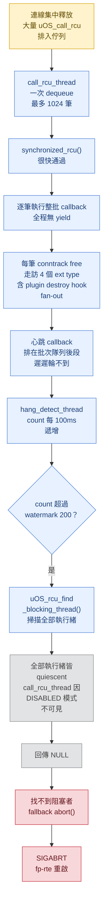
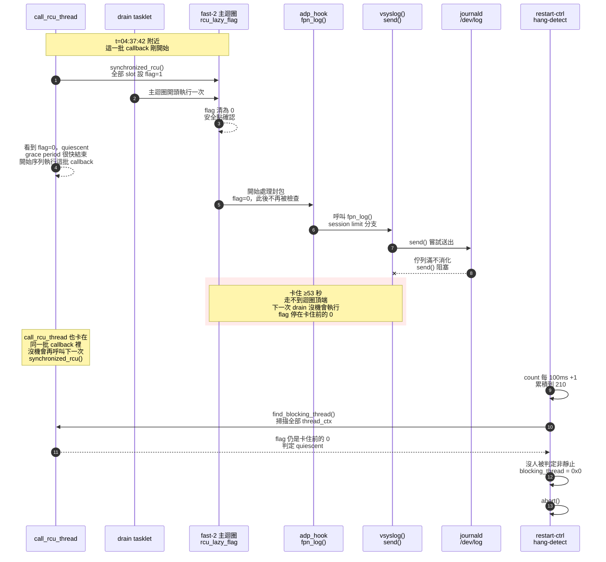
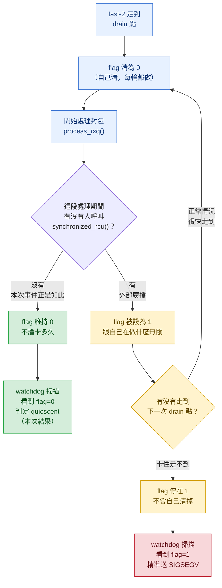
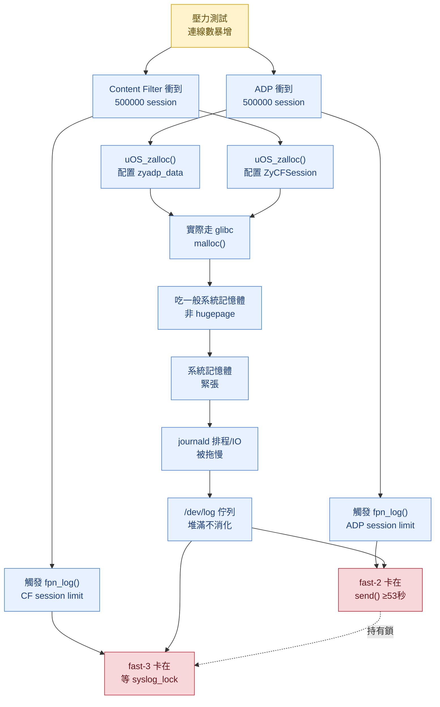

# FP RTE Crash Analysis: fp-rte-crash-11332

## 摘要

這不是記憶體損毀，是 `uOS_hang_detect_thread`（RCU 看門狗，執行緒名稱 `restart-ctrl`）主動 `abort()` 重啟 fp-rte。但觸發路徑與本 repo 目前已記錄的情境 A-G（見 `docs/uOS_hang_detect.md`）都不同：以往每一起都是「某個其他執行緒卡住 `uOS_synchronized_rcu()` 的 grace-period 等待」；這次 coredump 尾端的 `[dump-thread-rcu]` 快照顯示**全部執行緒的 `rcu_lock_cnt` 皆為 0**——沒有任何執行緒正阻塞 grace period。因此 `uOS_rcu_find_blocking_thread()` 掃描全部執行緒後回傳 **NULL**，`uOS_hang_detect_thread` 因而落入「找不到阻塞者」的 fallback（`zyxel-uOS-ctrl-hang-detect.c:42-45`），直接對自己 `abort()`，而不是現行版本常態的「精準對阻塞者送 SIGSEGV」。

真正的瓶頸鎖定在 `call_rcu_thread`（RCU callback 唯一消費者）自己：崩潰當下它正卡在**批次執行大量 conntrack entry 釋放 callback**（`uOS_conntrack_free_rcu` → `__uOS_conntrack_free` → `uOS_ct_ext_destroy` → `uOS_helper_ext_ct_remove`），而看門狗自己的心跳 callback（`uOS_hang_detect_rcu_head`）恰好被排在同一個批次佇列裡、排在它後面等著執行。`call_rcu_thread` 建立時使用 `uOS_thread_loop_disable_rcu(1)`（`DISABLED` RCU mode），而 `uOS_rcu_thread_is_quiescent()` 對 `DISABLED` 狀態**恆回傳 true**——這個設計原意是避免 `uOS_rcu_find_blocking_thread()` 誤把 `call_rcu_thread` 自己當成阻塞 grace period 的對象，但也造成一個結構性死角：**當瓶頸剛好就在 `call_rcu_thread` 自己執行 callback 的階段（而非等待 grace period 的階段）時，看門狗天生看不見它**，只能落入「找不到阻塞者」的 fallback。

`docs/uOS_hang_detect.md`「Crash 時的識別方式」一節已預先定義這個 fallback 為「情形 (d)」，並註明「目前尚無實際 coredump 案例，格式為推論」——**ZNGA-11332 是這個 fallback 路徑第一個真實案例**，也是文件既有情境 A-G 分類法（全部屬於「grace-period 等待階段被卡住」）之外，第一個「grace-period 之後、callback 批次執行階段被拖慢」的案例。

**時間軸修正（後續交叉比對）**：比對 coredump 內各執行緒區域變數中的時間戳後發現，兩個 dataplane lcore（`fast-2`/`fast-3`）在崩潰前已經卡在 `syslog()` 路徑約 **50 秒**（整個 dataplane 凍結），且由此可推得 `call_rcu_thread` 目前這一批已執行 **≥53 秒**、`restart-ctrl` 的 `count` 明顯落後實際時間。這使「批次過大」不再足以單獨解釋耗時——**目前最可疑的共同根因是壓力測試下的 syslog 接收端壅塞與／或控制平面 CPU（core 0-1）饑餓**，詳見「時間軸分析」一節。

---

## 問題發生流程圖



**節點細節對照**：
- **A**：本次無法從單一 coredump 快照直接證實「連線集中釋放」的確切規模，是推論出的觸發條件（見下方「侷限聲明」）。後續時間軸分析顯示，除了批次大小，**控制平面 CPU 饑餓／syslog 壅塞**很可能才是讓 D 步驟拖到 ≥53 秒的主因（見「時間軸分析」）。
- **D/E**：`call_rcu_thread` 崩潰當下的實際 backtrace 停在 `uOS_helper_ext_ct_remove`（`zyxel-uOS-conntrack-helper.c:263`），是 `uOS_ct_ext_destroy()` 走訪 4 個 ext type 中的第 3 個（`HELPER`）。
- **F**：`call_rcu_thread` 的本地變數 `batch_head` 當下指向 `uOS_hang_detect_rcu_head`——即心跳 callback 就是這個批次接下來要處理的下一筆。
- **J**：`[dump-thread-rcu]` 表（log 尾端）逐一核對，全部 32 個 thread slot 的 `rcu_lock_cnt` 皆為 `0`。
- **灰色節點 J/K 是本案與情境 A-G 的關鍵分岔點**：情境 A-G 走到這一步時，`uOS_rcu_find_blocking_thread()` 都能找到一個非 quiescent 的執行緒並精準送 SIGSEGV；本案因為瓶頸落在 `call_rcu_thread` 自己（對此函式天生不可見），才會回傳 NULL、落回舊版 `abort()` 的 fallback 路徑。

---

## 基本資訊

| 項目 | 值 |
|---|---|
| **Issue** | ZNGA-11332 |
| **Signal** | SIGABRT |
| **版本** | 1.40p0b4, USGv3 (build ABZI) |
| **平台** | AArch64 (Marvell Armada)，`fp-rte -a ffff:ff:ff.f --huge-dir=/dev/hugepages -n 4 -l 2-3 --socket-`（2 個 dataplane lcore：core 2、3） |
| **Core 檔案** | `260921-043836_1.40p0b4_ABZI#fp-rte.restart-ctrl#11e1c.1070be8.ae8c0.ae1d4.81448.bac84.81448.af184.ae1d4.b790.core` |
| **Binary** | `/root/sources/1.40p0b4/USGv3/buildroot/output_usg310v3/build/fp-custom/buildroot-build/fastpath/arch/dpdk/fp-rte` |
| **Threads** | 分析報告開頭摘要（自動偵測、誤判 top frame）記載 45（43 有可解析 backtrace）；`info threads` 實際列出 43 筆，與「43 有可解析 backtrace」一致；報告中段〈THREAD SUMMARY〉另記載 88，屬分析工具兩種統計口徑的落差，與根因無關，以下分析一律以 GDB `info threads`／`thread apply all bt full` 的 43 筆為準 |

> 註：自動分析報告（log L14-20）將 Thread 43（`socket_listener`，DPDK telemetry 的 `__libc_accept`，長期阻塞屬正常閒置）誤判為「Crashed in / Top frame」。實際崩潰（`raise`/`abort`）執行緒是 GDB 標示的 **Thread 1 (LWP 6106)**，本文以此為準。

---

## Backtrace 摘要

### Thread 1 — 崩潰執行緒 (LWP 6106)：`uOS_hang_detect_thread`

```
#0  __GI_raise (sig=6)
#1  __GI_abort ()
#2  uOS_hang_detect_thread (blocking_thread=0x0, count=210)
        at zyxel-uOS-ctrl-hang-detect.c:44
#3  thread_wrapper (arg=0x12, thread_idx=18)
        at zyxel-uOS-infra-thread.c:332
```
（log L2641–2665；暫存器 dump 於 L4265–4301，`x27 = 0xd2 = 210` 對應 `count`）

**觸發條件**：`count=210 > uOS_hang_detect_watermark(200)` 且 `count % 10 == 0`——與 `docs/uOS_hang_detect.md` 記載的現行版本首次觸發點（21 秒無回應）完全吻合。`blocking_thread` 本地變數為 `0x0`，對照現行原始碼 `zyxel-uOS-ctrl-hang-detect.c:41-45`：

```c
blocking_thread = uOS_rcu_find_blocking_thread();
if (!blocking_thread) {
    uOS_ERROR(RCU, "No thread is blocking the RCU grace period?\n");
    abort();                              // ← 本次實際走到這一支
}
```

**核對 core 檔名**：`#fp-rte.restart-ctrl#...`——崩潰執行緒就是 `restart-ctrl` 自己，日誌中不會出現「`Sending SIGSEGV to RCU blocking thread`」字樣（coredump 本身不含 stdout log，但由 `blocking_thread=0x0` 與檔名一致可直接確認）。對照 `docs/uOS_hang_detect.md`「Crash 時的識別方式」一節，這正是文中定義、當時「尚無實際案例」的**情形 (d)**。

---

### Thread 15 — RCU 消費者 (LWP 6082)：`call_rcu_thread` 正在批次執行 conntrack 釋放 callback

```
#0  uOS_helper_ext_ct_remove (ct=0xfffeccc43818)
        at zyxel-uOS-conntrack-helper.c:263
#1  uOS_ct_ext_destroy (ct=0xfffeccc43818)
        at zyxel-uOS-conntrack-extend.c:61
#2  __uOS_conntrack_free (ct=0xfffeccc43818)
        at zyxel-uOS-conntrack.c:966
#3  uOS_conntrack_free_rcu (head=0xfffeccc438f0)
        at zyxel-uOS-conntrack.c:982
        ct = 0xfffeccc43818
#4  call_rcu_thread (arg=<optimized out>)
        at zyxel-uOS-infra-rcu.c:323
        batch_head = 0x27a0e88 <uOS_hang_detect_rcu_head>
        batch_tail = <optimized out>
        batch_count = <optimized out>
#5  thread_wrapper (arg=0x4, thread_idx=4)
```
（log L1229–1259）

**關鍵細節**：
- `#2` 停在 `conntrack.c:966`，即 `__uOS_conntrack_free()` 內呼叫 `uOS_ct_ext_destroy(ct)` 那一行（`conntrack.c:958-973`）；`#3` 停在 `conntrack.c:982`，即 `uOS_conntrack_free_rcu()` 呼叫 `__uOS_conntrack_free(ct)` 那一行。兩個行號都精確對應現行原始碼，非推測。
- `#1` `uOS_ct_ext_destroy()`（`conntrack-extend.c:48-63`）會依序走訪全部 4 個已註冊的 ext type（`uOS_CT_EXT_NAT` / `uOS_CT_EXT_ZYXEL` / `uOS_CT_EXT_HELPER` / `uOS_CT_EXT_SEQADJ`，定義於 `common/zyxel-uOS-conntrack-extend.h:12-18`）；`#0` 目前停在第 3 個（`HELPER`）的 destroy callback `uOS_helper_ext_ct_remove()`（`conntrack-helper.c:262-277`）。
- **`batch_head` 已指向 `uOS_hang_detect_rcu_head`**：`call_rcu_thread` 的批次處理迴圈（`infra-rcu.c:309-324`）用 `node = batch_head; batch_head = node->next;` 逐筆消化鏈結串列，因此此刻的 `batch_head` 值就是「目前這筆處理完後，下一筆要處理的節點」——也就是說，看門狗自己的心跳 callback 是這個批次接下來緊接著要執行的下一項，只是還沒輪到。

---

### `[dump-thread-rcu]` 快照（log L4347–4380）：無人阻塞 grace period 的直接證據

```
index rcu_lock_cnt rcu_lazy_flag tid  type mode name
0     0            0             5978 2    0    fast-2              ← dataplane lcore A
4     0            1             6082 0    1    call_rcu             ← DISABLED mode，恆 quiescent
18    0            0             6106 0    0    restart-ctrl         ← 崩潰執行緒本身
29    0            0             5981 2    0    fast-3              ← dataplane lcore B
```

全部 32 個 slot（完整清單見 log L4348-4380）的 `rcu_lock_cnt` 欄位**無一例外皆為 0**。兩個 dataplane lcore（`fast-2`/`fast-3`，`type=2` 對應 `uOS_THREAD_DATA_PLANE`）不但 `rcu_lock_cnt=0`，連 `rcu_lazy_flag` 也是 `0`（已完整通過一次迴圈邊界），與情境 D／G（dataplane lcore 卡在迴圈中段、`rcu_lazy_flag` 恆為 1）的既有案例特徵明顯不同——**對 RCU grace period 而言，這次兩個 dataplane 核心都是靜止的，沒有卡住任何一次 `uOS_synchronized_rcu()` 的檢查窗口**。`call_rcu` 這一列 `mode=1`，對照 `common/zyxel-uOS-infra-thread.h:38-41` 的 enum 順序（`LAZY=0, DISABLED=1, EXPERT=2`），確認就是 `uOS_THREAD_RCU_MODE_DISABLED`。

> **修正**：`rcu_lock_cnt=0`／`rcu_lazy_flag=0` 只證明這兩個核心「不卡 grace period」，**不代表它們真的完全空閒**。交叉比對這兩個 thread 完整的 backtrace 後發現，它們當下其實正卡在另一條與 RCU 無關的鎖路徑上——見下一節。

---

## dataplane lcore 的 syslog 鎖競爭（`fast-2`/`fast-3`）

回頭比對 `fast-2`（`Thread 8`，LWP 5978）與 `fast-3`（`Thread 6`，LWP 5981）各自完整的 backtrace（而不只是 `dump-thread-rcu` 表的兩個 RCU 欄位），發現兩者當下都卡在 **ADP 與 Content Filter 兩個 UTM 模組因 session 數衝頂（皆為 500000）觸發的 `fpn_log()` → `syslog()` 路徑**，而且彼此互相鎖住：

**`Thread 8 (LWP 5978 = fast-2)`**：
```
#0  __libc_send (...) at send.c:28
#1  __GI___vsyslog_chk (...) at syslog.c:279
        buf = "<27>Sep 21 04:37:42 fp-rte[5978]: ADP session limit reached: limit=500000\n"
#2  __syslog (...)
#3  fpn_log_write (...) at ../../fpn-log.c:81
...
#9  fpn_vlog (...) at ../../fpn-log.c:182
#10 fpn_log (...) at ../../fpn-log.c:192
#11 adp_hook (nfstate=...) at ../../../../fp-modules/zyxel-adp/dataplane/fp-adp.c:2489
#12 __uOS_nfhook_iterator (...) at ../../../../fp-modules/zyxel-uOS/common/zyxel-uOS-nfhook-iterator.h:244
```
（log L1502–1729）——正在執行 `send()` 系統呼叫，把訊息寫進 syslog socket。

**`Thread 6 (LWP 5981 = fast-3)`**：
```
#0  __lll_lock_wait_private (futex=&syslog_lock) at lowlevellock.c:33
#1  __GI___vsyslog_chk (...) at syslog.c:258
        buf = "<27>Sep 21 04:37:45 fp-rte[5978]: Content filter reached max session: 500000\n"
#2  __syslog (...)
#3  fpn_log_write (...) at ../../fpn-log.c:81
```
（log L2012–2033）——卡在等待 glibc 內部的全域 `syslog_lock` 互斥鎖，而這把鎖正被 `fast-2` 持有。

**觸發點與限流保護**：
- `fp/fp-modules/zyxel-adp/dataplane/fp-adp.c:2486-2490`：`adp_current_handle_session >= ZLDSYSPARM_DOS_PREVENTION_MAX_SESSION` 時，僅在 `!fpn_log_is_ratelimited()` 才呼叫 `fpn_log()`，之後 `verdict = uOS_NF_ACCEPT`——**不會**強制驅逐既有連線。
- `fp/fp-modules/zyxel-content-filter/dataplane/fp-content-filter.c:3547-3555`：`content_filter_session_count >= ZLDSYSPARM_CF_MAX_SESSION` 時同樣先檢查 rate-limit 才記錄，然後直接 `return -1`，同樣不驅逐既有連線。
- `fpn-sdk/fpn-log.c:198-237`（`fpn_log_is_ratelimited()`）：`RATELIMIT_MSG_PER_SEC=5`、`RATELIMIT_MSG_BURST=25`，且 credit/prev/drops 都是 `FPN_DEFINE_PER_THREAD`——**每個核心各自獨立配額**，並非無限制的 flooding，穩態下每核心每秒最多 5 則、爆量上限 25 則。

**它們沒有卡住 grace period**：若 `fast-2`/`fast-3` 卡住了某一次 `uOS_synchronized_rcu()` 的檢查窗口，`rcu_lazy_flag` 應該會維持在 `1`——它們是 LAZY 模式 + `DATA_PLANE` 型別，是前一節判定式中唯一沒有 `rcu_lock_cnt==0` 逃生門的組合，一旦被 `uOS_rcu_find_blocking_thread()` 掃到非靜止，就會回傳非 NULL，`uOS_hang_detect_thread` 會走「精準 `pthread_kill(SIGSEGV)`」分支（`ctrl-hang-detect.c:46-58`），而不是本案實際看到的 `blocking_thread=0x0 → abort()`（`ctrl-hang-detect.c:42-45`）分支。實際證據是兩者的 `rcu_lazy_flag` 都是 `0`，因此它們**不是**被 watchdog 當成兇手的那一方。

**但它們並非「瞬間被快照抓到」，而是已經卡了約 50 秒**——見下一節「時間軸分析」。rate-limit（5/sec、burst 25，per-thread）只限制了「呼叫次數」，限制不了**單次 `send()` 被阻塞多久**：只要 `/dev/log` 接收端不消化，即使一秒只送一則，送的那一次就會卡住，並連帶用 `syslog_lock` 把另一個 lcore 一起鎖住。

---

## 時間軸分析：dataplane 凍結約 50 秒，與其推論

### 崩潰時間與 syslog 訊息時間

| 來源 | 值 | 換算（CST, UTC+8） |
|---|---|---|
| `fingerprint_ipc_thread`（每 1ms 迴圈）的 `current_time`（log L578） | `1789936715` | **04:38:35** ≈ 崩潰時間（core 檔名 `260921-043836` 吻合） |
| `ip_fragment_log_thread` 的 `now`（log L882）、多個執行緒暫存器 `x10`/`x23` | `1789936712`–`1789936715` | 04:38:32–04:38:35 |
| `fast-2` `__GI___vsyslog_chk` 的 `now`（log L1593） | `1789936662` | **04:37:42**（崩潰前約 53 秒） |
| `fast-3` `__GI___vsyslog_chk` 的 `now`（log L2030） | `1789936665` | **04:37:45**（崩潰前約 50 秒） |

glibc `vsyslog` 先取時間戳並格式化整條訊息，**之後**才搶 `syslog_lock`（syslog.c:258）、再 `send()`（syslog.c:279）。`fast-3` 停在搶鎖那一行時 `buf` 已是完整格式化的訊息，直接證實這個順序。因此：
- `fast-3` 已等待 `syslog_lock` 約 **50 秒**；
- `fast-2` 自 04:37:42 起就在「搶鎖 + `send()`」之中，目前持鎖卡在 `send()`，最長約 **53 秒**；
- `send()` 的 `flags=16384`（`MSG_NOSIGNAL`）為阻塞模式，代表 `/dev/log` 另一端（syslogd）長時間幾乎沒有消化訊息。

**結論：崩潰前約 50 秒，兩個 dataplane lcore 都停止處理封包（整個 dataplane 凍結）**，原因是 syslog 送不出去。

### 由 `rcu_lazy_flag=0` 推出的時間矛盾（推論）

1. `fast-2` 卡了約 53 秒，`rcu_lazy_flag` 卻仍是 `0`：代表這 53 秒內**沒有任何新的 `uOS_synchronized_rcu()` 開始**（否則 flag 會被設為 1，而凍結中的 `fast-2` 無法再清除，watchdog 就會抓到它並送 SIGSEGV）。
2. 因此 `call_rcu_thread` 目前這一批，必定在 04:37:42 之前就已通過 `synchronized_rcu()` 開始執行——**一批（≤1024 筆）callback 已跑了 ≥53 秒**，平均每筆 ≥50ms，不像單純的 CPU 運算。
3. 心跳 callback 就在這一批裡（`batch_head` 指向它），所以它實際已等待 ≥53 秒；但 `count=210`，照設計只對應 21 秒——**`restart-ctrl` 的迴圈比預期慢了約 2.5 倍**（每圈平均 ≥250ms，而非 `usleep(100000)` 的 100ms）。

補充：`uOS_ERROR()` 走 `uOS_debug_log()` → `printf(stdout)` + `fflush(stdout)`（`zyxel-uOS-lib-debug-log.c:106-122`），**不經過** `syslog_lock`；`fpn_log()` 才走 per-thread cookie stream → `fpn_log_write()` → `syslog()`（`fpn-sdk/fpn-log.c:46-94,167-183`）。因此 `restart-ctrl` 變慢不是因為搶 `syslog_lock`；若 fp-rte 的 stdout 導向某個同樣被堵住的 pipe，則有可能；否則較可能是 CPU 排程饑餓。

### 圖解：`rcu_lazy_flag=0` 為何跟「卡住 53 秒」不矛盾

關鍵在於**時間先後順序**：flag 是在 `fpn_log()` 卡住**之前**被清成 0 的，之後就再也沒有人重新檢查過它——不是「卡住了但 flag 神奇地維持 0」，而是「flag 在卡住前就已經是 0，而卡住這件事本身，讓『下一次檢查』永遠沒有機會發生」。



**看圖的重點**：第 3 步（flag 清 0）跟第 8 步（送出訊息卡住）之間**沒有任何一個箭頭指向 F2 或 flag**——也就是說，從 flag 被清成 0 的那一刻，到 watchdog 最後掃描的那一刻，中間完全沒有任何機制會去更新這個欄位。`send()` 卡多久，flag 就維持 0 多久，這不是巧合或例外，是這個機制的必然行為。

### 常見誤解澄清：「還在迴圈內，flag 應該還是 1」？

一個直覺但錯誤的想法是：`fast-2` 既然還卡在這輪迭代裡（封包還沒處理完），`rcu_lazy_flag` 應該要是 1（「忙碌中」）才對，等處理完才變回 0（「閒置」）。**這個直覺不成立**，原因是 flag 的運作方式跟「忙碌/閒置」燈號完全不同。

**先確認 drain 呼叫點在主迴圈裡的實際位置**（`fpn-sdk/dpdk/fpn-main-loop-dpdk.c`）：

```c
// L991：drain（含清 rcu_lazy_flag）在這裡執行，早於封包處理
if (fpn_process_mainloop_cb() > 0) { ... }   // → uOS_drain_process() → uOS_drain_rcu_lazy_process() → flag 清 0

// L1024-1030：封包處理在這裡，晚於上面，最終才會走到 adp_hook/fpn_log()
for (i = 0; i < curconf->global.conf.n_rx_queue; i++)
    nic_nb_rx += process_rxq(&curconf->rxq[i], lcore_id, cur_tsc, ...);
```

`process_rxq()`（封包處理）確實排在清 flag **之後**，不是之前。

**關鍵：flag 不是迴圈自己拿來標記「忙不忙」的燈號，而是一個外部廣播、各自回應的機制**：

- **設成 1 只有一個來源**：`uOS_synchronized_rcu()`——這是**外部、一次性廣播給全部 64 個 thread slot** 的動作，跟 `fast-2` 自己的迴圈跑到哪個位置完全無關。不管 `fast-2` 當下是剛進迴圈、還是卡在封包處理中間，只要這個廣播發生，牠的 flag 就會被設成 1。
- **`fast-2` 自己的迴圈只做「清成 0」這件事**，而且只在每輪迴圈固定的同一個點（drain，即 `process_rxq()` 之前）做。**迴圈本身沒有任何程式碼會把自己的 flag 設回 1。**

所以平常大部分時間，根本沒有人在呼叫 `uOS_synchronized_rcu()`，flag 就一直停在 0——不是因為迴圈「跑完了才清 0」，而是因為從上一次清 0 之後，就沒人再動過它，不管迴圈又跑了幾百萬輪都一樣。

**用流程圖表示「flag 最終是 0 還是 1」由什麼決定**：



**看圖的重點**：從 B（清 0）到卡住這段路徑上，`fast-2` 自己完全不會碰 flag——會不會變成 1，**只取決於 D 這個菱形決策點**（外部有沒有廣播），跟 `fast-2` 卡多久、在做什麼無關。這次事件走的是 D 的左邊分支（沒有第二次廣播）， 所以最終停在綠色的 E／I（flag=0、watchdog 看不到）；如果走的是右邊分支且卡住走不到下一次 drain，才會變成黃色／紅色的 F→H→J（flag=1、被精準抓到）——**這兩種結局的差別，純粹在於「外部廣播剛好有沒有發生」，不是「卡住的事實有沒有發生」**。

**「還在迴圈內」只有在下面這件事剛好發生時，才會讓 flag=1**：`uOS_synchronized_rcu()` 的廣播，剛好落在 `fast-2` 已經過了自己的 drain 點、還沒繞回下一輪的這段期間。這次事件的實際時序是：

1. `fast-2` 走到 drain 點，flag 清 0。
2. **緊接著**（幾乎同一瞬間，時間戳都落在 04:37:42 附近）`call_rcu_thread` 呼叫了唯一一次 `uOS_synchronized_rcu()`，檢查到 `fast-2` 的 flag 是 0，判定通過。
3. `fast-2` 才**接著**進入 `process_rxq()`，處理到某個封包時卡進 `send()`。
4. 之後 53 秒內沒有第二次廣播（`call_rcu_thread` 自己也卡住，沒機會迴圈回去再呼叫一次），flag 就一直停在步驟 1 清好的 0。

**結論**：flag=0 是「卡住之前」就已經存在的既有事實，不是「卡住之後還能維持」的巧合——牠沒有機會被設回 1，是因為「設 1」這個動作（`uOS_synchronized_rcu()`）根本沒有再發生過，不是因為 `fast-2` 自己又把 1 清回了 0。這跟 `fast-2` 現在到底忙不忙、卡在哪裡完全脫鉤。

### 統一解釋：控制平面 CPU 饑餓／syslog 壅塞

### 圖解：`fpn_log()` 為何會卡住



**節點細節對照與確定性分級**：
- **A-F（確定，來自原始碼）**：`fp-adp.c:2495`／`fp-content-filter.c:3556` 命中 session 上限時，都用 `uOS_zalloc()` 配置物件；`zyxel-uOS-infra-malloc.c:219` 證實 `uOS_malloc()` 底層是 `malloc()`，走一般 glibc heap，不是 hugepage。
- **G（SVD 現場回報，非本 coredump 直接證據）**：問題發生時系統記憶體很緊張。
- **H-J（推論）**：記憶體緊張 → journald 被拖慢 → `/dev/log` 佇列堆滿，這段目前是合理推論，coredump 本身看不到 journald 的狀態，需在重現時以「重現時的驗證項目」第 6、7 項驗證。
- **K-N（確定，來自 backtrace）**：`fast-2`／`fast-3` 的完整呼叫鏈與卡住的系統呼叫，見「dataplane lcore 的 syslog 鎖競爭」一節。

這張圖跟最上面「問題發生流程圖」是**兩條平行的分支**，共同源頭都是同一場連線風暴：一條走向 `call_rcu_thread` 批次過大、最終觸發 `abort()`；另一條走向 dataplane 凍結在 `syslog()`。兩條分支目前**沒有證據顯示互為因果**，但共用同一個上游觸發事件。

以下三個現象可由同一個原因解釋——**壓力測試下，控制平面所在的 core 0-1（各背景執行緒 `cpuset = {3}`）負載飽和**：
- `call_rcu_thread`（`SCHED_OTHER`，RT 優先度已被移除，見建議修復第三層）拿不到足夠 CPU，一批 callback 跑了 ≥53 秒；
- `restart-ctrl` 同樣排程延遲，`count` 落後實際時間；
- syslogd 同樣跑在控制平面、消化不及（或被壓測的大量日誌打爆），導致 dataplane 的 `send()` 阻塞。

ADP 與 Content Filter 同時衝到 500000 session 上限，證實當下確實處於連線數/流量高峰。**這個統一解釋目前是推論**：coredump 無法直接量測各 core 的 CPU 使用率或 syslogd 狀態，需在重現時驗證（見建議修復「重現時的驗證項目」）。

**現場資訊補充（SVD 提供，非本 coredump 直接證據）**：問題發生時系統記憶體很緊張。交叉比對原始碼後發現，這很可能**不是巧合的並行事件，而是連線風暴本身直接造成的結果**——關鍵在於 `uOS_malloc()`/`uOS_zalloc()` 實際上是怎麼配置記憶體的：

```c
// fp/fp-modules/zyxel-uOS/dataplane/zyxel-uOS-infra-malloc.c:219
header = malloc(sizeof(uOS_malloc_header_t) + size + sizeof(unsigned long));
```

**修正**：先前一版分析誤以為 `uOS_malloc`/`uOS_zalloc` 主要吃 DPDK hugepage 池、與一般系統記憶體分開——**這是錯的**。上面這行原始碼證實 `uOS_malloc()` 底層直接呼叫 **glibc 的 `malloc()`**，跟 journald、rsyslogd、任何一般行程搶的是**同一塊系統記憶體**，不是獨立池子。

而 ADP／Content Filter 命中 session 上限時要配置的物件，正是走這條路徑：

```c
// fp-adp.c:2495            zyadp_data_ptr = (struct zyadp_data *)uOS_zalloc(sizeof(struct zyadp_data), uOS_MALLOC_TYPE_DOS_PREVENTION);
// fp-content-filter.c:3556 session = uOS_zalloc(sizeof(struct ZyCFSession), uOS_MALLOC_TYPE_CONTENT_FILTER);
```

**因果鏈**：壓力測試把連線數推到 ADP 500000 + Content Filter 500000 這兩個上限 → 這兩種 session 物件（還有 conntrack 本身與其他 extension，如 NAT/seqadj/helper）全數用 `malloc()` 吃一般系統記憶體 → fp-rte 自己就把系統記憶體吃到緊張（在記憶體有限的嵌入式路由器上，數十萬筆這個等級的物件數量足以構成有感的壓力）→ journald 跟所有一般行程一起搶記憶體，I/O 與排程被拖慢 → 同時控制平面執行緒（`call_rcu_thread`、`restart-ctrl`）的排程也被 kernel 記憶體回收（reclaim）拖慢。

這樣一來，「journald 沒消化 `/dev/log`」與「`call_rcu_thread`／`restart-ctrl` 排程延遲」這兩個原本各自獨立、都還沒證實的推論，就有了同一個具體、可驗證的共同根因，而且方向是**連線風暴 → 記憶體緊張**這條單一因果鏈，不是兩個不相干的巧合並行事件。

這也讓 `fp/fp-modules/zyxel-uOS/CLAUDE.md` 已記錄、原本評為「pending fix、待重現」的已知缺陷——`net-zyiface.c:1870-1891` malloc 失敗 fallback（呼叫 `uOS_synchronized_rcu()` 後立即 destroy `old_htb`，見「dataplane lcore 的 syslog 鎖競爭」一節提及的第二個 `uOS_synchronized_rcu()` 呼叫點）——的觸發機率在記憶體緊張的情境下不再只是理論值：`uOS_malloc()` 失敗（`malloc()` 回傳 NULL）在真實記憶體緊張下是會發生的。**但本次 coredump 沒有任何直接證據顯示這條路徑在這次事件裡被觸發過**，僅記錄為需要留意的關聯風險。

---

## 根因鏈

| 環節 | 證據 |
|---|---|
| **崩潰點是 watchdog 的 fallback abort，非記憶體錯誤** | Thread 1，`uOS_hang_detect_thread`，`count=210`，`blocking_thread=0x0` → `abort()`（`zyxel-uOS-ctrl-hang-detect.c:44`） |
| **並非 grace-period 等待被卡住（與情境 A-G 的關鍵差異）** | `[dump-thread-rcu]` 全部 32 個 slot `rcu_lock_cnt=0`；兩個 dataplane lcore 連 `rcu_lazy_flag` 也是 0，未卡住任何一次 grace-period 檢查窗口 |
| **dataplane 已凍結約 50 秒** | `fast-2` 卡在 `send()`（訊息時間 04:37:42）、`fast-3` 等 `syslog_lock`（04:37:45），崩潰約 04:38:35（見「時間軸分析」） |
| **真正瓶頸：`call_rcu_thread` 正批次執行大量 conntrack 釋放 callback** | Thread 15 (LWP 6082)，停在 `uOS_helper_ext_ct_remove` → `uOS_ct_ext_destroy` → `__uOS_conntrack_free` → `uOS_conntrack_free_rcu`（`conntrack.c:966,982`） |
| **看門狗心跳恰好排在同一批次隊列裡、還沒輪到** | `call_rcu_thread` frame 的本地變數 `batch_head = <uOS_hang_detect_rcu_head>`（`infra-rcu.c:323`） |
| **`call_rcu_thread` 對看門狗結構性不可見** | `mode=1 (DISABLED)`；`uOS_rcu_thread_is_quiescent()`（`infra-rcu.c:237-238`）對 `DISABLED` 恆回傳 `true` |
| **批次迴圈本身無上限筆數、無 yield** | `uOS_RCU_BATCH_MAX = 1024`（`infra-rcu.c:290`）；`while (batch_head) { ...; rcu->func(rcu); }`（`infra-rcu.c:319-324`）中間沒有任何 `usleep`/逾時檢查 |
| **（推論）這一批已跑 ≥53 秒、watchdog 計數落後實際時間** | `fast-2` 凍結期間 `rcu_lazy_flag` 仍為 0 → 期間無新 `synchronized_rcu()`；`count=210` 對應 21 秒，實際 ≥53 秒 → 疑似控制平面 CPU 饑餓／syslog 壅塞 |

---

## 為何 `uOS_rcu_find_blocking_thread()` 找不到阻塞者：技術解析

`uOS_rcu_thread_is_quiescent()`（`infra-rcu.c:207-244`）的判定表：

```c
switch (th_ctx->rcu_mode) {
case uOS_THREAD_RCU_MODE_LAZY:
    return (th_ctx->rcu_lazy_flag == 0) ||
           (th_ctx->type != uOS_THREAD_DATA_PLANE && th_ctx->rcu_lock_cnt == 0);
case uOS_THREAD_RCU_MODE_EXPERT:
    return th_ctx->rcu_lock_cnt == 0;
case uOS_THREAD_RCU_MODE_DISABLED:
    return true;                      // ← call_rcu_thread 永遠落在這一支
}
```

`call_rcu_thread` 建立時使用 `uOS_thread_loop_disable_rcu(1)`（`infra-rcu.c:304`），進入 `DISABLED` 模式。`docs/uOS_hang_detect.md` 已記載這個設計的原意：「這保證了 `uOS_rcu_find_blocking_thread()` 掃描 `thread_ctx[]` 時，不會誤把 `call_rcu_thread` 自己判定為阻塞 grace period 的執行緒」——因為 `call_rcu_thread` 呼叫 `uOS_synchronized_rcu()` 這件事本身不該被算成「它在阻塞自己」。

但這個豁免沒有區分「`call_rcu_thread` 正在等待別人（`synchronized_rcu()` 內部）」與「`call_rcu_thread` 正在做自己的事（批次執行 callback）」這兩種狀態——`DISABLED` 模式對兩者一視同仁，恆回傳 `true`。本案 `call_rcu_thread` 停在後者：`synchronized_rcu()`（`infra-rcu.c:318`）在批次一開始已經呼叫過一次且已經返回（backtrace 已經進入到 `while (batch_head) {...}` 迴圈內的 `rcu->func(rcu)`，不是停在 `synchronized_rcu()` 內），代表 grace period 本身很快就結束了（與 `[dump-thread-rcu]` 全員 `rcu_lock_cnt=0` 完全吻合）——真正耗時的是 grace period 結束**之後**，序列執行這一整批（最多 1024 筆）conntrack 釋放 callback 的過程，而這個階段完全在 `uOS_rcu_find_blocking_thread()` 的偵測範圍之外。

**每筆 conntrack 釋放的實際工作量不小**：`uOS_ct_ext_destroy()` 走訪的 4 個 ext type 中，`uOS_CT_EXT_ZYXEL` 這一型別的 destroy（`zyxel-uOS-conntrack-extend-zyxel.c` 的 `uOS_ct_ext_zyxel_destroy_all()`）本身還會再 fan-out 呼叫最多 9 個外部 `zyxel-fp-plugin-*` 註冊的 destroy hook（App Patrol、Content Filter、ZyParser、SSL Inspection ×2、BWM、TCP Reorder、IPS、ADP、IP Reputation——完整清單與逐一核對結果見 `issues/fp-rte-crash-10761.md`〈疑似相關 Plugin 清單〉一節）。若當下佇列裡累積了數百到上千筆連線同時釋放（例如連線集中逾時、介面 flap、規則變更導致的批次 flush，或連線風暴），單一批次逐筆跑完整條「4 ext type × 最多 9 個 plugin hook」的鏈路，要吃掉 watermark 的 20 秒預算並非不合理——且全程都是 `call_rcu_thread` 自己的 CPU-bound 工作，不涉及等待任何其他執行緒，因此 `[dump-thread-rcu]` 才會呈現「全員 quiescent」的畫面。

> **修正**：「時間軸分析」推得這一批已執行 ≥53 秒（平均每筆 ≥50ms），單靠「每筆工作量不小」難以解釋到這個程度；較可能是 `call_rcu_thread` 在控制平面 core 0-1 上拿不到足夠 CPU，或部分 callback 本身被阻塞。批次無上限、無 yield 仍是讓心跳排不到的機制，但**不再是唯一原因**。

---

## 與既有情境 A-G 的對照

`docs/uOS_hang_detect.md` 記載的情境 A-G，核心機制都是「**某個其他執行緒卡住 `uOS_synchronized_rcu()` 的 grace-period 等待階段**」（迴圈不返回 / 持鎖不放 / 阻塞式 I/O 佔用 RCU read lock），因此 `uOS_rcu_find_blocking_thread()` 一定能找到那個非 quiescent 的執行緒並精準 `pthread_kill(SIGSEGV)`。

本案的機制不屬於這七種之一：grace period 本身沒有被卡住（`synchronized_rcu()` 很快就通過），卡點在 grace period **之後**——`call_rcu_thread` 序列執行整批 callback 的階段本身沒有時間上界，而這個階段因 `DISABLED` 模式對看門狗的偵測邏輯完全不可見。這是文件既有分類法之外的第八種觸發機制：

| | 情境 A-G（既有） | 本案（ZNGA-11332） |
|---|---|---|
| 卡住的階段 | `synchronized_rcu()`（grace-period 等待） | grace period 之後，callback 批次執行 |
| 卡住的執行緒 | 某個其他執行緒（dataplane lcore / CONTROL thread / plugin thread） | `call_rcu_thread` 自己 |
| `[dump-thread-rcu]` 特徵 | 至少一個 thread 的 `rcu_lock_cnt>0` 或 `rcu_lazy_flag` 恆為 1 | 全員 `rcu_lock_cnt=0`，`fast-2`/`fast-3` 連 `rcu_lazy_flag` 都是 0 |
| `uOS_rcu_find_blocking_thread()` 結果 | 找到阻塞者，精準 SIGSEGV | 回傳 NULL（對 `call_rcu_thread` 自身結構性不可見） |
| 對應 `docs/uOS_hang_detect.md`「識別方式」情形 | (b) 或 (c) | **(d)**——文件原記載「尚無實際案例」 |

---

## 侷限聲明

這份 coredump 是單一時間點快照：能直接證實的只有「`call_rcu_thread` 崩潰當下正處於某個 `ct` 的 ext-destroy 鏈路中，且緊接著要處理的下一筆正是心跳 callback」，以及「全部執行緒當下確實都是 quiescent」。**無法從這份資料直接證實**：
- 當下佇列裡實際累積了多少筆待處理的 RCU callback（是否真的接近 `uOS_RCU_BATCH_MAX=1024`）。
- 是哪一個或哪幾個 `zyxel-fp-plugin-*` destroy hook 對整體耗時貢獻最大——目前只看到 `#0` 停在核心自己的 `uOS_helper_ext_ct_remove`（無鎖、無 syscall 的簡單函式），沒有任何一筆 plugin destroy hook 出現在這份 backtrace 裡，因此無法像 `fp-rte-crash-10761.md` 的 plugin 稽核那樣指名道姓。
- 觸發這波連線集中釋放的上游事件（是連線逾時集中到期、介面事件、規則 flush，還是連線風暴）。

「批次執行大量 conntrack 釋放 callback、耗時累加超過 watermark」是**目前證據下最合理的機制推論**，不是逐筆重建的確定性根因；若要進一步收斂，需要在可重現環境中對 `call_rcu_thread` 的批次迴圈加上計時／計數 log（見下方建議修復），或取得同一時段的應用層日誌（`uOS_ERROR` 系列訊息不含在 coredump 內）比對佇列深度。

**補充**：交叉比對 `fast-2`/`fast-3` 的完整 backtrace 與時間戳後發現，兩者當下正處理 ADP／Content Filter 的 session-limit 分支（皆達 500000 上限），且已卡在 `syslog()` 約 50 秒——這能直接證實系統當下處於連線數/流量高峰（與壓力測試環境一致），也說明 syslog 已嚴重壅塞。由此推得的「call_rcu 批次 ≥53 秒、watchdog 計數落後」指向**控制平面 CPU 饑餓／syslog 壅塞**這個共同根因，但以下幾點仍**無法從 coredump 證實**：
- core 0-1 當下的 CPU 使用率與各執行緒的排程延遲；
- syslogd／journald 的狀態（是被日誌量打爆、被 CPU 饑餓、被記憶體壓力拖慢，還是其他原因卡住）；
- fp-rte 的 stdout 導向何處（若接到同樣被堵住的 pipe，也會讓 `restart-ctrl` 的 `uOS_ERROR` 變慢）；
- `call_rcu_thread` 這一批裡是否有 callback 本身被阻塞（快照當下停在 `uOS_helper_ext_ct_remove`，屬 CPU 運算）；
- **系統記憶體當下的實際使用狀況**——SVD 現場回報問題發生時系統記憶體很緊張，這是本次分析唯一非源自這份 coredump 的輸入，coredump 本身不含 `/proc/meminfo`／`dmesg` 這類系統面資訊，此說法目前只能當作佐證「統一解釋」一節的外部線索，無法從這份檔案獨立驗證。

---

## 建議修復（僅記錄評估，本次分析不實作程式碼變更）

### 第一層：`call_rcu_thread` 批次迴圈加入時間／筆數預算，中途讓出

**檔案**：`fp/fp-modules/zyxel-uOS/dataplane/zyxel-uOS-infra-rcu.c`，`call_rcu_thread()`（L297-330）。

現行 `while (batch_head) { node = batch_head; ...; rcu->func(rcu); }`（L319-324）一旦 dequeue 出一個批次（最多 1024 筆），就會不間斷地連續執行完所有 callback。應在這個迴圈內加入以「已處理筆數」或「累積耗時」為單位的檢查點：超過門檻就讓剩餘節點留到下一輪 `uOS_thread_loop_disable_rcu` 迭代繼續處理（迴圈本身每輪都會重新 dequeue，不會遺漏），避免單一批次無上界地佔用 `call_rcu_thread`。這是**唯一能直接切斷「批次過大 → 心跳排隊過久 → watchdog fallback abort」這條鏈路**的修法，且不影響前段 `synchronized_rcu()` 的既有語意。

### 第二層：心跳 callback 與一般 RCU callback 分流

**檔案**：`fp/fp-modules/zyxel-uOS/dataplane/zyxel-uOS-ctrl-hang-detect.c`、`zyxel-uOS-infra-rcu.c`。

目前 `uOS_hang_detect_rcu_head` 與所有 conntrack free／hash table 回收等一般 callback 共用同一個 MPSC 佇列（`uOS_call_rcu_queue`），先天上就會被排在其他 callback 後面等待。可評估讓心跳訊號改用獨立的、不經過這個佇列的存活檢查機制（例如直接量測 `call_rcu_thread` 上一次進入/離開批次迴圈的時間戳，而非依賴它「執行一個 callback」這件事本身），讓看門狗的判斷依據不受一般 callback 佇列深度影響。

### 第三層：還原 `call_rcu_thread` 的 RT 排程優先度

`docs/uOS_hang_detect.md`〈新增風險〉一節已記載：`call_rcu_thread` 建立時原本會設定 `args.prio = 1`（`SCHED_FIFO`），現行原始碼已移除，退回一般 `SCHED_OTHER` 排程。原先判斷本案非排程優先度問題（`call_rcu_thread` backtrace 顯示它確實在執行）；但「時間軸分析」推得這一批已跑 ≥53 秒、`restart-ctrl` 迴圈也慢了約 2.5 倍，**控制平面 CPU 饑餓已成為主要懷疑方向之一**，因此這一層的優先度應提高：`SCHED_OTHER` 下，壓力測試時 core 0-1 上的大量執行緒與 syslogd 會直接拉長批次耗時。建議與第一層修法一併評估是否還原。

### 第四層：批次迴圈補充計時／計數 log

在 `call_rcu_thread()` 的批次迴圈前後量測 `batch_count` 與實際耗時，超過門檻時 `uOS_ERROR_RATELIMIT` 記錄，未來遇到同類情況可直接從應用層日誌判讀，不必每次都仰賴 coredump 事後重建（呼應「侷限聲明」一節指出的資料缺口）。

### 第五層：dataplane 熱路徑不應呼叫會阻塞、會搶全域鎖的 `syslog()`

**檔案**：`fp/fp-modules/zyxel-adp/dataplane/fp-adp.c:2489`、`fp/fp-modules/zyxel-content-filter/dataplane/fp-content-filter.c:3552`（皆透過 `fpn_log()` → `vsyslog()`）。

`adp_hook`／content-filter 在封包快速路徑上呼叫 `fpn_log()`，會走到 `vsyslog()` 內部的阻塞式 `send()` 與 glibc 全域 `syslog_lock`，違反 dataplane run-to-completion、無阻塞的設計原則（見專案頂層 `CLAUDE.md`「Key Performance Techniques」）。**本次已實際造成兩個 dataplane lcore 凍結約 50 秒**（一個卡在 `send()`，另一個卡在等鎖）——`fpn_log_is_ratelimited()` 只限制呼叫次數，無法限制單次 `send()` 被阻塞多久，因此調整 rate-limit 門檻**不能**解決這個問題。建議：(a) dataplane 上的事件改為非阻塞、無鎖的方式記錄，例如寫入 per-core 環形緩衝區，由控制平面背景執行緒彙整後才呼叫 `syslog()`；或 (b) 至少讓 dataplane 的 syslog 送出改為非阻塞（`MSG_DONTWAIT`，送不出去就丟棄並計數），避免接收端壅塞時整個 dataplane 陪葬。這一層與 abort 本身是否有因果無關，**單獨就是一個會造成服務中斷的缺陷**，建議優先處理。

### 重現時的驗證項目

為確認「控制平面 CPU 饑餓／syslog 壅塞」這個共同根因推論，建議在壓力測試重現時收集：
1. `top -H`（或 `pidstat -t`）觀察 core 0-1 使用率、`call_rcu`／`restart-ctrl` 執行緒的 CPU 佔用，以及 syslogd 的 CPU 與狀態。
2. `/dev/log` 接收端是否堆積（例如 `ss -x` 觀察 syslog socket 的佇列），以及 syslogd 的輸出目的地（本機檔案、遠端）是否成為瓶頸。
3. fp-rte 的 stdout 導向何處（`ls -l /proc/$(pidof fp-rte)/fd/1`），確認 `uOS_ERROR` 的 `printf`／`fflush` 是否可能被堵住。
4. 依第四層在 `call_rcu_thread` 批次迴圈與 `restart-ctrl` 加上 wall-clock 計時，直接量測批次耗時與 `count` 相對實際時間的落差。
5. 對照實驗：暫時關閉 syslog 轉送（或改送遠端、加大接收緩衝），觀察同樣壓力下問題是否消失。
6. 同步收集 `/proc/meminfo`（`MemAvailable`/`Cached`/`SwapFree`）、`dmesg`（是否有 OOM killer 紀錄）、swap 使用量，驗證 SVD 現場回報的「記憶體緊張」與 journald／控制平面排程延遲的關聯（見「統一解釋」一節）；若記憶體確實緊張，一併觀察 `uOS_malloc`/`uOS_zalloc` 是否出現配置失敗（可能觸發 `net-zyiface.c:1870-1891` 的已知 pending 缺陷）。
7. 直接量化「連線風暴 → 記憶體緊張」這條因果鏈：在達到 ADP／Content Filter 的 500000 session 上限附近，記錄 `/uOS_proc/stats/`（或 `uOS_malloc` 各 `type` 的統計，見 `zyxel-uOS-infra-malloc.c` 的 per-type 計數）裡 `uOS_MALLOC_TYPE_DOS_PREVENTION`／`uOS_MALLOC_TYPE_CONTENT_FILTER` 的總配置量，與同時間 `/proc/meminfo` 的 `MemAvailable` 下降幅度是否對得上，藉此確認「connection storm 本身就是記憶體緊張的直接原因」這個推論，而不只是兩者剛好同時發生。

---

## 相關文件

- `docs/uOS_hang_detect.md` — hang detect watchdog 完整機制；本案對應文件「Crash 時的識別方式」一節的情形 (d)（原記載「尚無實際案例」）；本案機制不屬於文件既有情境 A-G 分類，屬於一個新的觸發類別，留待後續視需要補充文件
- `docs/uOS-RCU.md` — RCU 子系統設計，`call_rcu_thread` 與 `uOS_synchronized_rcu()` 詳述；`args.prio = 1` 排程優先度的原始設計意圖記載於此，與現行程式碼不同步
- `issues/fp-rte-crash-10761.md` — 情境 D 案例（`ageout_lock` 無上界掃描）；本案引用其〈疑似相關 Plugin 清單〉一節確認 `uOS_ct_ext_zyxel_destroy_all()` fan-out 的完整 plugin destroy hook 清單
- `fp/fp-modules/zyxel-uOS/CLAUDE.md` — 模組總覽與已知 Bug 表
