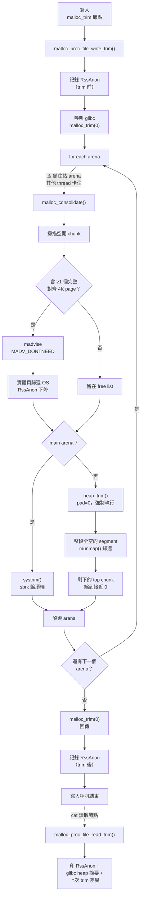
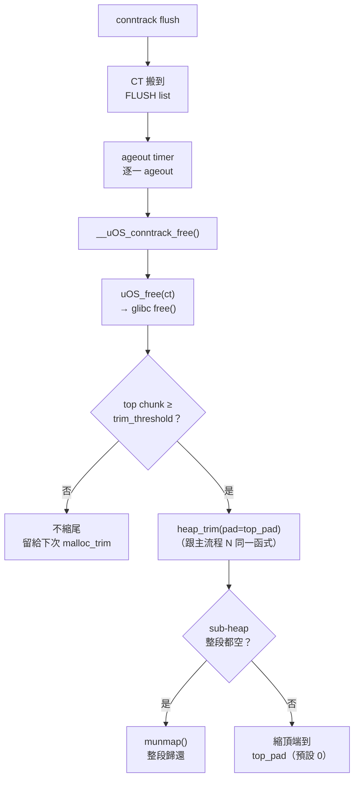
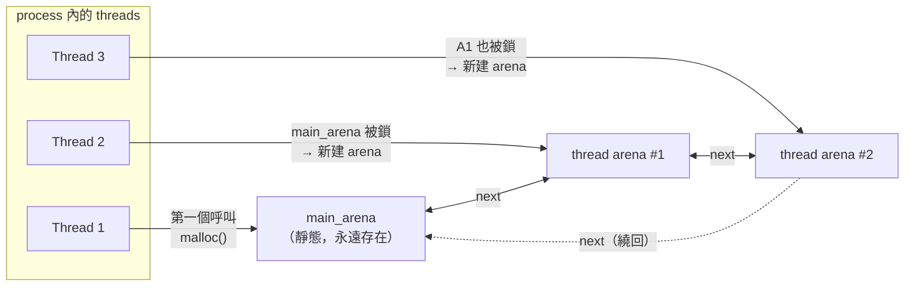
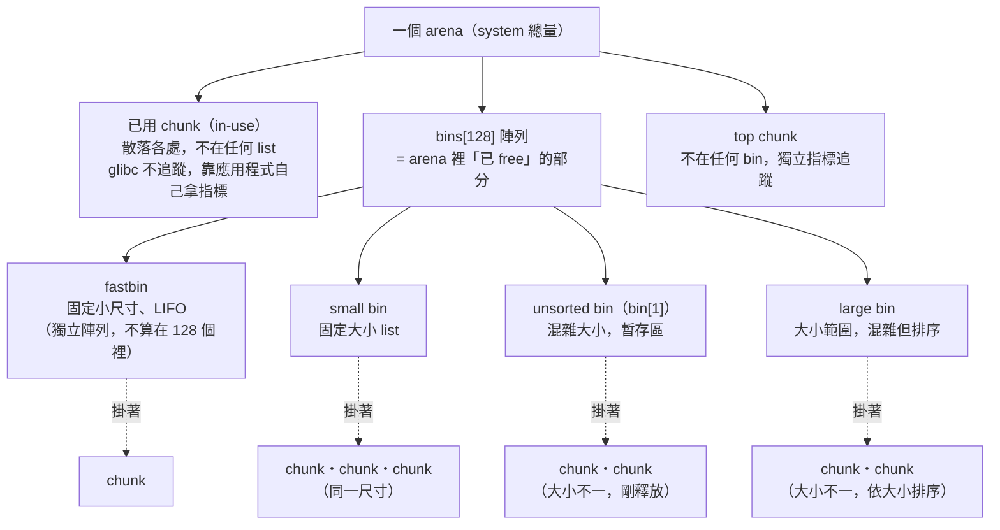
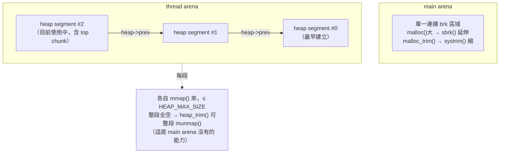
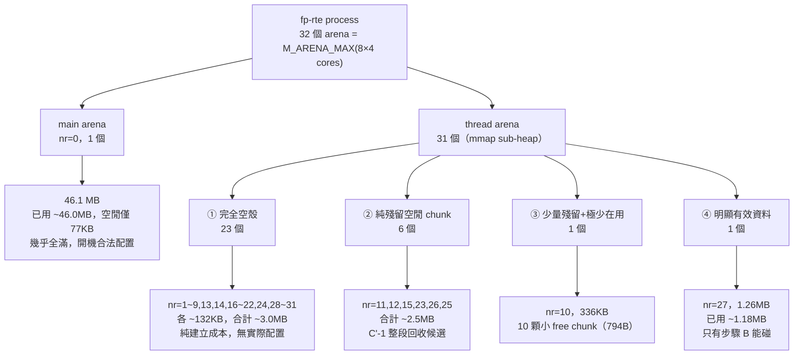
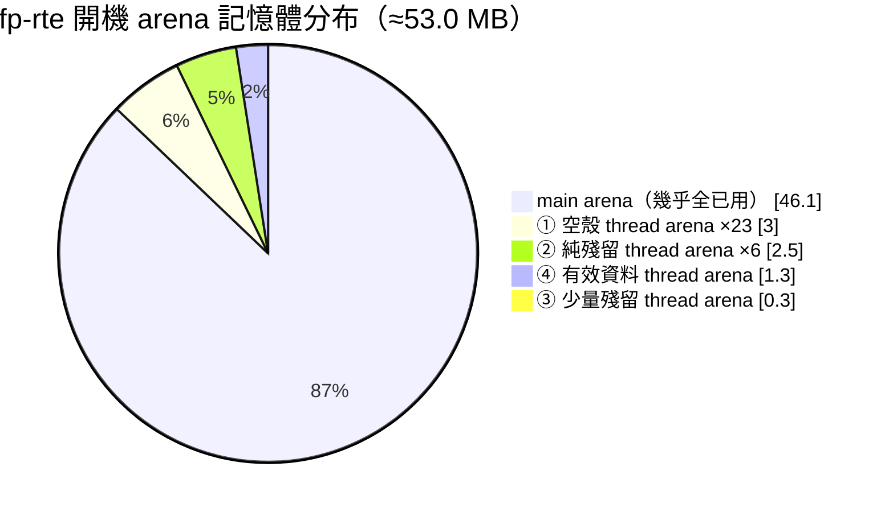

# glibc malloc_trim 對 conntrack fallback fragmentation 的修改評估

> **狀態**：分析評估，尚未實作。部分結論（見「malloc_trim 有效性分析」）目前只有機制層級推論，缺實機數字，文件內已明確標註。

## 問題描述

現場對 fp-rte 做百萬 conntrack 壓力測試，process RSS 逼近 3GB；測試結束、連線全部 ageout 之後，RSS **不會**降回去。

已確認：測試後 `/uOS_proc/memory/malloc_stats` 的 `CONNTRACK` 欄位會掉回接近 0——CT entry 本身確實有被邏輯上釋放，**不是物件層級的洩漏**。問題出在「已釋放的記憶體沒有還給 OS」。

**修復要求**（兩條需同時成立）：

1. Idle RSS 必須維持低——不能用「開機就固定多吃一塊記憶體換取曲線變平」的方式解決。
2. 壓測後 RSS 要能真正回落到接近 idle 值。

### ⚠️ 產品線範圍確認：實際問題發生在 `usg310v3`

**已確認**：實際回報這個問題的裝置是 `usg310v3`，不是本文件先前引用程式碼位置時所在的 `usg110v3`（後者是本 repo `product/` 目錄下唯一存在的產品線，先前只是拿它當唯一可查的參考）。已跟回報者確認：

- **`usg110v3` 與 `usg310v3` 是同一份 source code**——本文件所有程式碼層級的發現（拆除路徑完整性、ageout timer 機制、`uOS_malloc()` header 大小、glibc arena 行為）**直接適用**，不需要針對 `usg310v3` 重新查證。
- **記憶體設定相同**——`FP_MEMORY`/`EXT_MEMORY` hugepage 預算與「已否決方案」段落算出的 hugepage 成本表，也可視為對 `usg310v3` 同樣成立。
- **部分「rules 支援數量」不同**——這是兩條產品線唯一已知的差異來源，**但尚未確認 `uOS_CONNTRACK_MAX`（`ZLDSYSPARM_MAX_CONN_SESSION`）是否是其中之一**。這個數字是本文件下方「CT entry 記憶體足跡」整段算術（slab 250,000、fallback 750,000、~1.03GB 理論值）的唯一基礎——下面列的 `1,000,000` 是查 `product/usg110v3/zld-spec.h` 得到的值，**尚未在 `usg310v3` 上確認是否相同**。

**待確認**：直接在 `usg310v3` 實機讀 `/uOS_proc/conntrack/conntrack_max`（已列在「現場資料蒐集清單」的 `ct/max`）即可確認，不需要找 `usg310v3` 的 `zld-spec.h`。若數字不是 `1,000,000`，下方「CT entry 記憶體足跡」與「已否決方案」的 hugepage 成本表全部要按比例重算。

---

## 已確認事實

### CT entry 記憶體足跡

- `sizeof(uOS_conntrack_t)` ≈ 960B（`fp/fp-modules/zyxel-uOS/common/zyxel-uOS-conntrack.h:501-555`）。內嵌的 `ext` 子結構（544B：UTM/NAT/helper/seqadj 狀態）是**固定大小內嵌**，不是動態配置——`zyxel-uOS-conntrack-extend.c`／`-extend-zyxel.c` 完全沒有 allocator 呼叫。
- Conntrack slab（`uOS_slab_create("uOS_conntrack_cache", sizeof(uOS_conntrack_t), uOS_CONNTRACK_MAX/4)`，`fp/fp-modules/zyxel-uOS/dataplane/zyxel-uOS-conntrack.c:2114`）覆蓋前 25%（250,000 筆，`uOS_CONNTRACK_MAX` = `ZLDSYSPARM_MAX_CONN_SESSION` = 1,000,000，`conntrack.c:197`，**查自 `product/usg110v3/zld-spec.h`，尚未在實際發生問題的 `usg310v3` 上確認是否相同，見上方「產品線範圍確認」**）。
- 超出 slab 容量的連線（以 `usg110v3` 的 1,000,000 為例是 750,000 筆）落入 `uOS_zalloc(sizeof(uOS_conntrack_t), uOS_MALLOC_TYPE_CONNTRACK)`——即一般 glibc `malloc()`（`uOS_conntrack_alloc()`，`conntrack.c:334-373`）。
- `uOS_malloc()` 的實際 per-allocation overhead 是 **40B header + 8B footer = 48B**（header 內 `rcu_head` 是 24B：`uOS_mpscq_node` 8B + `jiffies_stamp` 8B + `func` 8B，見 `common/zyxel-uOS-infra-rcu.h:79-83`；已據此修正 `docs/uOS_memory_usage.md` 先前誤寫的 24B+8B=32B）。
- 以 `usg110v3` 的 1,000,000 連線上限估算，CT 理論記憶體總量 ≈ **1.03GB**（slab 256MB + fallback 768MB + hash DB ≈4MB），**無法解釋觀察到的 ~3GB RSS**，中間有 ~2GB 缺口尚未定位（詳見下方「未解事項」）——若 `usg310v3` 的實際上限不同，這組數字要按比例重算。

### 拆除路徑完整性（teardown 完整、非洩漏）

- `uOS_conntrack_l4proto_ageout_timer()`（`fp/fp-modules/zyxel-uOS/dataplane/zyxel-uOS-conntrack-proto.c:465-537`）是**唯一**真正釋放已 confirm 連線的路徑。`uOS_conntrack_release_check()`（`common/zyxel-uOS-conntrack.h:729-740`）只要 `ct->ageout_list` 非空就拒絕釋放並重新持有引用，確保沒有 bypass；`uOS_conntrack_kill()`／flush 都只是搬去 DROP/FLUSH list，不會繞過 reaper。
- `uOS_conntrack_count`／`uOS_conntrack_db_count` 在唯一的釋放函式（`__uOS_conntrack_free()`，`conntrack.c:958-973`）內正確遞減，未發現任何 bypass 路徑。
- **Batch 上限不是瓶頸**：`uOS_CONNTRACK_AGEOUT_MAX_BATCH = 5000`（`conntrack-proto.c:467`），但每次呼叫只處理一個 state list、1ms 重掛一次；TCP（15 states）理論上限約 333k entries/s，UDP（6 states）約 833k entries/s——1,000,000 筆連線退場是秒級，不是卡住還沒退完。
- **Timer 是時間驅動、非封包驅動**：`uOS_drain_process` 是 DPDK mainloop callback，每圈都跑，跟有沒有收到封包無關——流量停止後 idle 機器仍會正常 ageout（`docs/uOS-fp-ageout.md:127-209` 佐證）。

**結論**：CT 記憶體確實被正確、即時釋放，問題落在「已釋放的記憶體有沒有被主動 trim 還給 OS」——glibc 不會自動把已釋放的記憶體立刻還給 OS，需要靠 `malloc_trim()`（自動或手動觸發）才會發生。這不等於「fragmentation 讓 trim 收不回來」，詳細機制與修正後的回收率預期見下方「`malloc_trim` 機制與本情境下的有效性分析」；`docs/uOS_memory_usage.md` 對應段落已同步修正。

### 未解事項：~2GB 記憶體缺口

CT entry 理論值只有 ~1GB，跟觀察到的 ~3GB RSS 有落差，尚未實機定位這個缺口的性質。候選解釋：

- **開機固定 baseline**：DPDK mbuf pool／`FP_MEMORY`/`EXT_MEMORY` 換算出的 hugepage 保留量，這部分本來就不會、也不應該隨測試結束而下降，不屬於本文件要修的異常。
- **其他 `uOS_MALLOC_TYPE_*` 也在漲又沒退回去**：例如啟用中的 UTM per-CT session 物件（`BWM`、`ANTI_MALWARE`/`SANDBOX`、`APP_PATROL`、`CONTENT_FILTER`、`DEVICE_INSIGHT`、`IPS`、`IP_REPUTATION`、`DNS_FILTER`、`SSL_INSPECTION`、`PKT_REORDER`、`DOS_PREVENTION` 等，每個模組都有自己專屬的 `uOS_MALLOC_TYPE_*`，可用 `/uOS_proc/memory/malloc_stats_detail` 或 `peak/{type}`／`current/{type}` 逐一排查）——若屬於這類，需要另開後續調查，不在本文件的修復範圍內。

本文件後續分析聚焦在已確認屬於 CONNTRACK type 的 fragmentation 問題；~2GB 缺口需要另外的實機診斷來歸類（見「驗證方法」）。

---

## 已否決方案：放大 conntrack DPDK hugepage slab

技術上可行的一個方向是把 `conntrack.c:2114` 的 `uOS_CONNTRACK_MAX/4` 放大，讓更多／全部連線留在 hugepage slab，避開 glibc fallback：

| 目標 slab 大小 | 額外 hugepage 成本 |
|---|---|
| `MAX/2`（500,000） | ≈ +300MB |
| `MAX`（1,000,000，完全消除 fallback） | ≈ +860MB（+430 頁） |

**否決理由**：`uOS_slab_create()` 底層是固定容量的 `rte_mempool_create()`（`common/zyxel-uOS-infra-env.h:205-224`），開機一次 `populate`、**沒有任何縮小機制**——建立失敗還會直接 `uOS_panic()`（`:213-216`），是硬開機失敗，非優雅降級。放大這個 slab 只會把 **idle RSS floor 永久墊高到接近原本的 peak**，不管放大多少都一樣：這是 hugepage mempool 這個機制類別本身的限制，不是量的問題，直接違反「idle RSS 必須維持低」的要求。

**與既有提案的區分**：`docs/uOS-fastpath-performance.md` Tier 1.10「slab 分階段放大」已經獨立提出放大同一個 slab，但動機是 **CPU cache 局部性**（避開 glibc malloc 的全域鎖與 TLB miss），不是 RSS 回收。兩者結論衝突——Tier 1.10 若要推進，執行者需要知道它會讓 idle RSS 墊高，這點在本文件否決放大 slab 的脈絡下必須清楚區分，避免後續有人誤把兩份分析合流。

---

## `malloc_trim` 機制與本情境下的有效性分析

`/uOS_proc/memory/malloc_trim`（`fp/fp-modules/zyxel-uOS/dataplane/zyxel-uOS-infra-malloc.c:591-640`）讀取回報 `RssAnon` 前後差異與 glibc heap 摘要，寫入（任意內容）觸發 glibc `malloc_trim(0)`。這是整個 repo 唯一呼叫 `malloc_trim()` 的地方，**目前完全沒有自動／週期性觸發**。

### 回收機制流程圖



節點對應的原始碼位置：`A`→`/uOS_proc/memory/malloc_trim`、`B`/`T`→`infra-malloc.c:591-617`／`:619-640`、`F`鎖 arena 的說明見 `infra-malloc.c:586-589`。glibc heap 摘要欄位（Total/Alloc/Free/Arena/Arena max/Mmap size）trim 前後不會變，見下方「機制限制」。**`N`/`N2`/`N3`（thread arena 的 `heap_trim()`）是這張圖第二次修正的地方**：先前版本誤以為 thread arena 的 top chunk 完全不受 `malloc_trim()` 處理，實際上 `heap_trim()` 會被無條件呼叫，效果跟 main arena 的 `systrim()` 對等，見下方「機制限制」。

**旁支流程**（不是 `malloc_trim()` 做的，但會影響「trim 前」這個量測起點，容易被誤會成 trim 的功勞——量測時建議在 flush 後、trim 前先拍一張快照，把這段自動釋放的量跟 trim 本身的貢獻分開看，見「驗證方法」第 1 節）：



節點對應的原始碼位置：`A2`→`uOS_conntrack_flush_all()`（`conntrack.c:1250-1290`）、`D2`→`conntrack.c:958-973`。`F2`/`G2` 是 `_int_free()` 尾端自動觸發的邏輯，跟主流程 `N`/`N2`/`N3` 呼叫的**是同一個 `heap_trim()` 函式**，差別只在觸發條件：這裡受 `trim_threshold`（動態門檻，最高可拉高到 64MB／arena）閘控，主流程的顯式 `malloc_trim(0)` 呼叫則完全不受這個閘控，直接以 `pad=0` 強制執行。

判讀重點：流程圖裡只有 `MADV_DONTNEED` 那個節點、以及 `N2`/`I2`（segment munmap）、`N3`/`J2`（top chunk 縮尾）這些節點會讓 **RssAnon 下降**，是唯一該看的指標；「glibc heap 摘要」那個節點無論 trim 前後都不會變，因為 `madvise`/`munmap` 只影響實體頁，不改變 glibc 對虛擬位址範圍的記帳。真正收不回來的是「跟存活物件共用同一頁、或共用同一個 heap segment」的那部分，對應下一節「`malloc_trim(0)` 詳細執行流程」的說明。

### `malloc_trim(0)` 詳細執行流程

本節把上面流程圖的每個節點展開到虛擬碼層級。機制來自 glibc ptmalloc（`malloc/malloc.c`、`malloc/arena.c`），已對照 `usg310v3` 確認的 glibc 2.27 行為核對過。

#### 架構總覽：glibc arena 架構圖

進入虛擬碼之前，先看三張圖建立整體架構背景。

**① Thread 如何被分配到 arena（懶惰建立 + 環狀鏈結）**



每個 arena 都有一把鎖，thread 找 arena 是「找一個沒被鎖的」，不是固定分配；建到 `M_ARENA_MAX`（64-bit 預設 `8×ncpus`）之後就不再新建，後面的 thread 只能排隊等現有 arena 解鎖。第 0 層虛擬碼裡 `__malloc_trim()` 走的就是這條 `next` 鏈，從 `main_arena` 開始繞一圈回到自己。

**② 單一 arena 內部結構（已用 chunk + bins + top chunk）**



**arena = 已用 chunk + bin（已 free 的集合）+ top chunk 三者的總和**，`system` 量的是三者加起來的大小。bin 只是「arena 裡已 free 那部分」的索引，不是 arena 本身，更不包含已用的部分——已用 chunk 完全不在任何 bin 裡，glibc 不維護一份「已用 chunk 清單」，唯一的追蹤方式是下方「`PREV_INUSE` bit」這個機制。只有 fastbin／small bin 保證同一個 bin 裡的 chunk 大小一致，unsorted bin／large bin 都是混雜大小；步驟 B 只掃 unsorted bin 跟 large bin，理由見下方虛擬碼。

#### `PREV_INUSE` bit：chunk 如何得知自己是不是 free

bin 本身不用「判斷」，它就是答案本身——`free()` 明確把 chunk 插進對應的 bin，`malloc()` 重用時明確把它摘出來，**一顆 chunk 在不在某個 bin 的串列裡，本身就是「它是不是 free」的定義**，不需要另外查詢。真正有趣的是另一個問題：**任意給一顆 chunk，怎麼知道它是不是 free？** glibc 不會在 chunk 自己的 header 裡存「我是不是 free」這個 flag，而是用一個經典技巧——把這個資訊存在**下一顆** chunk 的 header 裡，叫 `PREV_INUSE` bit。

```
chunk P（不管是 free 還是 in-use）
┌───────────────────────────────┐
│ prev_size（只有前一顆是 free 時才有效） │
├───────────────────────────────┤
│ size | flags（最低 3 bit）        │  ← 這裡的最低 bit 是 PREV_INUSE
├───────────────────────────────┤
│         P 的資料區               │
└───────────────────────────────┘
chunk Q（緊接在 P 後面）
┌───────────────────────────────┐
│ prev_size（只有 P 是 free 時才有效） │
├───────────────────────────────┤
│ size | flags                    │  ← 這個 PREV_INUSE bit 記的是「P」在不在用
├───────────────────────────────┤
│         Q 的資料區               │
└───────────────────────────────┘
```

**Q 的 `size` 欄位最低那個 bit（`PREV_INUSE`），記的不是 Q 自己，是它前一顆（P）在不在使用中**。要問「P 是不是 free」，不是看 P 自己的 header，而是看**它後面那顆 chunk（Q）**的 header。

**為什麼要這樣設計**：如果每顆 chunk 都要自己存一個「我是不是 free」的 flag，等於白白浪費空間——不如把「是不是 free」這件事直接靠「有沒有出現在某個 bin 的串列裡」代表，header 完全不需要另外存這個狀態。省下來的這個 bit，轉而拿去記「前一顆在不在用」，讓合併相鄰空閒 chunk（coalescing）時不用額外查前一顆的狀態，直接看自己的 `PREV_INUSE` bit 就知道能不能往前併。

**`prev_size` 欄位**：只有在前一顆（P）是 free 的時候才有效——因為如果 P 是 free，glibc 需要知道「P 從哪裡開始」才能把它從 bin 裡摘出來、跟 Q 合併；如果 P 是 in-use，這塊空間其實是 P 自己的資料區在用，這個欄位的值沒有意義、也不能被讀取。

**合併（coalesce）時的運作**：`free(Q)` 的時候，glibc 會：
1. 看 Q 自己 `size` 的 `PREV_INUSE` bit → 知道 P 是不是 free → 是的話，用 Q 的 `prev_size` 找到 P 的起點，跟 P 合併。
2. 看 Q 後面那顆（R）的 `PREV_INUSE` bit（透過 `chunksize(Q)` 算出 R 的位置去讀）→ 知道 Q 自己是不是能往後併 → 是的話跟 R 合併。
3. 合併完的新 chunk，依最終大小 `insert` 進對應的 bin（unsorted bin，之後步驟 A/B 再依大小重新分類）。

這套「查下一顆的 bit 判斷自己、查自己的 bit 判斷前一顆」的機制，正是為什麼一顆 chunk 光看自己的 header 判斷不出自己是不是 free——free 與否是「它有沒有被登記在某個 bin 的串列裡」決定的，`PREV_INUSE` bit 記的只是**前一顆**的狀態。

**③ main arena vs thread arena 的底層記憶體來源（兩者唯一的本質差異）**



main arena 用 `brk`，是單一連續區域，只能從頂端縮（`systrim()`）；thread arena 用 `mmap()`，可能由多段 segment 串接（`heap->prev` 鏈），`heap_trim()` 除了縮頂端，還能把中間完全空掉的 segment**整段** `munmap()`——這是 thread arena 特有、main arena 沒有的回收路徑，對應下方步驟 C' 的虛擬碼。

#### 第 0 層：`malloc_trim(pad)` → `__malloc_trim(pad)`

```c
int __malloc_trim(size_t s) {
    mstate ar_ptr = &main_arena;
    do {
        lock(ar_ptr->mutex);
        result |= mtrim(ar_ptr, s);      // s = 呼叫時傳入的 pad，這裡是 0
        unlock(ar_ptr->mutex);
        ar_ptr = ar_ptr->next;           // 走 arena 的環狀 linked list
    } while (ar_ptr != &main_arena);
    return result;
}
```

- 走訪的是「目前已經被建立過的 arena」環狀鏈結串列（從 `main_arena` 開始，`next` 一路串起所有 thread arena，繞回 `main_arena` 結束），不是 `M_ARENA_MAX` 這個上限值——沒被用過的 arena 根本不存在，不會出現在鏈結裡。
- 每個 arena **逐一**上鎖、處理、解鎖，不是全域一次鎖死（但單一 arena 被鎖住那段時間，任何 thread 只要 `malloc`/`free` 剛好落在這個 arena 上，就會卡住，對應 `infra-malloc.c:586-589` 的註解，即流程圖 `E` 節點旁的警告標籤）。

#### 第 1 層：`mtrim(av, pad)` ── 對單一 arena 做的事

```c
static int mtrim(mstate av, size_t pad) {
    malloc_consolidate(av);                     // 步驟 A（流程圖節點 F）

    for (i = 1; i < NBINS; ++i)                  // 步驟 B（流程圖節點 G/H/I/J/K）
        if (i == 1 || i >= psindex)
            對 bin[i] 裡每個空閒 chunk 做「頁對齊 madvise」;

    return result | (av == &main_arena
        ? systrim(pad, av)                       // 步驟 C（流程圖節點 M）
        : heap_trim(heap_for_ptr(top(av)), pad)); // 步驟 C'（流程圖節點 N/N2/N3）
}
```

**步驟 A ── `malloc_consolidate(av)`**

把 fastbin（小物件釋放後暫存的 LIFO cache，不會立刻跟鄰居合併）裡的所有 chunk 掃出來，跟前後相鄰的空閒 chunk 合併，結果丟進 unsorted bin。這一步是必要前置作業——如果不做，剛釋放不久、還躺在 fastbin 裡的小 chunk 永遠不會被步驟 B 檢查到，也就沒機會合併出一整頁。

**步驟 B ── 逐 bin 掃描、頁對齊 `madvise`**

```c
for (i = 1; i < NBINS; ++i)
    if (i == 1 || i >= psindex)          // 只查 unsorted bin(1) 與「size ≥ 1 page」的 large bin
        for each free chunk p in bin[i]:
            paligned_mem = 把 p 的可用記憶體起點無條件進位到下一個 4K 邊界;
            trimmable = (p + chunksize(p)) - paligned_mem;   // 對齊後剩多少
            trimmable 向下取整到 4K 的倍數;
            if (trimmable ≥ 1 page)
                madvise(paligned_mem, trimmable, MADV_DONTNEED);
```

- 只查 unsorted bin 和「size ≥ 一頁」的 large bin，**跳過所有 small bin**——small bin 的 chunk 大小是固定的小尺寸類別，單一 chunk 本身就不可能大到含一整頁，查了也白查，這是純粹的效能捷徑。
- 對每個候選 chunk，計算它裡面「從下一個 4K 邊界開始，到 chunk 結尾」還剩幾個完整頁——不是整個 chunk 都要空，只要**其中一段**是頁對齊的，就切那一段做 `madvise`。
- `MADV_DONTNEED` 只是告訴核心「這段虛擬位址目前沒有有意義的內容，對應的實體頁可以直接丟棄」——chunk 本身還留在 unsorted/large bin 裡（結構沒變、虛擬位址沒變），下次 `malloc()` 要用到這塊時，核心會用 0 重新分配實體頁（page fault 進 zero page 再 COW），不需要 glibc 做任何額外處理。

**步驟 C（main arena）── `systrim(pad, av)`**

用 `sbrk(-(top_size - pad))` 直接把 `brk` 邊界往回收，heap 頂端那段記憶體被真正 `munmap`（核心層級）歸還給 OS。

**步驟 C'（thread arena）── `heap_trim(heap, pad)`**

```c
static int heap_trim(heap_info *heap, size_t pad) {
    // C'-1：整段回收（backward walk，流程圖節點 N2）
    while (top_chunk 剛好等於這個 heap segment 扣掉 header 後的起點) {
        // 代表這整段 segment 除了 top chunk 沒有任何存活物件
        prev_heap = heap->prev;
        if (退到上一段後空間還是不夠 pad) break;
        munmap(heap, heap->size);         // 整段 segment 直接還給 OS
        heap = prev_heap;
        把 arena 的 top 指標接到 prev_heap 的 top chunk；
    }

    // C'-2：頂端縮尾（流程圖節點 N3，跟 systrim 同效果、換一種系統呼叫實作）
    extra = (現在的 top chunk 大小 - pad) 向下取整到 4K;
    if (extra < 1 page) return 0;
    shrink_heap(heap, extra);   // munmap 掉這段 segment 尾端 extra bytes
    更新 top chunk 的大小;
    return 1;
}
```

- **C'-1**：只要「目前 arena 用的 heap segment，除了 top chunk 以外完全沒有任何存活物件」，就把整段 segment（最大到 `HEAP_MAX_SIZE`，64-bit 上通常是 64MB 上限，但實際段大小是按需成長、不一定頂到上限）直接 `munmap()` 還給 OS，然後退到上一個 segment 繼續檢查——這是**整段**歸還，不只是縮尾端。
- **C'-2**：不管上面那個迴圈有沒有觸發，最後都會對「現在的 top chunk」做跟 `systrim` 同等效果的縮尾動作——用 `munmap()` 砍掉 segment 尾端多出來的頁，把 top chunk 縮到只剩 `pad` 大小（這裡是 0，所以縮到最小）。**這一步跟 main arena 的 `systrim()` 是對等的，thread arena 一樣有**，只是實作手段從 `sbrk` 換成對 mmap 段做 `munmap`。

#### 自動觸發 vs 顯式呼叫的關鍵差異

`pad` 這個參數是整個機制的關鍵：

| 觸發方式 | 呼叫的 `pad` 值 | 受不受 `trim_threshold` 限制？ | 對應圖上節點 |
|---|---|---|---|
| 一般 `free()` 內建自動觸發（`_int_free()` 尾端） | `mp_.top_pad`（預設 0） | **受限制**——只有 top chunk 大小 ≥ 動態 `trim_threshold`（最高可漲到 64MB）才會觸發這次縮尾 | 旁支流程圖 `F2`/`G2` |
| 顯式呼叫 `malloc_trim(0)`（寫 `/uOS_proc/memory/malloc_trim`） | 呼叫者傳入的 `0` | **完全不受限制**——直接、無條件對每個 arena 的 top chunk 做縮尾/整段回收 | 主流程圖 `N`/`N2`/`N3` |

`trim_threshold` 被動態拉高到 64MB，只會讓「connection 建立/釋放過程中，glibc 自己順手做的縮尾」變懶，**不會**影響手動寫入 `/uOS_proc/memory/malloc_trim` 的效果——手動觸發時，所有 arena 的 top chunk 都會被強制縮到接近 0，跟 `trim_threshold` 目前被拉到多高無關。

程式碼註解也明講：trim 會走訪並鎖住每個 arena 的每個 bin，執行期間會讓其他 thread 的 `uOS_malloc()`/`uOS_free()` 短暫卡住（`infra-malloc.c:586-589`），因此刻意設計成「寫入才觸發」而非讀取時順便觸發。

**已確認一個資料點**：`usg310v3`（buildroot 輸出，`.../output_usg310v3/target/usr/lib/libc.so.6`，`strings ... | grep "GNU C Library"` 得到 **`stable release version 2.27`**）；`usg110v3` 實際用哪個 glibc 版本尚未確認，但因為以上「逐 arena trim」與 `heap_trim()` 都是 glibc ptmalloc 長期存在的行為（不是近幾個版本才加的），版本差異對本文件的結論已不構成影響，這裡僅供背景參考。

### 機制限制小結（第二次修正：先前版本誤判 thread arena 的處理方式）

先前兩個版本都誤判成「thread arena 沒有對應機制、top chunk 完全不受 `malloc_trim()` 處理」——完整的正確機制見上方「`malloc_trim(0)` 詳細執行流程」。一句話總結：**`malloc_trim()` 對所有 arena 的頁對齊空閒區有效（不限頂端），而且顯式呼叫時每個 arena 的 top chunk 與整段清空的 heap segment 都會被無條件強制回收，不受 `trim_threshold` 限制**——不是「main arena 才有、thread arena 沒有」的差異，也不是被 `trim_threshold` 卡住。

### 為何這個情境沒有想像中悲觀（第二次修正：先前版本高估了殘留量）

`uOS_MALLOC_TYPE_CONNTRACK` fallback 物件的配置／釋放順序取決於流量到達順序、跟它們在 heap 上的實際位址無關，等同**隨機順序** churn。但如上一節澄清，`malloc_trim()` 對 heap 中段的頁對齊空洞一樣有效，而且顯式呼叫時**每個 arena 的 top chunk 與整段清空的 heap segment 也都會被強制收回，不受 `trim_threshold` 限制**——這兩點合起來，收不回來的只剩「跟存活物件共用同一頁、或共用同一個 heap segment」的那部分。

一個物件約 1KB、一頁 4KB 可放 4 筆，只要同一頁的 4 筆不是同時存活/同時死亡，那一頁就收不回來；heap segment 層級同理（segment 通常遠大於一頁，只要裡面還有 1 個存活物件，整段就不能整段 `munmap()`，但仍能享受到「頂端縮尾」那部分）。真正決定回收率的是釋放完成後還剩多少筆物件存活、以及它們落在哪些 page/segment——這個分佈由流量順序決定，只能靠實機量測，不能只憑程式碼分析定論。另外兩個會造成殘留的獨立因素：(1) THP 的 deferred split／khugepaged re-collapse；(2) 「trim 前 CT 還沒真正釋放完」造成的時間點誤差（詳見「驗證方法」）。fp-rte 是多執行緒 process，`uOS_zalloc(..., uOS_MALLOC_TYPE_CONNTRACK)` 的呼叫依 `M_ARENA_MAX`（64-bit 預設 `8×ncpus`，本 repo 未覆寫）分散到多個 thread arena；這個分佈只影響「有多少個 arena 各自殘留多少存活物件」，不影響「頁層級／segment 層級的強制回收」是否生效——後者不論 arena 分佈如何都成立。

### 實機驗證狀態（⚠️ 分析結論，已再次下修先前的悲觀預測；仍缺實機數字）

根據修正後的機制分析，**`malloc_trim(0)` 預期能收回 CT fallback 記憶體的絕大部分**——不只是頁對齊空洞，thread arena 的 top chunk 與整段清空的 heap segment 也會被強制歸還，不受 `trim_threshold` 限制。真正收不回來的只剩「跟存活物件共用同一頁/同一 segment」的殘留，以及 THP 的干擾（見「驗證方法」第 3 節）。但這個判斷仍只有機制層級推論支持，**尚未取得實機的 `malloc_trim` 回收率數字**——診斷方法已設計好（見「驗證方法」）。若實機數字顯示回收率明顯偏低，代表存活物件比例、或 THP re-collapse 的影響比預期高，應以實機數字為準重新檢視，而非直接歸咎於「glibc 沒有 compaction」或「thread arena 收不到」這類已經排除的過度簡化解釋。

---

## 候選修改方案評估

### 方案 A（輕量，本文件建議優先驗證的方向）：idle 觸發 trim

不改變分配方式，改成偵測到「conntrack 已從高點退回 idle」時，由 control-plane 主動觸發一次 trim。兩種實作路線：

1. **包裝現有節點**：control-plane 背景執行緒偵測 `conntrack_count` 低於門檻一段時間後，自己寫入 `/uOS_proc/memory/malloc_trim`（等同現在「人工手動寫入」的邏輯，改成自動觸發）。
2. **`GLIBC_TUNABLES=glibc.malloc.trim_threshold=<值>`（或 `mallopt(M_TRIM_THRESHOLD, ...)`）**：讓 glibc 在每次符合條件的 `free()` 後自動就地 trim，不用寫任何偵測邏輯。零程式碼（用啟動環境變數即可測試），但**會關閉 glibc 內建的動態門檻自動調整**（`M_TRIM_THRESHOLD`／`M_MMAP_THRESHOLD` 兩個門檻互相耦合，動一個兩個的動態調整都失效），且是**全 process 生效**，不只影響 `CONNTRACK` type，需要一併觀察對其他 `uOS_malloc()` type 有沒有副作用；另需確認目標 toolchain 的 glibc 版本是否 ≥ 2.25/2.26（tunables 框架的最低需求）。

**前提**：兩種實作方式底層都是同一個 `malloc_trim()`／`mtrim()` 機制，**是否可行取決於實際回收率**——見上一節，修正後的機制分析預期效果不差（不只頁對齊空洞，thread arena 的 top chunk 與整段清空的 segment 也會被強制收回），但仍待實機數字確認。

**風險**：trim 會鎖住所有 arena，觸發時機必須避開封包路徑，只能在確認系統 idle、且不在 dataplane 熱路徑上觸發。

### 方案 B（重量，備援方向——僅在實機數字證明方案 A 回收率不足時才需要）：自建可縮小分配器

幫 `uOS_MALLOC_TYPE_CONNTRACK` fallback 這條路徑自建一個**可成長也可縮小**的分配器——例如以 `mmap()`／`fpn_malloc_socket()` 固定大小 chunk 為單位、chunk 內用簡單 free-list 管理物件，整個 chunk 空了就整塊 `munmap()`／歸還，而不是逐筆 malloc/free 讓 glibc 自己管理。

**優點**：不依賴 glibc 的 arena 行為，能保證已清空的 chunk 真的還給 OS——直接解決「grow under load、真正 shrink at idle」的需求，跟已否決的固定容量 hugepage slab 方案不同。

**風險點**（只指出問題，具體 API 設計留給後續專門的設計文件）：

- **與現有 `uOS_free()`/`uOS_free_rcu()` 巨集的相容性**：這兩個巨集（`common/zyxel-uOS-infra-malloc2.h:51-82`）靠 header 裡的 magic number（`uOS_MALLOC_MAGIC_PRE`/`POST`）分辨物件是否合法，且 free 時會把兩個 magic 改成 `0xDEADBEEF...` 做 double-free 偵測。換一套分配器，要嘛讓新分配器的物件也塞得進同一個 header 格式以相容既有巨集，要嘛整條 CONNTRACK fallback 路徑改用專屬的 alloc/free API——後者需要修改 `conntrack.c:958-973` 現有 `ct->malloc_type` 分派邏輯，以及所有呼叫 `uOS_zalloc(..., uOS_MALLOC_TYPE_CONNTRACK)` 的地方（目前只有 `conntrack.c:349` 這一處配置路徑，但要確認沒有遺漏）。
- **「整個 chunk 何時判定為空、可以安全歸還」的時機設計**：需要追蹤 chunk 內物件的存活計數，並且跟 CT entry 本身已經走 `uOS_call_rcu()` deferred free 的生命週期疊加時，要避免產生新的 UAF 風險——chunk 歸還（`munmap`）的時機必須晚於該 chunk 內所有物件的 RCU grace period 都已完成。

**工作量與風險評級**：明顯高於方案 A，等同新增一個記憶體管理子系統，需要獨立的設計文件與測試計畫。

---

## 建議與待確認事項

**建議**：根據修正後的機制分析，**方案 A（輕量）預期能收回 CT fallback 記憶體的絕大部分**，建議優先做方案 A，並在投入方案 B 的詳細設計前，先用下方「驗證方法」跑一輪實機診斷，確認：

1. `malloc_trim` 的實際回收率（決定性數字，若實機數字證明回收率確實偏低，才需要轉向評估方案 B）。
2. ~2GB 記憶體缺口的歸類（若缺口主要來自其他 UTM type 的洩漏，修復範圍需要擴大，不能只處理 CONNTRACK）。
3. ageout timer 是否有綁錯核心導致「幾乎不跑」的風險（若存在，這是更優先的獨立 bug，需要先修才能重新評估後續分析）。

以上三項互相獨立，都需要實機資料才能收斂，但不影響本文件先給出方向性建議。

---

## 驗證方法（可直接在實機執行，零程式碼改動）

### 1. `malloc_trim` 回收率（決定性測試）

在壓測結束、`conntrack_count` 已確認掉到 <1000 且 `malloc_stats_detail` 的 `CONNTRACK` 欄位已回到基準值附近之後：

```sh
NS="nsenter -t $(pidof fp-rte) -m --"
$NS cat  /uOS_proc/memory/malloc_trim          # 記錄「trim 前」
$NS sh -c 'echo 1 > /uOS_proc/memory/malloc_trim'
$NS cat  /uOS_proc/memory/malloc_trim          # 節點自己回報 RssAnon 前後差異、耗時
```

| 結果 | 判讀 |
|---|---|
| `conntrack_count` 此時仍不接近 0 | 拆除路徑在實機上沒有真正跑完，跟本文件的程式碼層級分析矛盾，需要重新開調查 |
| RssAnon 大幅下降（數百 MB 等級） | 符合修正後的機制預期，方案 A 可行 |
| RssAnon 幾乎沒變化 | **不能只看 `Arena size`/`Alloc size` 判讀**——`MADV_DONTNEED` 過的頁在 glibc 眼中仍算 arena 的一部分，trim 後這兩個數字本來就不會降，只有 RssAnon 是真正指標。若 RssAnon 確實沒降，先排除「trim 前 CT 還沒真正釋放完」「THP khugepaged 在量測期間把頁 re-collapse 回去」這兩個常見原因（見下方第 3 節 THP 檢查步驟），排除後才考慮走方案 B |

**⚠️ 判讀時的常見陷阱**：`glibc_malloc_info`／`malloc_stats_detail` 印出的 `Arena size`／`Free size` 是 glibc 對該記憶體範圍「是否仍屬於某個 arena」的記帳，不是「是否仍佔用實體記憶體（RSS）」。`madvise(MADV_DONTNEED)` 只是告訴核心「這塊虛擬位址目前沒有有意義的內容、可以直接丟棄對應的實體頁」，虛擬位址範圍本身（因此 arena 的記帳）完全不受影響——這正是 trim 為什麼能重複執行、且不需要 `munmap`／改變 heap 佈局就生效的原因。判斷 trim 是否有效，**只能看 `RssAnon`（或 `/proc/<pid>/smaps_rollup` 的 `Rss`）**，不能看 `Arena size`/`Alloc size`/`Free size` 這幾個欄位。

### 2. ~2GB 缺口定位

開機（S0，尚未跑流量）、壓測中（S1，`conntrack_count` 逼近 1,000,000）、壓測後（S2，`conntrack_count` <1000）三個時間點，各拍一次：

```sh
$NS cat /uOS_proc/memory/memory_stats
$NS cat /uOS_proc/memory/malloc_stats_detail
$NS cat /uOS_proc/memory/mempool_stats
```

比對 `malloc_stats_detail` 逐 type 的 S1−S0／S2−S0 差異：`CONNTRACK` 漲 ~750MB 後退回符合預期；任何其他 type 在 S2 沒退回 S0 的值，代表該 type 對應的模組有獨立的洩漏問題，需要另開調查。

### 3. THP 對 trim 效果的干擾

`usg110v3` 的 `linux.config` 設定 `CONFIG_TRANSPARENT_HUGEPAGE_ALWAYS=y`。THP 會影響 trim 判讀的兩個方式：(a) `MADV_DONTNEED` 打在一個 2MB THP 的中段時，核心通常要先拆成一般 4K page 才能局部釋放，實體頁的真正歸還可能延後到有記憶體壓力時才發生；(b) khugepaged 背景執行緒可能在 trim 之後，把同一段 2MB 範圍內殘留的 mapped page 重新 collapse 成完整的 2MB huge page，讓 `RssAnon`/`AnonHugePages` 在 trim 完成一段時間後又回升，造成「trim 好像沒用」的錯覺。

```sh
NS="nsenter -t $(pidof fp-rte) -m --"; P=$(pidof fp-rte)
cat /sys/kernel/mm/transparent_hugepage/enabled
cat /sys/kernel/mm/transparent_hugepage/khugepaged/max_ptes_none
grep AnonHugePages /proc/$P/smaps_rollup
# trim 後每 30 秒觀察一次，持續 5-10 分鐘
for i in $(seq 1 10); do
  date +%T; grep -E 'RssAnon' /proc/$P/status; grep AnonHugePages /proc/$P/smaps_rollup
  sleep 30
done
```

若觀察到 trim 後 `RssAnon`／`AnonHugePages` 隨時間回升，可用 `echo madvise > /sys/kernel/mm/transparent_hugepage/enabled` 或調低 `khugepaged/max_ptes_none` 做 A/B 對照，確認是否為 khugepaged re-collapse 造成。

### 4. Ageout timer 退場速率

壓測結束、流量停止後：

```sh
NS="nsenter -t $(pidof fp-rte) -m --"
while :; do printf '%s ' "$(date +%s)"; $NS cat /uOS_proc/conntrack/conntrack_count; sleep 10; done
```

退場速率應為數量級 10⁵/s（幾秒到幾十秒內從 1M 退完）；若呈規律的 ~5000/秒階梯狀或完全不退，代表 ageout timer 綁定到了只被秒級輪詢的慢速 timer base（`uOS_fast_add_timer()`／`uOS_get_current_timer_base()`，`conntrack-proto.c:791`、`infra-timer.c:509-517`），這是需要優先排除的獨立風險。

**注意**：以上診斷期間避免執行 `/uOS_proc/conntrack/conntrack_dump` 或 `conntrack_db`——這兩個節點會在單一 RCU read lock 內掃完全部 131,072 個 hash bucket，會卡住 CT 回收並污染量測結果（詳見 `docs/uOS-proc.md` 附錄「已知風險——無上限 RCU 全表掃描節點」）。

### 5. 開機基準快照範例（`usg110v3` 實機，`references/glibc_malloc_info.log`）

以下是一份**剛開機、尚未跑流量**的 `glibc_malloc_info` 實測輸出（對應第 2 節「S0」基準），可直接當作「怎麼判讀這份 XML」的具體範例，也是後續壓測應該對照的起點。

**arena 數量**：輸出裡 `<heap nr="0">` 到 `<heap nr="31">`，總共 **32 個**——剛好等於 `M_ARENA_MAX = 8 × 4 = 32`（`usg110v3` 是 4 核心，見「fp-rte 會有多少 arena」一節的推算）。也就是說，**開機階段就已經把 arena 數量頂到理論上限**，不是等流量上來才慢慢長出來的——開機過程中各模組 `uOS_module_init_iterator()` 依序啟動、加上各種背景執行緒短時間內並行配置記憶體造成的鎖競爭，已經足夠逼 glibc 一路新建到封頂。





從圓餅圖可以看出一個重點：雖然「32 個 arena」聽起來很多，但 31 個 thread arena 加起來只佔了 ~7MB，**main arena 一個就佔了 46.1MB、87% 的總量**——「arena 數量頂到上限」跟「記憶體用量大」是兩件事，不能只看 arena 數量就判斷問題嚴重程度。

─────────────────────────────────────────────────────────────────────
 分類          數量    system 總計      對 malloc_trim(0) 的意義
─────────────────────────────────────────────────────────────────────
 main arena      1      46.1 MB       主要靠步驟 B，systrim() 貢獻有限
 ① 空殼           23       3.0 MB       C'-1 理論上可整段收（但本來就沒佔多少）
 ② 純殘留          6       2.5 MB       C'-1 主要候選，回收率最高的一群
 ③ 少量殘留         1       0.3 MB       步驟 B 收一點，C'-2 收 top chunk
 ④ 有效資料         1       1.3 MB       只有步驟 B 能碰，回收有限
─────────────────────────────────────────────────────────────────────
 合計           32      ≈ 53.0 MB     （與 log 尾端 <system current> 53.0MB 吻合）
═══════════════════════════════════════════════════════════════════════

附註：這 53MB 是「arena 管理的記憶體」總量，不含另一個獨立的類別——
log 最後 <total type="mmap" size="78614528"/>（~75MB）是單次配置超過
mmap threshold、glibc 直接用 mmap() 服務、完全繞過 arena/bin/chunk
機制的大塊配置。這類配置 free() 時會立刻 munmap() 還給 OS，
不受任何 arena、不需要 malloc_trim()，跟本文討論的機制無關。
```

**保留條件**：② 這 6 個 arena「可望整段回收」是根據 XML 裡「空閒量幾乎等於 system 減掉零頭」推論的，**不是確定值**——`malloc_info()` 的輸出只列空閒 chunk 的明細，無法直接證明「這個 unsorted chunk 跟 top chunk 之間完全沒有存活物件擋著」。要確認這 6 個 arena 是否真的會在 `malloc_trim(0)` 後消失，必須實測比對：

```sh
NS="nsenter -t $(pidof fp-rte) -m --"
$NS cat /uOS_proc/memory/glibc_malloc_info > glibc_malloc_info_S0.log   # 本節分析的基準（開機、trim 前）
$NS sh -c 'echo 1 > /uOS_proc/memory/malloc_trim'
$NS cat /uOS_proc/memory/glibc_malloc_info > glibc_malloc_info_S0_trimmed.log
diff <(grep '<heap nr=' glibc_malloc_info_S0.log) <(grep '<heap nr=' glibc_malloc_info_S0_trimmed.log)
```

若 `nr=11/12/15/23/25/26` 這幾個 `<heap>` 區塊在 trim 後的輸出裡消失，就直接證實了 C'-1 對這批「純殘留」arena 確實整段生效；若仍在，代表這幾個 arena 裡有本文分析沒看到的存活物件擋著，判斷需要修正。這是成本最低、不需要壓測就能立刻執行的一次交叉驗證，建議排在壓測前先做一輪，建立「開機基準的 trim 有效性」對照組。

---

## 現場問題發生時的資料蒐集清單

上一節「驗證方法」假設的是**可控環境**（能規劃 S0/S1/S2/S3、能重跑壓測）。若是**正式環境現場回報**這個症狀（RSS 偏高、疑似不回落），通常只有「事情已經發生」的單一時間點可以採證，而且裝置很可能隨時會被重開機（常見的第一反應）——重開機會讓所有記憶體層級的證據**全部消失**（glibc arena 狀態、conntrack 內部結構都在 process 記憶體裡，reboot 後無法回溯）。以下是**在裝置重開機之前**應該優先蒐集的資料，依風險與優先度排序。

### 0. 最優先：先問清楚，再動手

- **裝置是否已經重開機／fp-rte 是否已經重啟過？** 若已重啟，以下大部分記憶體層級證據都已遺失，只能靠「重啟前的監控歷史數據」（若有）與後續復現。
- **是否為必要維運，裝置無法保留現狀？** 若維運上必須立刻重啟，先跑第 1-2 節（純讀取、幾秒內完成）再重啟；不要為了蒐證而延誤必要的維運處置。
- **這是第一次發生，還是重複發生？** 重複發生的話，之前是否有留下任何記錄（監控圖表、log），對判斷「~2GB 缺口」是開機就有還是逐漸累積特別有幫助。

### 1. 純讀取快照（安全、無副作用，優先執行）

```sh
NS="nsenter -t $(pidof fp-rte) -m --"
OUT=/tmp/glibc-malloc-trim-$(date +%Y%m%d-%H%M%S)
mkdir -p "$OUT"/{mem,ct,os,cfg}

# 記憶體（同「驗證方法」用的節點，但這裡只有一個時間點，不是 S0-S3）
$NS cat /uOS_proc/memory/memory_stats          > "$OUT"/mem/memory_stats
$NS cat /uOS_proc/memory/heap_stats            > "$OUT"/mem/heap_stats
$NS cat /uOS_proc/memory/mempool_stats         > "$OUT"/mem/mempool_stats
$NS cat /uOS_proc/memory/malloc_stats_detail   > "$OUT"/mem/malloc_stats_detail
$NS cat /uOS_proc/memory/glibc_malloc_info     > "$OUT"/mem/glibc_malloc_info
$NS cat /uOS_proc/memory/malloc_trim           > "$OUT"/mem/malloc_trim_before   # 只讀，不會觸發 trim

# conntrack 狀態（避開 conntrack_dump/conntrack_db，見上方注意事項）
$NS cat /uOS_proc/conntrack/conntrack_count    > "$OUT"/ct/count
$NS cat /uOS_proc/conntrack/conntrack_db_count > "$OUT"/ct/db_count
$NS cat /uOS_proc/conntrack/conntrack_max      > "$OUT"/ct/max
$NS cat /uOS_proc/conntrack/debug_slab_inuse   > "$OUT"/ct/slab_inuse

# 排除 ageout timer 綁錯核心的風險（見「驗證方法」第 3 節的背景）
$NS cat /uOS_proc/thread/thread_info_detail    > "$OUT"/ct/thread_info_detail

# OS 層級
P=$(pidof fp-rte)
echo "$P"                                                                    > "$OUT"/os/pid
grep -E 'VmRSS|VmHWM|RssAnon|RssFile|RssShmem|Threads' /proc/$P/status       > "$OUT"/os/status
cat /proc/$P/smaps_rollup                                                    > "$OUT"/os/smaps_rollup
grep -E 'MemTotal|MemFree|MemAvailable|HugePages_|Hugepagesize' /proc/meminfo > "$OUT"/os/meminfo
cat /proc/sys/vm/nr_hugepages                                                > "$OUT"/os/nr_hugepages
uptime                                                                        > "$OUT"/os/uptime
ps -o etimes= -p "$P"                                                        > "$OUT"/os/fp_rte_uptime_sec   # fp-rte 自身已跑多久

# 環境設定（供比對是否跟本文件假設的 usg110v3 預設值不同）
cat /etc/fast-path.env 2>/dev/null | grep -E '^(FP_MEMORY|EXT_MEMORY|MBUF_RX_SIZE)=' > "$OUT"/cfg/fast-path.env

# glibc 版本（決定 malloc_trim 是否能吃到 thread arena，見「malloc_trim 有效性分析」的版本差異說明）
{ ldd --version 2>/dev/null | head -1; getconf GNU_LIBC_VERSION 2>/dev/null; } > "$OUT"/cfg/glibc_version

tar czf "$OUT.tar.gz" "$OUT" && echo "已打包：$OUT.tar.gz"
```

### 2.（可選、會改變狀態）現場直接測一次 trim 回收率

若裝置狀況允許（不急著重啟、conntrack 已無壓測流量），可以趁機直接把「驗證方法」第 1 節的 trim 實驗跑一次，順便拿到這台現場機器的真實回收率數字，比之後在測試機重現更有價值（現場的 heap 佈局、UTM 功能啟用組合是實測試機無法完全複製的）：

```sh
$NS sh -c 'echo 1 > /uOS_proc/memory/malloc_trim'
$NS cat /uOS_proc/memory/malloc_trim           > "$OUT"/mem/malloc_trim_after
```

**這一步會鎖住 glibc 所有 arena、短暫影響封包處理延遲**（見「malloc_trim 機制」一節），若裝置正在承載生產流量、對延遲敏感，評估風險後再執行；不執行也不影響第 1 節蒐集到的證據完整性。

### 3. 蒐集後，回報時應一併說明的脈絡

單靠上述數字無法重建完整時間軸，回報時請額外註明：

- **產品線與韌體版本**（`FP_MEMORY`/`EXT_MEMORY` 的預設值因產品而異，見「已否決方案」一節的 hugepage 成本表）。
- **glibc 版本**（`cfg/glibc_version`）——決定 `malloc_trim()` 能不能吃到 thread arena，見「malloc_trim 機制與本情境下的有效性分析」的版本差異說明；版本不同，同一份回收率數字的可信推廣範圍也不同。
- **距離上次重開機的時間**、期間是否發生過已知的連線數尖峰（例如已排程的壓測、真實流量突增事件）。
- **啟用中的 UTM 功能**（`/uOS_proc/utm/status`）——用於對照「~2GB 缺口」候選解釋裡「其他 `uOS_MALLOC_TYPE_*` 也在漲」這項，若有啟用 BWM/Anti-Malware/App Patrol 等，一併記錄對應 type 的 `current`/`peak` 數字（`/uOS_proc/memory/current/{type}`、`peak/{type}`）。
- **是否記得問題發生前後 RSS 的粗略走勢**（例如監控系統的 RSS 曲線截圖），用於判斷是逐漸墊高還是單次尖峰後卡住。

以上蒐集到的資料，可直接對照「驗證方法」表格的判讀規則使用；若時間點不齊全（例如沒有 S0 基準），至少能用單一快照裡的 `Arena size` vs `Alloc size` 差距，初步判斷是否符合 fragmentation 的特徵。

---

## 交叉引用

- `docs/uOS_memory_usage.md` — `uOS_malloc()`/`fpn_malloc()` 選用原則、`malloc_trim` 概念與限制、conntrack 記憶體分佈章節
- `docs/uOS-proc.md` 第 2 節 — `/uOS_proc/memory/` 完整節點清單（`malloc_stats_detail`、`peak/{type}` 等診斷工具）
- `docs/uOS-fastpath-performance.md` Tier 1.10 — 放大同一個 slab 的獨立提案（動機為 CPU cache 局部性，與本文件的 RSS 回收動機衝突，見上方「已否決方案」段落）
- `issues/fp-rte-crash-10761.md` — 同樣涉及 `uOS_conntrack_l4proto_ageout_timer()` 的相關調查（O(N) 全表走訪風險），第三層維運建議也提到「設定 conntrack table 上限」
