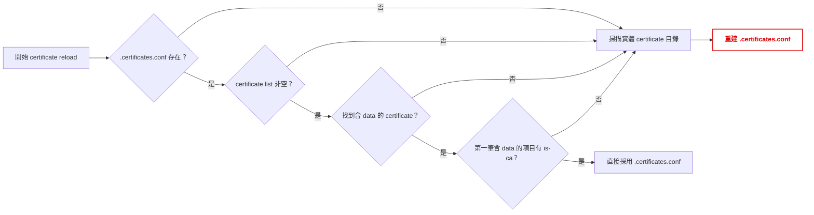

# KSM-10589 簡報大綱（9 頁）— YAMS certificate reload 的重複 YANG validation 最佳化

報告對象：AE / PM / SVD / CSO / RD
資料來源：`docs/yams-certificat-tunning.md`（YAMS certificate reload、Sysrepo 與 sr2txtd）

---

## 第 1 頁

**Title：問題動機**

### 異常發現

- 開機套用 default config 時，量測到系統共執行 **6 次 YANG validation**：RUNNING datastore 3 次、STARTUP datastore 3 次。
- 同一輪開機流程出現 6 次 validation 顯不合理；重複驗證會增加開機處理成本，也使行為難以判讀。

### 開機影響

- 複雜 config 的單次 YANG validation 約需 **60 秒**。
- validation 次數增加會近似按次數累加耗時；若連續執行 6 次，理論上可能累積至約 **360 秒**，對開機時間影響很大。

### 盤查方向

- 逐一追蹤每次 validation 對應的 transaction 與觸發元件，找出重複驗證的根源。
- 先釐清這 6 次分別從哪裡產生，再針對可安全略過的路徑做最小化修改。

---

## 第 2 頁

**Title：盤查結果**

### 原始 Validation 總量

- 原本套用 default config 的完整流程，總共會引發 **6 次 YANG validation**。
- 其中 RUNNING datastore 為 **3 次**，STARTUP datastore 為 **3 次**。

| 觸發元件 | Validation 次數 | 說明 |
| --- | ---: | --- |
| sr2txtd bootup_config | **2 次** | default config 的開機套用流程 |
| YAMS certificates | **4 次** | certificate reload 的相關 transaction |
| 合計 | **6 次** | RUNNING 3 次、STARTUP 3 次 |

### 判讀原則

- 6 次的基準同時應以 datastore（3 次 RUNNING、3 次 STARTUP）及觸發元件（2 次 bootup_config、4 次 YAMS certificates）交叉判讀。
- 不能只用單一總數判讀 certificate reload 的影響。

### 修復範圍

- 盤查後可區分出兩條 RUNNING 至 STARTUP 寫入路徑，以及既有 .certificates.conf 可直接採用時的 YAMS RUNNING 路徑。
- 本次只在這三個明確路徑略過重複 validation；6 次仍是修復前完整開機流程的量測基準。

---

## 第 3 頁

**Title：既有 Gate**

### 判斷流程

### 關鍵規則

- Gate 只看依 list 順序的第一筆含 `data` certificate 是否具 `is-ca`；條件成立時直接使用整份設定檔，append 後 `return`。
- `.certificates.conf` 不存在、list 為空、找不到含 `data` 的項目，或第一筆含 `data` 的項目缺少 `is-ca` 時，均維持既有 `break` 行為，掃描 `/share/cert`、`trusted`、`sslvpn` 並**重建 `.certificates.conf`**。

---

## 第 4 頁

**Title：量測判讀**

### Validation 次數

| 情境 | certificate reload 引發的 RUNNING validation |
| --- | ---: |
| 原始 `.certificates.conf` gate 成功 | 0 次 |
| 設定檔不存在或 gate 失敗、實體掃描重建 | 2 次：delete、restore |
| 手動／實體 certificate reload | 2 次：delete、restore |

### 正確的統計方式

- 以 `state=CHANGED mod=vrouter` 的 `[validate]` console 行計數。
- 此表只呈現 YAMS certificate 的 RUNNING 局部計數；原始 default config 的完整基準仍是 6 次。
- 開機統計必須將 sr2txtd bootup_config 的 2 次 validation，與 YAMS certificates 的 4 次 validation 分開；前者不是本次最佳化對象。

### 修復後預期

- 開機流程最後只保留 **1 次 YANG validation**：`bootup_config` 的 RUNNING datastore。
- 相較原始 6 次，省去 5 次重複或不必要的 validation。

---

## 第 5 頁

**Title：修復步驟**

### 1. bootup_config 寫入 STARTUP

- `bootup_config` 由 RUNNING 寫入 STARTUP datastore 時，STARTUP transaction 不執行 YANG validation。
- 因此 bootup_config 原始 2 次 validation 中，只保留 RUNNING 的 1 次。
- `bootup_config` 的 RUNNING validation 目前無法省略；除非能驗證 `startup-config.conf` 為可信任來源，才可評估略過該次驗證。

### 2. YAMS certificates 寫入 STARTUP

- YAMS certificates 由 RUNNING 寫入 STARTUP datastore 時，不執行 YANG validation。
- transaction 本身仍正常 commit，後續 callback、snapshot、delta 與序號更新不受影響。

### 3. YAMS 未重建設定檔的 RUNNING 路徑

- 若既有 `/share/cert/.certificates.conf` 可直接採用、YAMS 不需重建 certificate 設定，RUNNING transaction 不執行 YANG validation。
- 設定檔不存在或 gate 失敗、需實體掃描重建時，不套用這個 RUNNING exemption。

### 最終結果

- 開機時只剩 `bootup_config` 的 RUNNING datastore 執行 **1 次 YANG validation**。

---

## 第 6 頁

**Title：開機流程**

### 流程分工

1. bootup_config 在 RUNNING 執行 YANG validation，之後由 RUNNING 寫入 STARTUP 時略過 validation。
2. YAMS 依既有 gate 決定直接讀取 `.certificates.conf`，或改由實體目錄重建 certificates。
3. YAMS 未重建設定檔時，certificate RUNNING transaction 略過 validation；YAMS 由 RUNNING 寫入 STARTUP 時也略過 validation。
4. sr2txtd 照常處理 callback、snapshot、delta、`seq` 與 `ready_seq`。

### 可讀性重點

- certificate RUNNING 的 exemption 只適用於既有設定檔可直接採用、沒有重建的路徑。
- STARTUP 的兩個寫入路徑不執行 validation；只有 bootup_config RUNNING 保留 validation。

---

## 第 7 頁

**Title：Delta 保證**

### Validation 與 Delta 是兩件事

- 略過 validation 不等於略過 Sysrepo transaction；RUNNING delete / restore 仍會 commit。
- sr2txtd 仍以 transaction 前後的 snapshot 產生原生 XML delta。

### Delta 產生條件

- delete 前 snapshot 含 certificates、delete 後不含 certificates：產生 delete delta。
- 若前一 snapshot 已不含 certificates，delete 為 no-op，預期不產生 delete delta。
- 後續 restore 仍可能產生 add / restore delta。

---

## 第 8 頁

**Title：風險控制**

### 維持原始回退機制

- Gate 失敗即走實體掃描與重建；YAMS 僅在沒有重建設定檔時略過 RUNNING validation。
- Gate 只看第一筆含 `data` 的 certificate 是否具 `is-ca`，行為與原設計完全一致。

### 設定檔完整性

- `data` 為 YANG `base64` leaf；手動修改 `.certificates.conf` 時不得截斷或破壞資料。
- Base64 不合法會讓 restore 失敗，因此 JSON 與每筆 `data` 的完整性是上線前檢查項目。

### startup-config 信任邊界

- 目前不能把 `startup-config.conf` 直接視為可信任，因此開機時仍必須保留 bootup_config 的 RUNNING YANG validation。
- 未來只有在可驗證檔案來源、完整性與內容可信任時，才可評估省略這 1 次 validation。

---

## 第 9 頁

**Title：驗證項目**

### 必測情境

1. Gate 成功且未重建設定檔：YAMS certificate RUNNING 與 STARTUP 均不應出現 validation；只保留 bootup_config RUNNING 的 1 次。
2. 刪除 `.certificates.conf` 後重開機：確認實體掃描重建，並確認 YAMS RUNNING 不套用「未重建」的 exemption；YAMS 寫入 STARTUP 仍不做 validation。

### Delta 機制

- 確認略過 YANG validation 後，RUNNING delete / restore transaction 仍正常 commit。
- 以前一 snapshot 含 certificates 的狀態重開機，確認 delete delta 與 restore 後的 add delta；其產生條件及結果均不變。

### RUNNING Certificates

- 確認 RUNNING config 內的 certificates 與預期設定一致，內容、欄位與比較規則皆正確。
- 確認 certificate `data` 的 Base64 完整合法，且 restore 後的 certificates 未遺失或異常。

### 最終一致性

- 確認最終 `seq` 與 `ready_seq` 一致。
- 確認 JSON 與每一筆 Base64 `data` 均完整合法。

---

**附註**：本大綱為精簡後的簡報用摘要；完整技術細節、逐步分析與原始量測數據請參考來源文件 `docs/yams-certificat-tunning.md`。
