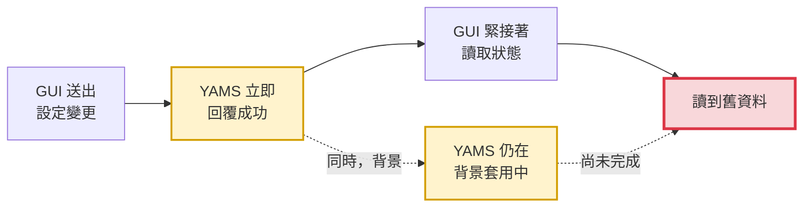
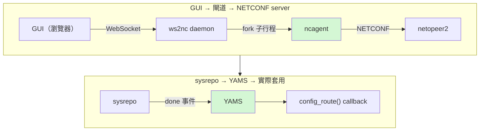
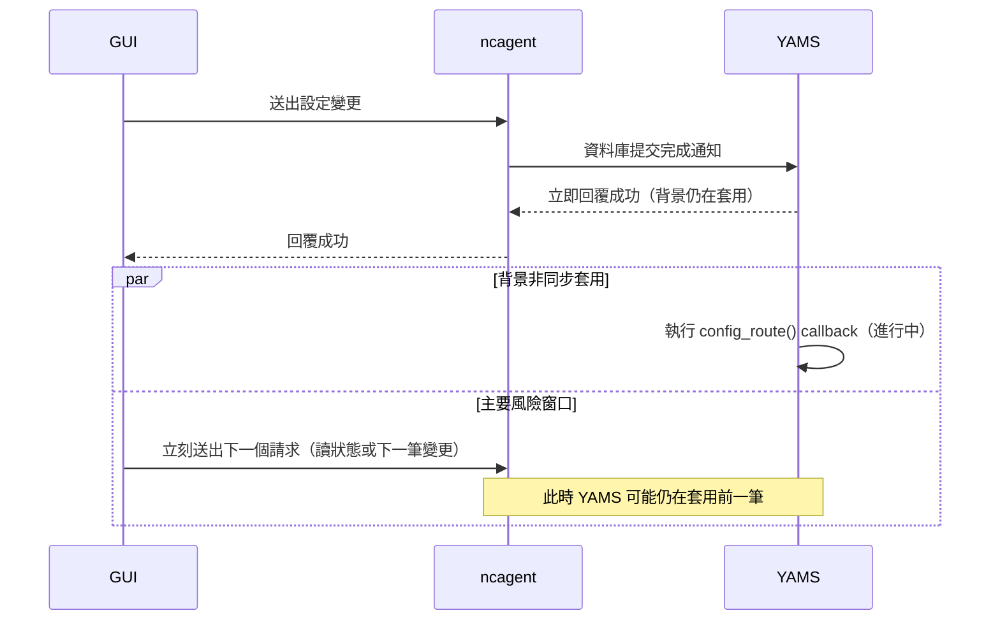

# KSM-10714 簡報大綱（8 頁）— NETCONF edit-config 完成狀態查詢設計

報告對象：AE / PM / SVD / CSO / RD
資料來源：`docs/yams-config-callback-progress.md`（YAMS SysrepoDispatcher / ws2nc ncagent）

---

## 第 1 頁

**Title：問題動機**

### 副標
GUI 設定變更「回覆成功」與「實際套用完成」之間的時間差，及其查詢機制設計

### 時序追蹤發現的落差
追蹤 GUI 送出設定變更(edit-config)到 `config_route()` callback 實際執行完成的完整時序，發現一個關鍵落差：YAMS 收到底層資料庫的變更通知後，**不等實際套用完成，就先讓呼叫端拿到成功回覆**，真正把設定套用到系統的工作仍在背景非同步執行。

### 問題成因示意



黃底兩格是問題根因——**回覆成功的當下，套用其實還沒開始／還沒做完**；紅框是結果——GUI 誤以為已經套用完成而提前讀取，讀到舊資料。「回覆成功」跟「套用完成」是兩個被誤以為同步、實際上分開的時間點。

### 造成的實際影響
使用者透過 GUI 送出設定變更、拿到「成功」回覆後，如果馬上讀取裝置狀態，有可能讀到 YAMS 還沒套用完的舊資料——這正是先前使用者回報的「時間差」問題的根本原因。

### 目標
提供一支查詢 RPC，讓 GUI 能在**同一個 NETCONF session** 精確確認「剛剛那次設定變更是否已經完全套用完成」，且要能**精確指定是哪一筆**（不受同個 session 之後送出的其他變更影響），確認完成後再去讀取狀態，避免拿到時間差資料。

---

## 第 2 頁

**Title：系統架構**

### 比預期多一層的閘道
一開始假設 GUI 是直接的 NETCONF client，實際調查後發現架構多了一層：GUI 透過 WebSocket 連到一個閘道 daemon，daemon 為每個瀏覽器連線各自 fork 一個代理子行程（同時最多 5 個），由這個代理才是真正跟 NETCONF server 溝通的一方，NETCONF server 再橋接進底層資料庫，最後由 YAMS 訂閱資料庫的異動事件、實際套用到系統。

### 這次改動的範圍



綠色（YAMS、ncagent）是這次實際修改程式碼的部分；`ws2nc` daemon 本身、netopeer2、libnetconf2、sysrepo 這四塊都**不會修改**，只作為調查對照，用來確認技術限制在哪裡。

---

## 第 3 頁

**Title：根因時序**

### 回覆與實際套用是兩個分開的時間點
YAMS 收到資料庫送來的「已提交」事件後，把實際套用工作丟進背景任務就立刻回覆處理成功，這個回覆節點跟「`config_route()` callback 真正執行完成」節點是分開的兩個時間點——這個回覆行為本身不是這次改動的對象，維持不變。

### 真正的風險窗口
閘道代理是單執行緒、同步處理請求的：一收到 NETCONF 回覆就馬上處理下一個 WebSocket 請求（可能是讀狀態，也可能是另一筆設定變更），但 YAMS 可能還在背景套用前一筆——這才是整個時間差問題的核心，而不是設定變更本身的回覆時間點被延後。



---

## 第 4 頁

**Title：採用方案設計**

### 三種追蹤方式比較
新識別碼 `sequence` 由閘道代理自己遞增產生，刻意不重用系統既有的 WebSocket／NETCONF 兩層 message-id——這兩層都各自有無法傳到 YAMS 或風險太高的限制，經評估後不採用。

| 追蹤方式 | 能回答的問題 | 限制 |
|---|---|---|
| 單一 pending 值(未採用) | 目前誰在套用中 | 兩個 session 幾乎同時送出時，後到的會覆蓋前一筆記錄，導致誤判已完成 |
| 參照計數(session 聚合，保留作 fallback) | 這個 session 是否**全部**做完 | 答不出「第幾筆」做完，同 session 有多筆時只能給粗略答案 |
| `sequence` + 單調遞增完成計數(本次採用) | **第 N 筆**是否已完成，不受同 session 後續變更影響 | 需多維護一組遞增識別碼，複雜度略增 |

已用時間軸驗證過中間狀態(例如第 1 筆完成、第 2 筆未完成時，兩者的查詢結果能正確分開)，不會有跳著完成的情況。

### 呼叫模式：GUI 主動輪詢
查詢 RPC 立即回傳目前的完成與否布林值，由 GUI 自己短間隔（例如 200ms）重複呼叫直到完成，不做長時間等待中的 RPC 設計——避免牽涉協定層逾時的邊界情況，不必要地增加複雜度。查詢完全唯讀，不會因為被查過就改變任何內部狀態。

---

## 第 5 頁

**Title：改動總覽**

### 涉及套件與狀態

| 套件 | 角色 | 狀態 |
|---|---|---|
| sysrepo 前置修復 | 提供變更來源身份給 YAMS | ✅ 已完成（獨立、更早的前置修復） |
| YAMS 核心 | 追蹤參照計數與完成次數、提供查詢 RPC | ✅ 已完成（3 個檔案 + 1 個新測試檔） |
| ws2nc / ncagent | 產生並回傳 `sequence` 給 GUI | ✅ 已完成（4 處修改，已通過程式碼審查） |

### 核心邏輯摘要

```diff
+ pending_netconf_ids[id] += 1      # 收到變更事件時：進入 pending
  await 套用到系統(...)
+ pending_netconf_ids[id] -= 1      # 套用完成後：離開 pending
+ completed_counts[id] += 1         # 單調遞增，供 sequence 精確比對
```

新增上限保護：完成次數計數採 LRU，最多保留 32 筆 session 紀錄（閘道最多同時 5 個並行連線，留了 6 倍以上緩衝），避免長時間運行後無界成長；閘道端的 `sequence` 計數器在每次重新連線時歸零，避免跨連線誤判。

---

## 第 6 頁

**Title：GUI 使用流程**

### 精確確認單筆變更完成
1. 送出設定變更，從回覆拿到一個遞增的識別碼 `sequence`。
2. 需要精確確認「這一筆」是否套用完成的頁面，帶著這個 `sequence` 反覆查詢，直到完成——不受同個 session 之後送出的其他變更影響。
3. 收到完成後才讀取最新狀態，避免拿到時間差資料。

### 範例（同一 session 連續送出兩筆變更）

| 步驟 | 動作 | 結果 |
|---|---|---|
| 1 | 送出變更 #1 | 拿到 `sequence=1` |
| 2 | 不等待，立刻送出變更 #2 | 拿到 `sequence=2` |
| 3 | 查詢 `sequence=1` 是否完成 | 兩筆皆未完成時：`pending=true` |
| 4 | 短間隔重複查詢 `sequence=1` | #1 完成、#2 未完成時：**`pending=false`**（不受 #2 影響） |
| 5 | 拿到完成後讀取狀態 | 已反映 #1 套用完成後的最新資料 |

### 不需要逐筆精確度的頁面
可以完全不呼叫這支查詢 RPC，或查詢時不帶 `sequence`，退回「這個 session 全部做完了嗎」的較粗略判斷——行為與這次改動之前完全一樣，不影響任何既有頁面。

---

## 第 7 頁

**Title：封包範例**

### 送出設定變更，取得 sequence

```xml
→ <edit-device-config message-id="1001">
    <config>
      <!-- 實際 config 內容 -->
    </config>
  </edit-device-config>

← <edit-device-config message-id="1001" agent="12345">
    <ok/>
    <sequence>1</sequence>
  </edit-device-config>
```

### 帶 sequence 查詢是否完成

```xml
→ <run-device-rpc message-id="1003">
    <show-netconf-apply-pending xmlns="urn:6wind:vrouter/netconf-server">
      <sequence>1</sequence>
    </show-netconf-apply-pending>
  </run-device-rpc>

← <run-device-rpc message-id="1003" agent="12345">
    <pending xmlns="urn:6wind:vrouter/netconf-server">false</pending>
  </run-device-rpc>
```

不帶 `sequence` 時，YAMS 改回答「這個 session 全部做完了嗎」的粗略判斷，其餘封包格式相同。

### 備註
以上是根據 ncagent／YAMS 程式碼推導出的訊息格式，**尚未在真實環境對照過實際封包**；如果實測發現細節有出入（例如額外的 wrapper element），以實測為準。

---

## 第 8 頁

**Title：已知限制**

### 套用逾時目前不存在
YAMS 的 `config_route()` callback 沒有 timeout 機制——一旦開始執行，就會持續跑到做完為止，不會被系統強制中斷；如果某個處理環節卡住不回，對應的查詢就會一直回報「尚未完成」。**決定不在 YAMS 端加 timeout**，因為卡住不回本身代表 callback 有問題，應該直接修復該處理邏輯，而不是用逾時機制把它「掩蓋」成一個看似正常結束的失敗；GUI 端可以自行設定最大等待時間（例如 30 秒沒等到完成就放棄，顯示錯誤或警告），但這只是前端的使用者體驗防護，**不是用來解決 callback 執行過久的問題**——真的卡太久，代表的是需要被修的 bug。

### 一個環節卡死會影響全系統
YAMS 的 edit-config callback（實際套用設定的那段）是**循序執行**的——所有 session 送出的變更都排在同一把全域鎖後面依序處理。只要有一筆卡住不放，後面**所有 session** 排隊中的新變更都會被擋住，連帶讓它們自己的完成計數也永遠回不到「已完成」，一路持續到服務重啟為止。

但**查詢本身不受影響**：查詢 RPC（像這次新增的 `show-netconf-apply-pending`）跟一般 RPC callback 一樣是**併發執行**，不需要排在那把鎖後面，所以 GUI 呼叫查詢永遠能立刻拿到回應——只是回應內容會一直是「尚未完成」，反映的是背後真正卡住的套用流程，不是查詢機制本身失靈。

這不是這次新增功能造成的新問題，這個鎖本身早就沒有逾時/復原機制，**這次只是第一次讓這個既有的系統性凍結狀態變得外部可觀察**。建議另外開一個 follow-up 項目處理，不在這次範圍內。

---

**附註**：本大綱為精簡後的簡報用摘要；完整技術細節、逐步分析與原始量測數據請參考來源文件 `docs/yams-config-callback-progress.md`。
