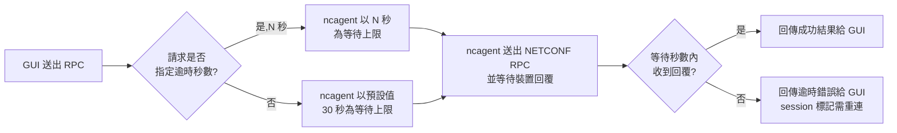

# KSM-10724 簡報大綱（7 頁）— ncagent NETCONF 回覆逾時可依 RPC 個別設定

報告對象：AE / PM / SVD / CSO / RD
資料來源：docs/ncagent-netconf-timeout.md（ws2nc / ncagent NETCONF gateway）

---

## 第 1 頁

**Title：問題與結論**

### 現況限制
- 過去 `ncagent` 對所有 NETCONF RPC 回覆,不論操作種類,一律套用同一組寫死的逾時設定,總計約 60 秒才判定逾時
- GUI 端無法依操作類型調整等待時間:大型設定查詢、可能觸發裝置端長時間動作的操作,容易被誤判逾時;而預期能快速回應的操作,又被迫陪著等一樣久

### 影響
- 逾時後 ncagent 會將該 NETCONF session 標記為需要重新連線,對使用者的體感是「操作失敗、需要重試」
- 單一固定逾時值,無法同時滿足「快操作要快回報」與「慢操作要給夠時間」兩種相反的需求

### 若不能個別設定
- 只要逾時是全域統一的一個值,就必須遷就「回覆最久的那個 RPC」,把所有 RPC 的逾時都統一放大到足夠等待該操作
- 結果是絕大多數原本能快速回應的操作,也被迫跟著陪等最長的時間,逾時判定、session 重連都會被不必要地拖慢
- 這正是本次改為 per-request 逾時設定的根本原因:讓少數慢操作自己要求更長時間,而不必拖累其他所有操作

### 本次結論
- GUI 現在可以針對個別 RPC 指定 NETCONF 回覆逾時秒數,不再受限於全域統一的等待時間
- 預設逾時同步由 60 秒下修為 30 秒,一般操作能更快判定逾時、更快恢復
- 支援自訂逾時的操作涵蓋所有主要 RPC 類型,是通用的請求層級機制
- 逾時後的錯誤回報與 session 重連機制維持不變

---

## 第 2 頁

**Title：架構總覽**

### 請求路徑
GUI ──(WebSocket)──▶ ws2nc ──(pipe)──▶ ncagent ──(Unix socket)──▶ netopeer2 / sysrepo

### 各角色分工
- GUI 透過 WebSocket client 送出 RPC
- `ws2nc` 是 WebSocket daemon,負責收發與轉發
- `ncagent` 是每個使用者 session 對應的子行程,實際負責跟裝置端 NETCONF server 溝通並等待回覆
- 逾時判定發生在 `ncagent` 等待裝置回覆的階段,是本次修改的作用點

---

## 第 3 頁

**Title：解法設計**

### 新增 per-request 逾時設定
- GUI 送出 RPC 時,可額外指定「這次操作願意等待的秒數」,此設定沿著請求路徑原樣傳遞到 ncagent,只影響這一次的 RPC
- 由前端依操作類型自行決定合理的等待時間(例如大型設定查詢給長一點、互動性高的操作給短一點)

### Default 逾時同步下修
- 正因為個別 RPC 已能自行要求更長的等待時間,預設逾時不再需要為了少數慢速操作統一設得很長
- 預設逾時從 60 秒下修為 30 秒:未特別指定的請求可以更快判定逾時、更快觸發重連
- GUI 若認為預設 30 秒不夠,直接在該次請求指定秒數覆寫即可,不需要調整系統層級設定

---

## 第 4 頁

**Title：適用範圍**

### 支援自訂逾時的操作

| RPC 操作 | 用途 |
|---|---|
| `get-device-config` | 取得目前裝置設定 |
| `get-device-state` | 取得裝置目前狀態 |
| `edit-device-config` | 套用一組設定變更 |
| `write` | 將目前設定寫入開機設定(startup) |
| `run-device-rpc` | 執行裝置端自訂操作 |
| `change-password` | 變更使用者密碼 |
| 其他一般 RPC | 未特別分類的請求,同樣支援 |

### 通用性
- 這是請求層級的通用機制,不是針對單一操作寫死的特例——只要是送到 ncagent 的請求,都可以個別指定逾時秒數
- 未來新增的操作類型,只要走既有的請求處理路徑,就自動具備這個能力

---

## 第 5 頁

**Title：流程示意**

### 判斷邏輯



---

## 第 6 頁

**Title：使用範例**

### 情境
以「修改裝置設定」(`edit-device-config`)為例,GUI 額外帶上 `timeout="60"`,要求 ncagent 針對這次設定變更等待最多 60 秒才判定逾時(預設只會等 30 秒)。

### GUI 送出的請求

```xml
<edit-device-config message-id="1" timeout="60">   <!-- ★ 新增：本次請求願意等待 60 秒才判定逾時 -->
  <config>
    <config xmlns="urn:6wind:vrouter">
      <vrf>
        <name>main</name>
        <nat xmlns="urn:6wind:vrouter/nat">
          <source-rule>
            <id>1</id>
            <translate-to><output-address/></translate-to>
            <outbound-interface><name>ge1</name></outbound-interface>
            <source><address><value>192.168.168.0/24</value></address></source>
          </source-rule>
        </nat>
      </vrf>
    </config>
  </config>
</edit-device-config>
```

> **★ `timeout="60"`**：只需在既有請求的根節點上加這一個屬性,實際要送出的設定內容(`<config>`)完全不受影響。


### 60 秒內收到回覆

```xml
<edit-device-config message-id="1" agent="1234">
  <ok/>
</edit-device-config>
```

### 60 秒仍未收到回覆

```xml
<edit-device-config message-id="1" agent="1234" nc-recover="1">
  <error>
    <error-type>netconf</error-type>
    <error-severity>error</error-severity>
    <error-message>RPC timeout</error-message>
  </error>
</edit-device-config>
```

若這次請求沒有帶 `timeout` 屬性,行為完全相同,只是逾時判定基準會是預設的 30 秒。

---

## 第 7 頁

**Title：附錄：實作摘要**

### 主要程式碼變動(`ws2nc/src/ncagent.c`)
- 新增 `get_timeout()`:解析請求上的 `timeout` XML 屬性,驗證後轉換成秒數;缺失或不合法時回傳預設值
- `nc_cli_netconf_send_recv()` / `netconf_recv()` 新增 `recv_retry_max` 參數,取代原本寫死的重試次數
- `NETCONF_RECV_RETRY_MAX` 數值由 60 改回 30,語意也從「最大重試次數」改為「預設總逾時秒數」

### 逾時計算方式

```c
int recv_retries_left = recv_retry_max > 0 ? recv_retry_max : NETCONF_RECV_RETRY_MAX;
do {
    msgtype = nc_recv_reply(session, rpc, msgid, timeout_ms, &envp, &op);
    recv_retries_left--;
} while (recv_retries_left > 0 && msgtype == NC_MSG_WOULDBLOCK && !SIGNAL_EXIT);
```

每次重試固定等待 1000 ms,總等待秒數 ≈ 重試次數,因此 `timeout="60"` 對應約 60 秒等待上限

### 附帶變更
- `ws2nc/src/ws2nc.h` 的 `_CONSOLE()` log 巨集加上 Unix 時間戳記,方便裝置端除錯時對照逾時／重試事件發生時間;與逾時邏輯本身無直接關聯

---

**附註**：本大綱為精簡後的簡報用摘要；完整技術細節、逐步分析與原始量測數據請參考來源文件 `docs/ncagent-netconf-timeout.md`。
