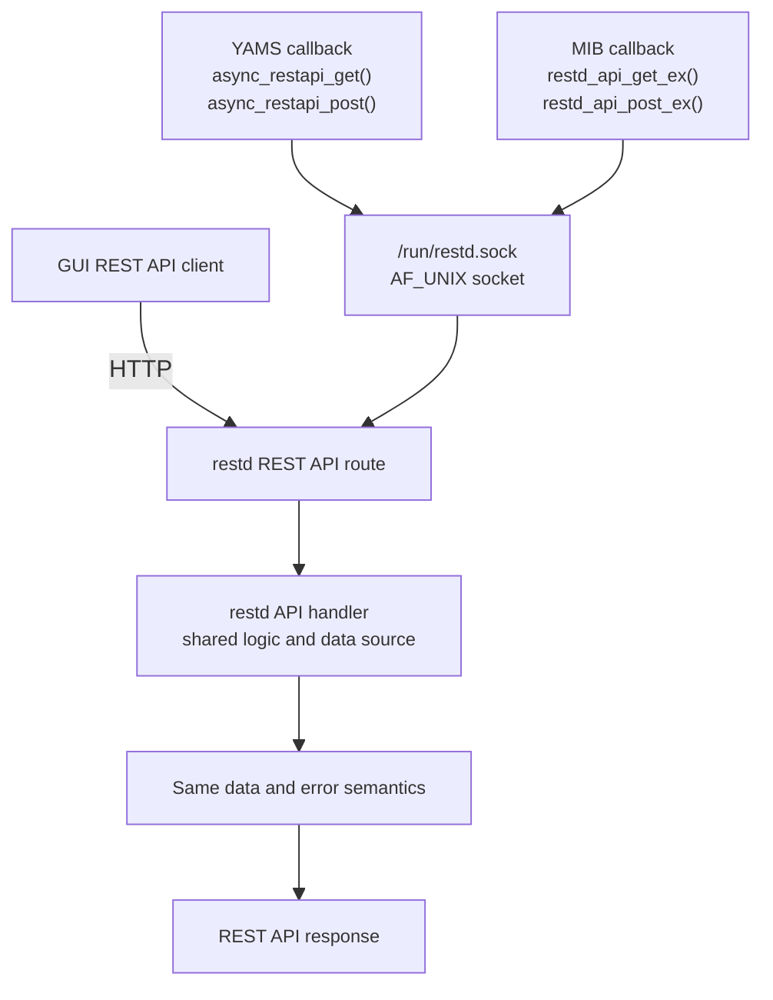

# SNMP MIB Callback 透過共通介面呼叫 restd REST API

**Version**: 0.1 (草案 — 共通介面已建立,尚未套用到任何模組)
**Last Updated**: 2026-08-23
**Status**: ⚠️ 未驗證(無 host 編譯/交叉編譯環境,見第 8 節)

---

## 目錄

1. [背景與動機](#1-背景與動機)
2. [已確認的關鍵事實](#2-已確認的關鍵事實)
3. [已定案的設計決策](#3-已定案的設計決策)
4. [共通介面:restd_client.h / .c](#4-共通介面restd_clienth--c)
5. [錯誤處理語意](#5-錯誤處理語意)
6. [快取設計](#6-快取設計)
7. [效能分析](#7-效能分析)
8. [目前實際異動的檔案](#8-目前實際異動的檔案)
9. [已知限制與尚未驗證項目](#9-已知限制與尚未驗證項目)
10. [後續工作:如何套用到其他模組](#10-後續工作如何套用到其他模組)
11. [Callback 共通流程](#11-callback-共通流程)

---

## 1. 背景與動機

裝置目前有三個對外介面處理相同事件,任一邏輯異動都得同時改三邊:

| 介面 | 位置 | 現況 |
|---|---|---|
| yams RPC | `yams/` (Python) | **已有共通介面** `yams/yams/util/restapi.py` — callback 直連 `/run/restd.sock` 呼叫 restd,不自己實作邏輯 |
| REST API | `restd/` (C) | 業務邏輯的單一真實來源 |
| SNMP MIB | `zyxel_mibs/` (C) | 各模組自己取數(讀 `/proc`、`system()`/`popen()` shell-out),與 restd 邏輯重複 |

yams 已經用 `restapi.py` 解決了重複問題。本次工作的目標是在 SNMP 側做同一件事:提供一支 C 版的 restd client 共通介面,讓 MIB callback **可以**改成呼叫 restd,把「三份邏輯」收斂成「一份邏輯(restd)+ 兩個 client(Python/C)」。

順帶的直接收益:未來若模組改接此介面,可以消滅 snmpd 內對應的 `system()` / `popen()` shell-out(例如 `zyxel_snmp_lib.c` 的 `get_mem_usage()`、`get_session_num()`),那在長駐 daemon 裡是安全與效能雙重負債。

**目前狀態**:共通介面(`restd_client.h`/`.c`)已完成並掛進建置,但**尚未套用到任何 MIB 模組** —— 原本規劃以 `sysRAMUsage.c` 作為示範改接,實作後經使用者決定不需要,已還原回原始邏輯。所以現階段這是一個「已就緒但無人呼叫」的函式庫,對現有行為零影響。

---

## 2. 已確認的關鍵事實

- **不需要認證**:`restd/src/auth_check.c:40-43` — 請求只要**沒有 `X-Real-IP` header** 就完全跳過驗證。nginx 才會加這個 header,直連 socket 的內部行程(這支 client、yams RPC)不會。
- **必須解析 `Content-Length`**:`restd/src/api_routes.c` 的 `send_json_response()` 有送 `Content-Length` 但**不送 `Connection` header**,而 CivetWeb `enable_keep_alive yes`(`keep_alive_timeout_ms 5000`)。只靠 read-to-EOF 會白等 5 秒。
- **jansson 已就緒**:`zyxel_mibs/Makefile` 的 CFLAGS 早就有 `-ljansson`,與 restd 同一套 JSON library。
- **`libzyxel_snmp_lib.so` 是全模組共用**:每個 MIB `.so` 都無條件連它,且 `dlmod` 用 `dlopen(RTLD_NOW)` 只載入一份 → 放在裡面的 `static` 變數是全 process 共享,這是跨 `.so` 快取去重的基礎。
- **一支 restd API 對到多個 `.so`**:例如 `/api/show/gui/widget/resource/usage` 同時對應 `sysRAMUsage.so`、`sysFLASHUsage.so`、`sysSessionNum.so`、`sysmgmt.so`。既有的 `netsnmp_cache` 綁在 registration 上,無法跨 `.so` 去重 → 快取只能做在 client 層。
- **snmpd 是同步單行程**,handler 內的阻塞 I/O 會卡住整個 agent。
- `zyxel_mibs` 內原本**完全沒有**任何 socket / HTTP client 程式碼。
- `issues/snmpd-crash-10800.md` 是 snmpd heap corruption 事故紀錄 → 記憶體管理必須保守(不開背景執行緒、單一 buffer 成長路徑、錯誤路徑統一走 `goto out` 清理)。

---

## 3. 已定案的設計決策

| 決策點 | 選項 | 結果 |
|---|---|---|
| 這次的實作範圍 | 共通介面 only / 共通介面+示範模組 / 全面遷移 | **共通介面**(示範模組 `sysRAMUsage.c` 已建立又還原,詳見第 8 節) |
| 共通介面支援的 HTTP method | GET only / GET+POST | **GET + POST** |
| restd 沒回應時(未啟動、逾時、socket 不存在)的行為 | 回退本地 `/proc`/`system()` 邏輯 / 回快取舊值,無快取才報錯 | **回快取舊值(grace window),無快取才報錯** — 不做本地 fallback,否則等於兩套邏輯都要維護,違背本次初衷 |

---

## 4. 共通介面:restd_client.h / .c

對照 `restapi.py` 的職責,但不照抄它「回傳整個 envelope」的形狀 —— 在 C 裡那會逼每個 handler 重複寫「取 data / 取 error / 判斷 / decref」樣板,refcount 容易出錯。改成 **`int` 回傳碼 + 直接交出 `data` 子物件**。

### 4.1 基本 GET / POST

```c
int restd_api_get(const char *path, const char *query, json_t **data_out);
int restd_api_get_ex(const char *path, const char *query,
                     int timeout_ms, json_t **data_out);

int restd_api_post(const char *path, json_t *body, json_t **data_out);
int restd_api_post_ex(const char *path, json_t *body,
                      int timeout_ms, json_t **data_out);
```

成功時 `*data_out` 帶回 response 的 `"data"` 子物件(新 reference,呼叫端須 `json_decref`)。失敗時 `*data_out` 一律設 `NULL`。**不送 `X-Real-IP`**(依賴 restd 的認證跳過機制,見第 2 節),`Connection: close`(讓 restd 的 4 個 worker 早釋放,但不依賴它)。

### 4.2 帶行程內共享快取的 GET(MIB 模組應一律使用這支)

```c
int restd_api_get_cached(const char *path, const char *query,
                         int ttl_sec, json_t **data_out);
int restd_api_get_cached_ex(const char *path, const char *query,
                            int ttl_sec, int grace_sec, json_t **data_out);

void restd_api_cache_invalidate(const char *path, const char *query);
void restd_api_cache_flush(void);
```

命中時回傳 `json_incref()` 過的**同一個物件**:呼叫端只可讀,不可修改;用完仍須 `json_decref` 一次。

### 4.3 Typed JSON accessor

restd 的欄位型別不一致(例如 `/api/system/memory` 的 `total_mb` 是 `json_integer`,`/api/show/gui/widget/resource/usage` 的 `memory-usage` 是 `json_string("45.2")`),以下函式兩種都吃:

```c
int  restd_json_get_long(json_t *obj, const char *key, long *out);
int  restd_json_get_double(json_t *obj, const char *key, double *out);
int  restd_json_get_u64(json_t *obj, const char *key, uint64_t *out);
int  restd_json_get_pct(json_t *obj, const char *key, long *out); /* 0-100 四捨五入 */
const char *restd_json_get_string(json_t *obj, const char *key); /* borrowed */
```

Key 不存在或型別用不了時回傳 `-1`(`get_string` 回 `NULL`)、不動 `*out`,並 `ZYSNMP_LOG(LOG_WARNING, ...)` 一行警告 —— 讓 restd 若改版換欄位名稱,問題在第一次 walk 就浮現,而不是靜默回錯值。

### 4.4 執行期調整

```c
void        restd_api_set_timeout_ms(int ms);
void        restd_api_set_max_body(size_t bytes);
void        restd_api_set_sock_path(const char *path);  /* 測試專用 */
const char *restd_strerror(int rc);
```

### 4.5 實作要點摘要

| 機制 | 用途 |
|---|---|
| `poll()` + 單一絕對 deadline(`clock_gettime(CLOCK_MONOTONIC)`),**不用 `SO_RCVTIMEO`** | `SO_RCVTIMEO` 對 `connect()` 無效(AF_UNIX backlog 滿時會阻塞),且是逐次 read 各自計時,無法給「整通呼叫最多 N 毫秒」的硬保證 |
| 非阻塞 connect + poll(POLLOUT) | 避免 restd worker 全滿或被 `SIGSTOP` 時卡死在 `connect()` |
| 依 `Content-Length` 主動停讀 | 不等 EOF、不等 keep-alive timeout,body 收滿立刻返回 |
| 明確拒絕 `Transfer-Encoding: chunked` | restd 唯二的串流端點是 conntrack 表,SNMP 沒有理由用到 |
| Circuit breaker:連續 3 次失敗 → 熔斷 10 秒 | 把「每 OID 卡 2 秒」壓成「每 10 秒最多卡 6 秒」,避免整趟 walk 被拖垮 |
| `stat()` 預檢 socket 路徑 | restd 沒開機時 0 成本立刻失敗 |
| 單一 buffer 成長路徑,256KB 硬上限 | 避免記憶體風險(對齊 `issues/snmpd-crash-10800.md` 的教訓) |
| `FD_CLOEXEC` | 避免其他模組的 `system()`/`popen()` 繼承到這個 fd |
| 60 秒全域 log 抑制 | restd 掛掉時,12 個 OID × 每 30 秒一次 walk 不會灌爆 flash |

**明確不開背景執行緒。** 用 worker thread 非同步取數理論上能把阻塞降到 0,但代價是在 `dlopen` 進來的 `.so` 裡管理 thread 生命週期與共享狀態 —— 風險預算不划算。

---

## 5. 錯誤處理語意

這是最容易寫錯的一點:MIB handler 收到非 `RESTD_OK` 時**不可以**回 `SNMP_ERR_GENERR`。

| 回法 | GETNEXT/walk 的行為 |
|---|---|
| `SNMP_ERR_GENERR` | 整趟 walk **中止** —— 一支 restd API 掛掉,整棵 MIB 樹都讀不到,不可接受 |
| `netsnmp_set_request_error(reqinfo, requests, SNMP_NOSUCHINSTANCE); return SNMP_ERR_NOERROR;` | 只有這一個 OID 產生 exception varbind,`snmpwalk` 跳過它繼續走其他 OID |

對應的呼叫端行為:
- `snmpget` 單一 OID:restd 掛了 → 該 varbind 顯示 `No Such Instance currently exists at this OID`
- `snmpwalk` 整棵樹:受影響的 OID 各自顯示 `No Such Instance`,其他 OID(仍走 `netsnmp_cache` 或本地邏輯)照常回值

restd 沒跑時**不可以**在 `init_xxx()` 建連線快取起來 —— restd 與 snmpd 的啟動順序沒有 systemd 相依保證,必須每次呼叫重新連,restd 重啟後才能自動復原。

---

## 6. 快取設計

兩層,職責不同:

### Layer 1(新):client 層行程內共享快取

做在 `libzyxel_snmp_lib.so` 裡,是唯一能跨 `.so` 去重的方案(見第 2 節「一支 API 對到多個 `.so`」)。

- 固定 8 筆陣列,無動態成長 → 記憶體上界可證明
- key = 完整 request line(`"GET /path?query"`)
- value = 已 parse 的 `json_t *data`,命中時 `json_incref()` 回傳
- 預設 TTL 5 秒(對齊既有 `hw_monitor_device_port.c` 的 `MIB_STATS_CACHE_TIMEOUT` 慣例)
- 滿了淘汰 `last_use` 最舊的
- POST 不快取

### Layer 2(既有,不動):table 模組沿用 `netsnmp_cache`

`hw_monitor_*`、`vpnStatus`、`wireless_*` 保留 `netsnmp_get_cache_handler()` 不變。它提供的是 **iterator 一致性**(一次 walk 期間 row list 不變),這是 Layer 1 給不了的。

### Grace 政策

`restd_api_get_cached_ex(path, query, ttl, grace, &data)`:

- `now - fetched <= ttl` → 命中,正常回傳
- `ttl < now - fetched <= ttl + grace` 且這次取數失敗 → 回傳舊值 + `LOG_WARNING`
- 超過 `ttl + grace` → 硬失敗,回傳實際的 `RESTD_ERR_*`

`grace` 預設 25 秒(5+25=30 秒,對齊 `zyxel_snmp_lib.h` 既有的 `MAX_ZYWALL_SNMP_CACHE_TIME`)。允許短暫沿用以涵蓋 restd 重啟,但絕不無限期沿用。

---

## 7. 效能分析

以下為根據程式邏輯與參數的**理論分析**,非實測數字(見第 9 節,此環境無法實際 benchmark)。

### 最好情況:快取命中

同一 TTL 窗內第 2 次以後的呼叫,只有 8 筆線性 `strcmp` 掃描 + `json_incref`,**不發任何 syscall**。比原本 `system()` shell-out(fork+exec,嵌入式 ARM 上通常數毫秒起跳)便宜得多。同一次 walk 裡打到同一 endpoint 的多個模組(如 `sysRAMUsage`/`sysFLASHUsage`/`sysSessionNum`/`sysmgmt` 共用 `/api/show/gui/widget/resource/usage`),只有第一個真的問 restd。

### 中等情況:快取過期,restd 正常回應

一次 AF_UNIX 往返 + 一次小 JSON parse。AF_UNIX 是核心內本地傳遞,無 TCP/IP 協定棧開銷,量級與原本「`system()` + 寫暫存檔 + `fopen`/解析」相近,實際誰快取決於 restd 內部實作。

### 最壞情況:restd 掛掉或掛住

有界,非無限卡死:前 3 次失敗各自最多卡 timeout(預設 2000ms)→ 最壞約 6 秒;第 4 次起熔斷開啟,直接失敗、近乎 0 成本;10 秒後自動放行重試。12 個受影響 OID 的一趟 walk,最壞總耗時被壓在約 6 秒左右,而非 12×2s=24 秒。

### 未解決的結構性風險

restd 只有 4 個 HTTP worker thread。若 GUI dashboard 或 conntrack SSE 串流同時佔滿 worker,SNMP 請求會在 restd 連線佇列排隊(仍受 2 秒 deadline 保護,不會無限等,但延遲會變得明顯且不穩定)。真的常態性撞到的話,需調整的是 restd 的 `num_threads`,不在本次改動範圍。

snmpd 是同步單行程,handler 卡住的期間整個 agent 無法處理其他 SNMP 請求 —— 這點原本的 `system()`/`popen()` 寫法同樣存在(甚至因 fork+exec 變異度更大而更嚴重),所以這不是新增的阻塞風險類型,而是把阻塞來源從「本地 shell-out」換成「本地 socket call」,並用熔斷器/deadline 把最壞情況的邊界訂清楚。

---

## 8. 目前實際異動的檔案

| 檔案 | 狀態 | 說明 |
|---|---|---|
| `zyxel_mibs/restd_client.h` | **新建** | 共通介面標頭,見第 4 節 |
| `zyxel_mibs/restd_client.c` | **新建** | 實作(HTTP over AF_UNIX + poll deadline + 熔斷 + Layer 1 快取) |
| `zyxel_mibs/Makefile` | **修改** | `libzyxel_snmp_lib.so:` 規則加入 `restd_client.o` + header 相依;`clean:` 目標修正既有 bug(`$(TARGETS)` → `$(TARGET)`) |
| `zyxel_mibs/sysRAMUsage.c` | **無淨變化** | 曾改為呼叫 `restd_api_get_cached_ex()` 作為示範,後依決定還原為原始的 `get_mem_usage()` 邏輯 |

**目前沒有任何 MIB 模組實際呼叫 `restd_client`**——這是一個已編譯進 `libzyxel_snmp_lib.so`、但無人使用的函式庫,對既有行為零影響,可獨立回滾(直接還原上述 3 個檔案即可,無其他副作用)。

---

## 9. 已知限制與尚未驗證項目

⚠️ 開發過程中,此工作環境(Windows,無 gcc/cc/pkg-config,未安裝任何 WSL distribution)**沒有任何 C 工具鏈**,因此以下驗證**尚未實際執行**:

- Host 端 `-Wall -Wextra -Werror` 編譯(`zyxel_mibs/Makefile` 全開此組警告)
- 針對 fault-injection 假 restd server 的 12 項故障情境測試(逾時、連線中斷、chunked、超過 body 上限、socket 不存在、熔斷觸發/恢復、快取去重等)
- `valgrind --leak-check=full` / `-fsanitize=address,undefined`
- 針對目標平台的交叉編譯(`make -C zyxel_mibs`)
- 裝置上的行為驗證(curl vs snmpget 對帳、restd 停機/掛住時的 walk 耗時、fd/RSS 洩漏)

已完成的替代措施是**逐行人工核對**兩個新檔案(型別、格式化字串、prototype 一致性、net-snmp API 簽名逐一以 `grep` 對照 `netsnmp-6wind/include` 確認存在),但這不能取代真正的編譯與執行。

**在任何模組實際改接此介面、部署到裝置之前,務必先在有 gcc+jansson 的 Linux 環境(WSL 或容器)完成上述編譯與測試。**

---

## 10. 後續工作:如何套用到其他模組

若之後要將某個 MIB 模組改接 restd,建議流程:

1. 確認 restd 是否已有對應端點,且輸出欄位與現有 MIB 語意一致(參考第 6/7 節提到的「`storage-usage` 語意漂移」風險 —— restd 用 `f_bfree`,`zyxel_snmp_lib.c` 的 `get_flash_usage()` 用 `f_bavail`,有 reserved blocks 時會有幾個百分點差異,推廣前需明確簽核)
2. `handle_xxx()` 改用 `restd_api_get_cached_ex()` 取資料、`restd_json_get_*` 轉型別
3. 失敗一律走 `netsnmp_set_request_error(..., SNMP_NOSUCHINSTANCE); return SNMP_ERR_NOERROR;`(第 5 節)
4. 原本的本地取值函式(如 `get_mem_usage()`)**不要刪**,除非確認沒有其他呼叫端(例如 `sysmgmt.c` 仍在用)
5. 依第 9 節完成 host 編譯 + fault-injection 測試,再上機依 curl/snmpget 對帳驗證

**已知不適合改接的項目**:`sysmgmt.c` 的 `SYS_MGMT_CPU5SECUSAGE`/`CPU1MINUSAGE`/`CPU5MINUSAGE` —— restd 只有瞬時值,沒有移動平均,改接會給出錯誤語意。

---

## 11. Callback 共通流程

下圖是 MIB 改接 `restd_client` 後的目標架構。YAMS 已經透過
`yams/yams/util/restapi.py` 走這條路徑；MIB callback 改用 C client 後，
三個介面會由同一個 restd API handler 取得資料並套用相同的商業邏輯。



因此資料取得、計算方式與錯誤結果均集中在 restd；YAMS 與 MIB 僅負責
transport、回應格式轉換與各自介面的 callback 回傳。MIB 尚未改接
`restd_client` 的模組仍維持既有本地取數行為，不在此一致性保證範圍內。

YAMS 與 MIB 不經 nginx 或 TCP/IP 對外連線，而是直接連到 AF_UNIX socket。
socket 內承載的仍是 HTTP GET/POST request/response 格式，因此可重用 restd
既有的 route 與 JSON response 處理。
